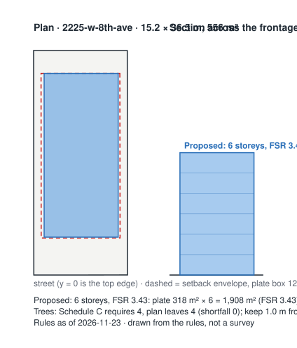
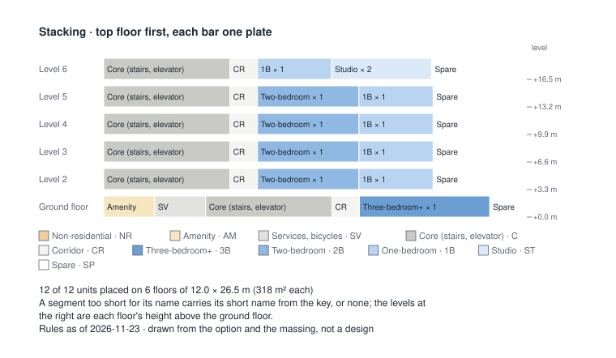
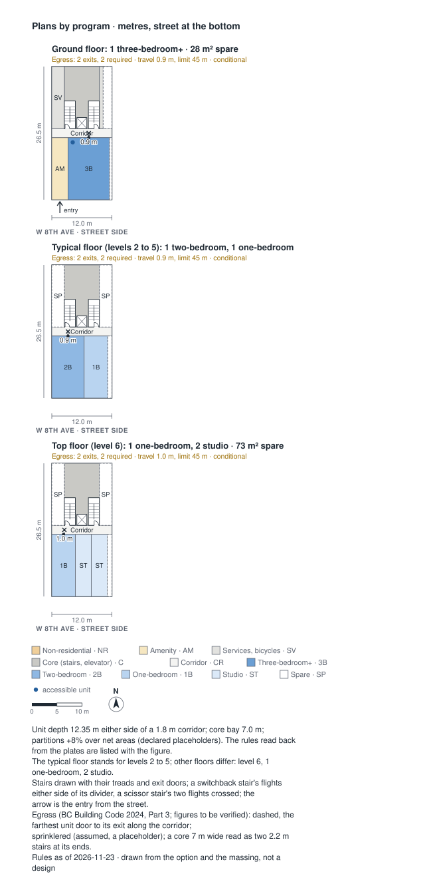
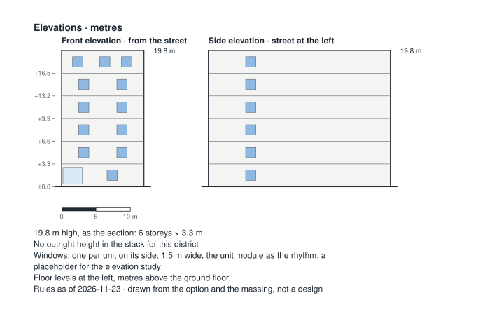
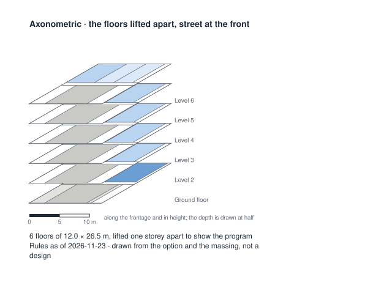
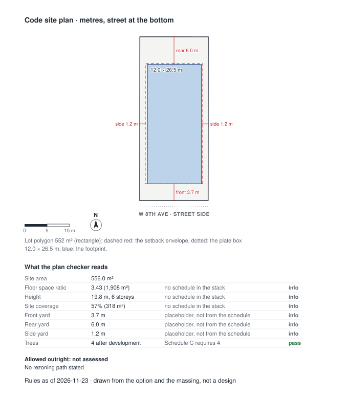

# First Read memo: 2225 W 8th Ave, Vancouver, BC

**Option:** Suggested, funder-ready: rule-derived as of 2026-11-23  
**Proponent:** None (non profit society)  
**Rules as of:** 2026-11-23 · **version stamp:** `4227307d738e56fe` · engine 0.1.0  

> Deterministic output of the rule stack listed under *Sources*. Same inputs and rule set give the same memo. It is a feasibility screen, not legal, planning or funding advice; every number links to the document it came from, so check it there.

## 1. Is it allowed?
**Outright, under R5-3: not assessed.**  Not assessed: the rules have no R5-3 schedule; the envelope is the option's own figure, not a permitted one.

## 2. Does it fit the funders?
**Does not meet the criteria of the Community Housing Fund.** The Community Housing Fund's 2025 call was cancelled in February 2026, so no intake is open now.
- *Uncertain* — BC Builds: eligibility and below-market requirement: BC Builds: whether it meets the criteria cannot be confirmed without the non-profit's developer or builder partner (the program requires one; say whether there is one). Non-residential space is 0.0% of area, under the 30% cap; ground must break within 12 to 18 months of the conditional land contribution letter.
- *Fail* — BC Housing Community Housing Fund: eligibility and unit mix: Community Housing Fund: does not meet the criteria: unit mix market 33.3%, rgi 50.0%, deep subsidy 16.7% is not 30/50/20. Its 2025 call was cancelled in February 2026, so no intake is open now; the program page says it will post when next seeking proposals (as of 22 Sep 2026).

## 3. What is still unsure, and who resolves it?
| Item | Status | Who / what |
|---|---|---|
| No R5-3 schedule in the rules | Uncertain | Architect: save the R5-3 schedule into inbox/ and have its FSR, height and yards entered as rules (or read it with Claude at stop 3 and confirm its clauses). |
| Yards not checked: no R5-3 yard rule in the rules | Uncertain | Architect: read the yard clauses in the R5-3 schedule and set the setbacks to them, or confirm the figures drawn are a relaxation to ask for. |
| What stays on the lot | Uncertain | Manager: say whether the buildings on the lot stay (stop 1); if they do, the architect draws the footprint that is kept and the massing moves off it. |
| Interim Rezoning Policy for Social Housing in Former Community Vision Areas | Uncertain | Architect: check Map 1 of the policy for this address. |
| Transit-oriented area minimum allowable height and density | Uncertain | Architect: check the City's transit-oriented areas map and record the tier. |
| Protection of Trees By-law 9958: minimum trees, protection distances, cash in lieu | Uncertain | Architect: obtain the arborist report and survey (every tree on the site, within 2 m of the boundary, and on the adjoining street). |
| BC Builds: eligibility and below-market requirement | Uncertain | Manager: say whether a developer or builder partner is in place; BC Builds applies opportunity by opportunity, so check the current Property Opportunity Notices. |
| BC Housing Community Housing Fund: eligibility and unit mix | Fail | Manager: resolve the failing criteria or target another program. |

## 4. Does the money work? (feasibility grade)
**Needs more sources.** The gap is $8,839,641, 71% of the cost before any land price, more than the 15% line (this tool's screening line, not a funder's rule); a land price would only widen it. Placeholders in use: Soft costs, Contingency, Rent-geared-to-income, Operating cost, Replacement reserve.

**For the development manager:** Look for more sources as well: other grants (CMHC's Affordable Housing Fund among them), more equity, a land contribution or a partner. Enter what is found as Other grants or Equity and run again.

- Capital cost **$12,464,173**: hard $9,232,721 (escalated ×1.0311), soft $2,308,180, contingency $923,272, land not given.
- Net operating income **$116,783 a year**: rent $209,744 less vacancy $7,761, operating cost $78,000 and reserve $7,200.
- Funding **$3,624,532**: grants $2,054,532, equity $0, supportable debt $1,570,000 at 6.19% repaid over 40 years, the loan the lender sizes so net income is 1.10 times the payment.
- Gap **$8,839,641** (71% of the capital cost).
- Left to a person: land cost (the owner is not a church, a society or a government, and no price is entered).

| Line | Figure | From | Note |
|---|---|---|---|
| Hard cost base | $4,693 per m² | `f.hard_cost_base` | average of Quadplex 01 ($425/sf), Quadplex 02 ($438/sf) and Townhouse ($446/sf) |
| Escalation to the index in force on the run date | ×1.0311 | `f.escalation_bcpi` | BCPI 109.4 (2026-07-01, the last quarter published 120 days before the run date 2026-11-23) over 106.1 (2024-07-01) |
| Hard cost | $9,232,721 | `f.hard_cost_base` | 1,908 m² × $4,693 × 1.0311 |
| Soft costs | $2,308,180 | `f.soft_costs` (placeholder) | 25% of hard cost |
| Contingency | $923,272 | `f.soft_costs` (placeholder) | 10% of hard cost |
| Land | not given | `f.land` | not settled: enter the assessed value or the agreed price in the option's finance block |
| Capital cost | $12,464,173 | the option | hard + soft + contingency + land; no land price yet, so this is the cost before land |
| Market rent | $100,624 a year | `f.rents` | CMHC October 2025, 4 units; some unit types priced at the CMHC all-units average: the table has no figure for them |
| Rent-geared-to-income | $97,120 a year | `f.rents` (placeholder) | 30% of a household income taken at 50% of the fund's income limit (placeholder) |
| Deep-subsidy rent | $12,000 a year | `f.rents` | the shelter rate, $500 a month |
| Vacancy | $7,761 a year | `f.rents` | 3.7% of gross rent, the CMHC survey's rate |
| Operating cost | $78,000 a year | `f.operating` (placeholder) | $6,500 per unit |
| Replacement reserve | $7,200 a year | `f.operating` (placeholder) | $600 per unit |
| Net operating income | $116,783 a year | the option | gross rent less vacancy, operating cost and reserve |
| Community Housing Fund grant | $2,054,532 | `bch.chf.eligibility` | $171,211 per unit × 12; indicative, the fund is between calls |
| Equity | $0 | the option | none entered |
| Supportable debt | $1,570,000 | `f.mortgage` | the largest loan the net operating income carries: the lender wants net income 1.10 times the loan payment (the debt coverage ratio), at 6.19% repaid over 40 years (the amortization), $106,166 a year in payments |
| Funding | $3,624,532 | the option | grants + equity + supportable debt |
| Gap | $8,839,641 | the option | capital cost less funding; a negative gap is headroom, and a gap above the 15% line (this tool's screening line, not a funder's rule) of the capital cost reads Needs more sources |

> A feasibility screen, not a lender's model: hard costs from a Class D catalogue estimate escalated by the Statistics Canada index, rents from the CMHC survey, debt at the posted five-year rate under CMHC's coverage ratio. Placeholders are marked; replace them with the project's own budget before anyone relies on the gap.

## Massing derived from the rules
- **Proposed: 6 storeys, FSR 3.43** — plate 318 m² × 6 storeys = 1,908 m² (FSR 3.43), 19.8 m high, inside a 12.0 × 26.5 m setback envelope. Derived from: option.gfa_m2, option.storeys, option.setbacks_m, option.floor_to_floor_m.

`massing.json` carries the same geometry for the Revit script (`revit/ffm_massing_pyrevit.py`).

## Layouts derived from the option
6 floors of 12.0 × 26.5 m (318 m² each); a double-loaded corridor, units 12.35 m deep; 12 of 12 units placed.

| Block | Count | Area | From |
|---|---|---|---|
| Three-bedroom+ | 1 | 102 m² | `bch.design_guidelines.unit_areas`: 1 × 94.6 m² net (86 m² minimum + 10%), 102.2 m² gross with partitions |
| Two-bedroom | 4 | 318 m² | `bch.design_guidelines.unit_areas`: 4 × 73.7 m² net (67 m² minimum + 10%), 79.6 m² gross with partitions |
| One-bedroom | 5 | 291 m² | `bch.design_guidelines.unit_areas`: 5 × 53.9 m² net (49 m² minimum + 10%), 58.2 m² gross with partitions |
| Studio | 2 | 78 m² | `bch.design_guidelines.unit_areas`: 2 × 36.3 m² net (33 m² minimum + 10%), 39.2 m² gross with partitions |
| Amenity | 1 | 40 m² | placeholder: 1.5 m² per unit, at least 40 m² |
| Services, bicycles | 1 | 40 m² | placeholder: 40 m² services + 0 bicycle spaces × 1.0 m² |

Adjacency rules, in plain words, read back from the plates:

- *info* — non residential: on the ground floor, facing the street. No non-residential space in the option
- *pass* — amenity: on the ground floor, next to the entry. On the ground floor beside the core, where the entry is
- *pass* — services: on the ground floor, away from the street. On the ground floor, lane side
- *pass* — core: at the centre of every floor, the corridor through it. One core bay at the centre of every floor, the corridor through it
- *conditional* — units: on both sides of the corridor, above whatever the ground floor gives to other uses. Units on the street side only: the plate is too shallow for a double-loaded corridor
- *pass* — three bed plus: on the lowest residential floors. Three-bedroom units on levels 1 to 1
- *pass* — accessible: next to the core, on the lowest residential floor. 1 accessible unit on the ground floor, nearest the core

### Egress

Egress (sprinklered, BCBC 2024 Part 3): conditional; 6 floors: 6 conditional; exits 4.8 m apart, at least 9 m needed, on 6 floors; farthest travel 1.0 m, limit 45 m. Read against `bcbc.exits` (BC Building Code 2024, Div B 3.4.2.1, 3.4.2.3, 3.4.2.5, 3.3.1.9; figures entered from recollection and to be verified against the code text). Sprinklered is assumed (a declared placeholder; `sprinklered: false` on the option switches the limits). Exits are the core zones, a core 7 m wide or wider read as two 2.2 m stairs at its ends (a placeholder); travel runs from a unit's door along the corridor to the nearest core.

- *conditional* — Ground floor: 2 exits, 2 required · travel 0.9 m, limit 45 m · separation 4.8 m, at least 9 m · dead end 2.5 m, limit 6 m. The two stairs are 4.8 m apart, under the 9 m required (3.4.2.3), read as two 2.2 m stairs at the ends of a 7 m core; the core runs 14.2 m deep, so stairs at its front and rear ends could be 11.9 m apart: an arrangement for the architect to draw.
- *conditional* — Level 2: 2 exits, 2 required · travel 0.9 m, limit 45 m · separation 4.8 m, at least 9 m · dead end 2.5 m, limit 6 m. The two stairs are 4.8 m apart, under the 9 m required (3.4.2.3), read as two 2.2 m stairs at the ends of a 7 m core; the core runs 14.2 m deep, so stairs at its front and rear ends could be 11.9 m apart: an arrangement for the architect to draw.
- *conditional* — Level 3: 2 exits, 2 required · travel 0.9 m, limit 45 m · separation 4.8 m, at least 9 m · dead end 2.5 m, limit 6 m. The two stairs are 4.8 m apart, under the 9 m required (3.4.2.3), read as two 2.2 m stairs at the ends of a 7 m core; the core runs 14.2 m deep, so stairs at its front and rear ends could be 11.9 m apart: an arrangement for the architect to draw.
- *conditional* — Level 4: 2 exits, 2 required · travel 0.9 m, limit 45 m · separation 4.8 m, at least 9 m · dead end 2.5 m, limit 6 m. The two stairs are 4.8 m apart, under the 9 m required (3.4.2.3), read as two 2.2 m stairs at the ends of a 7 m core; the core runs 14.2 m deep, so stairs at its front and rear ends could be 11.9 m apart: an arrangement for the architect to draw.
- *conditional* — Level 5: 2 exits, 2 required · travel 0.9 m, limit 45 m · separation 4.8 m, at least 9 m · dead end 2.5 m, limit 6 m. The two stairs are 4.8 m apart, under the 9 m required (3.4.2.3), read as two 2.2 m stairs at the ends of a 7 m core; the core runs 14.2 m deep, so stairs at its front and rear ends could be 11.9 m apart: an arrangement for the architect to draw.
- *conditional* — Level 6: 2 exits, 2 required · travel 1.0 m, limit 45 m · separation 4.8 m, at least 9 m · dead end 2.5 m, limit 6 m. The two stairs are 4.8 m apart, under the 9 m required (3.4.2.3), read as two 2.2 m stairs at the ends of a 7 m core; the core runs 14.2 m deep, so stairs at its front and rear ends could be 11.9 m apart: an arrangement for the architect to draw.

`layout.json` carries the blocks, the rules and every zone's coordinates; placeholders are listed in it under `assumptions`.

## Full ledger

### Layer A: Zoning district (City of Vancouver Zoning and Development By-law)

| Rule | Status | Finding | Numbers used | Source |
|---|---|---|---|---|
| C-2 outright floor space ratio (`cov.c2.outright_fsr`, v 2026-10-01) | Not applicable | Written for C-2 districts; this site is zoned R5-3. | district = R5-3 | [City of Vancouver Zoning and Development By-law, C-2 District Schedule (consolidation dated October 2026), s.3.1: a residential rental tenure building (a mixed-use residential building of at least 3 homes, all non-stratified and secured as rental, with dwelling use only from the third storey, outside sub-area A on Map 1) may reach 3.50 FSR with at least 0.35 FSR of non-dwelling use on the first storey facing the street (s.3.1.1.1), 3.70 on a corner site with a 45.7 m front property line and 1,672 m² (s.3.1.1.2), and up to 0.05 more for exterior circulation at the Director's discretion (s.3.1.1.3, not entered). The tool reads social housing and secured market rental as rental tenure and does not test the ground-floor share. Other uses (s.3.2.1.1): 0.75, which the Director of Planning may increase to 2.15 for multiple dwelling or 2.50 for all uses combined with 0.35 FSR of non-dwelling use at the street. The effective date is the consolidation's; the clauses may be older.](https://bylaws.vancouver.ca/zoning/zoning-by-law-district-schedule-C-2.pdf) |
| C-2 outright maximum height (`cov.c2.outright_height`, v 2026-10-01) | Not applicable | Written for C-2 districts; this site is zoned R5-3. | district = R5-3 | [City of Vancouver Zoning and Development By-law, C-2 District Schedule (consolidation dated October 2026), Residential rental tenure building: 22.0 m and 6 storeys where the first storey's non-dwelling use is 5.2 m floor to floor or more, else 19.8 m and 6 storeys (s.3.1.2.1(a)(ii)); 6.1 m within 4.6 m of the ultimate rear property line (not tested). Other buildings: 13.8 m (s.3.2.2.1(a)(ii) (15.3 m with a first storey 5.2 m floor to floor)). The lower figures are entered: the option does not say the ground floor's height. The effective date is the consolidation's; the clauses may be older.](https://bylaws.vancouver.ca/zoning/zoning-by-law-district-schedule-C-2.pdf) |
| C-2 minimum yards (`cov.c2.setbacks`, v 2026-10-01) | Not applicable | Written for C-2 districts; this site is zoned R5-3. | district = R5-3 | [City of Vancouver Zoning and Development By-law, C-2 District Schedule (consolidation dated October 2026), Residential rental tenure building: front yard 2.5 m (s.3.1.2.2), rear yard 4.6 m for dwelling uses (s.3.1.2.4(c)); side yard 3.7 m below the fourth storey and 10.7 m at or above it where the side adjoins a site in an R district without a lane (s.3.1.2.3), else not required. The effective date is the consolidation's; the clauses may be older.](https://bylaws.vancouver.ca/zoning/zoning-by-law-district-schedule-C-2.pdf) |
| C-2A outright floor space ratio (`cov.c2a.outright_fsr`, v 2026-10-01) | Not applicable | Written for C-2A districts; this site is zoned R5-3. | district = R5-3 | [City of Vancouver Zoning and Development By-law, C-2A District Schedule (consolidation dated October 2026), s.3.1.1.1: a mixed-use residential building takes 3.50 where the residential floor area is 100% residential rental tenure (a) and 2.50 with any other tenure (b), with at least 0.35 FSR of non-dwelling use on the first storey facing the street; s.3.1.1.3: 3.70 on a corner site with 45.7 m of frontage and 1,672 m²; s.5.1: the Director of Planning may relax the non-dwelling requirement for 100% social housing. The tool reads social housing and secured market rental as rental tenure. The effective date is the consolidation's; the clauses may be older.](https://bylaws.vancouver.ca/zoning/zoning-by-law-district-schedule-c-2a.pdf) |
| C-2A outright maximum height (`cov.c2a.outright_height`, v 2026-10-01) | Not applicable | Written for C-2A districts; this site is zoned R5-3. | district = R5-3 | [City of Vancouver Zoning and Development By-law, C-2A District Schedule (consolidation dated October 2026), s.3.1.2.1: maximum building height 23.0 m, measured from the building grades at the front property line (s.3.1.2.5); s.3.1.2.6: 27.5 m where the site is in a transit-oriented area. The effective date is the consolidation's; the clauses may be older.](https://bylaws.vancouver.ca/zoning/zoning-by-law-district-schedule-c-2a.pdf) |
| C-2A minimum yards (`cov.c2a.setbacks`, v 2026-10-01) | Not applicable | Written for C-2A districts; this site is zoned R5-3. | district = R5-3 | [City of Vancouver Zoning and Development By-law, C-2A District Schedule (consolidation dated October 2026), s.3.1.2.2 (front yard 2.5 m; the Director of Planning may decrease it, s.3.1.2.7), s.3.1.2.3 (side yard 1.8 m beside an R district), s.3.1.2.4 (rear yard 1.5 m). The effective date is the consolidation's; the clauses may be older.](https://bylaws.vancouver.ca/zoning/zoning-by-law-district-schedule-c-2a.pdf) |
| C-2B outright floor space ratio (`cov.c2b.outright_fsr`, v 2026-10-01) | Not applicable | Written for C-2B districts; this site is zoned R5-3. | district = R5-3 | [City of Vancouver Zoning and Development By-law, C-2B District Schedule (consolidation dated October 2026), s.3.1: a residential rental tenure building (a mixed-use residential building of at least 3 homes, all non-stratified and secured as rental, with dwelling use only from the third storey) may reach 3.50 FSR with at least 0.35 FSR of non-dwelling use on the first storey facing the street (s.3.1.1.1), 3.70 on a corner site with a 45.7 m front property line and 1,672 m² (s.3.1.1.2), and up to 0.05 more for exterior circulation at the Director's discretion (s.3.1.1.3, not entered). The tool reads social housing and secured market rental as rental tenure and does not test the ground-floor share. Other uses (s.3.2.1.1 and 3.2.1.2): 1.50 for dwelling uses other than a mixed-use residential building, 2.50 for all other uses combined. The effective date is the consolidation's; the clauses may be older.](https://bylaws.vancouver.ca/zoning/zoning-by-law-district-schedule-c-2b.pdf) |
| C-2B outright maximum height (`cov.c2b.outright_height`, v 2026-10-01) | Not applicable | Written for C-2B districts; this site is zoned R5-3. | district = R5-3 | [City of Vancouver Zoning and Development By-law, C-2B District Schedule (consolidation dated October 2026), Residential rental tenure building: 22.0 m and 6 storeys where the first storey's non-dwelling use is 5.2 m floor to floor or more, else 19.8 m and 6 storeys (s.3.1.2.2(a)(ii)); 6.1 m within 4.6 m of the ultimate rear property line (not tested). Other buildings: 12.2 m (s.3.2.2.2). The lower figures are entered: the option does not say the ground floor's height. The effective date is the consolidation's; the clauses may be older.](https://bylaws.vancouver.ca/zoning/zoning-by-law-district-schedule-c-2b.pdf) |
| C-2B minimum yards (`cov.c2b.setbacks`, v 2026-10-01) | Not applicable | Written for C-2B districts; this site is zoned R5-3. | district = R5-3 | [City of Vancouver Zoning and Development By-law, C-2B District Schedule (consolidation dated October 2026), Residential rental tenure building: front yard 2.5 m (s.3.1.2.3), rear yard 4.6 m for dwelling uses (s.3.1.2.5(c)); side yard 1.5 m where the side adjoins an RM site and 0.9 m where it adjoins an RA, R1 or RT site without a lane (s.3.1.2.4), else not required. The effective date is the consolidation's; the clauses may be older.](https://bylaws.vancouver.ca/zoning/zoning-by-law-district-schedule-c-2b.pdf) |
| C-2C outright floor space ratio (`cov.c2c.outright_fsr`, v 2026-10-01) | Not applicable | Written for C-2C districts; this site is zoned R5-3. | district = R5-3 | [City of Vancouver Zoning and Development By-law, C-2C District Schedule (consolidation dated October 2026), s.3.1: a residential rental tenure building (a mixed-use residential building of at least 3 homes, all non-stratified and secured as rental, with dwelling use only from the third storey, outside sub-area A on Map 1) may reach 3.50 FSR with at least 0.35 FSR of non-dwelling use on the first storey facing the street (s.3.1.1.1), 3.70 on a corner site with a 45.7 m front property line and 1,672 m² (s.3.1.1.2), and up to 0.05 more for exterior circulation at the Director's discretion (s.3.1.1.3, not entered). The tool reads social housing and secured market rental as rental tenure and does not test the ground-floor share. Other uses (s.3.2.1.1): 1.20 for office, 1.50 for dwelling uses other than a mixed-use residential building, 3.00 for all other uses, with 0.35 FSR of non-dwelling use at the street. The effective date is the consolidation's; the clauses may be older.](https://bylaws.vancouver.ca/zoning/zoning-by-law-district-schedule-c-2c.pdf) |
| C-2C outright maximum height (`cov.c2c.outright_height`, v 2026-10-01) | Not applicable | Written for C-2C districts; this site is zoned R5-3. | district = R5-3 | [City of Vancouver Zoning and Development By-law, C-2C District Schedule (consolidation dated October 2026), Residential rental tenure building: 22.0 m and 6 storeys where the first storey's non-dwelling use is 5.2 m floor to floor or more, else 19.8 m and 6 storeys (s.3.1.2.2(a)(ii)); 6.1 m within 4.6 m of the ultimate rear property line (not tested). Other buildings: 10.7 m (s.3.2.2.2). The lower figures are entered: the option does not say the ground floor's height. The effective date is the consolidation's; the clauses may be older.](https://bylaws.vancouver.ca/zoning/zoning-by-law-district-schedule-c-2c.pdf) |
| C-2C minimum yards (`cov.c2c.setbacks`, v 2026-10-01) | Not applicable | Written for C-2C districts; this site is zoned R5-3. | district = R5-3 | [City of Vancouver Zoning and Development By-law, C-2C District Schedule (consolidation dated October 2026), Residential rental tenure building: front yard 2.5 m (s.3.1.2.3), rear yard 4.6 m for dwelling uses (s.3.1.2.5(c)); side yard 1.5 m where the side adjoins an RM site and 0.9 m where it adjoins an RA, R1 or RT site without a lane (s.3.1.2.4), else not required. The effective date is the consolidation's; the clauses may be older.](https://bylaws.vancouver.ca/zoning/zoning-by-law-district-schedule-c-2c.pdf) |
| C-2C1 outright floor space ratio (`cov.c2c1.outright_fsr`, v 2026-10-01) | Not applicable | Written for C-2C1 districts; this site is zoned R5-3. | district = R5-3 | [City of Vancouver Zoning and Development By-law, C-2C1 District Schedule (consolidation dated October 2026), s.3.1: a residential rental tenure building (a mixed-use residential building of at least 3 homes, all non-stratified and secured as rental, with dwelling use only from the third storey, outside sub-area A on Map 1) may reach 3.50 FSR with at least 0.35 FSR of non-dwelling use on the first storey facing the street (s.3.1.1.1), 3.70 on a corner site with a 45.7 m front property line and 1,672 m² (s.3.1.1.2), and up to 0.05 more for exterior circulation at the Director's discretion (s.3.1.1.3, not entered). The tool reads social housing and secured market rental as rental tenure and does not test the ground-floor share. Other uses (s.3.2.1.1): 1.20 for office, 1.50 for dwelling uses other than a mixed-use residential building, 3.00 for all other uses, with 0.35 FSR of non-dwelling use at the street. The effective date is the consolidation's; the clauses may be older.](https://bylaws.vancouver.ca/zoning/zoning-by-law-district-schedule-c-2c1.pdf) |
| C-2C1 outright maximum height (`cov.c2c1.outright_height`, v 2026-10-01) | Not applicable | Written for C-2C1 districts; this site is zoned R5-3. | district = R5-3 | [City of Vancouver Zoning and Development By-law, C-2C1 District Schedule (consolidation dated October 2026), Residential rental tenure building: 22.0 m and 6 storeys where the first storey's non-dwelling use is 5.2 m floor to floor or more, else 19.8 m and 6 storeys (s.3.1.2.2(a)(ii)); 6.1 m within 4.6 m of the ultimate rear property line (not tested). Other buildings: 10.7 m (s.3.2.2.2). The lower figures are entered: the option does not say the ground floor's height. The effective date is the consolidation's; the clauses may be older.](https://bylaws.vancouver.ca/zoning/zoning-by-law-district-schedule-c-2c1.pdf) |
| C-2C1 minimum yards (`cov.c2c1.setbacks`, v 2026-10-01) | Not applicable | Written for C-2C1 districts; this site is zoned R5-3. | district = R5-3 | [City of Vancouver Zoning and Development By-law, C-2C1 District Schedule (consolidation dated October 2026), Residential rental tenure building: front yard 2.5 m (s.3.1.2.3), rear yard 4.6 m for dwelling uses (s.3.1.2.5(c)); side yard 1.5 m where the side adjoins an RM site and 0.9 m where it adjoins an RA, R1 or RT site without a lane (s.3.1.2.4), else not required. The effective date is the consolidation's; the clauses may be older.](https://bylaws.vancouver.ca/zoning/zoning-by-law-district-schedule-c-2c1.pdf) |
| CD-1 (324) maximum residential floor area by sub-area (800-1100 Pacific Blvd) (`cov.cd1_324.floor_area`, v 2024-04-23) | Not applicable | Written for CD-1 (324); this site is zoned R5-3. | district = R5-3 | [City of Vancouver CD-1 (324) By-law No. 7248, 800-1100 Pacific Boulevard (consolidated to By-law No. 14009, 23 Apr 2024), s.6.2 and Table 1a [By-law 14009, 2024]: the residential floor area in sub-area A must not exceed 19,300 m² and in sub-area B 23,600 m²; the sub-areas are drawn on Schedule A (sub-area B is the triangle between Expo Blvd, Pacific Blvd and the Cambie Bridge approach). s.6.1 Table 1: 249,543 m² of residential floor area for the whole CD-1, which a site outside the sub-areas shares and this rule does not test. s.6.4 and 6.5: exclusions (balconies up to 12% of the residential floor area, amenity up to 10%). s.6.6: the Development Permit Board may permit up to 1% more within Table 2's neighbourhood totals. s.5.2: in sub-areas A and B at least 35% of the units must suit families, with two or more bedrooms (not tested by this rule). The effective date is By-law 14009's enactment.](https://cd1-bylaws.vancouver.ca/cd-1(324).pdf) |
| CD-1 (324) maximum height (800-1100 Pacific Blvd) (`cov.cd1_324.outright_height`, v 2024-04-23) | Not applicable | Written for CD-1 (324); this site is zoned R5-3. | district = R5-3 | [City of Vancouver CD-1 (324) By-law No. 7248, 800-1100 Pacific Boulevard (consolidated to By-law No. 14009, 23 Apr 2024), s.7.1 [By-law 8715, 2003]: the maximum building height measured above the base surface, excluding the mechanical penthouse and roof, will be 91 m. The by-law sets no yards; the form of development decides them. The effective date is the consolidation's (By-law 14009).](https://cd1-bylaws.vancouver.ca/cd-1(324).pdf) |
| CD-1 (819) maximum floor space ratio (1015 E Hastings St) (`cov.cd1_819.outright_fsr`, v 2021-01-19) | Not applicable | Written for CD-1 (819); this site is zoned R5-3. | district = R5-3 | [City of Vancouver referral report, CD-1 Rezoning: 1015 East Hastings Street (report dated 5 Jan 2021, Council 19 Jan 2021), Appendix A: draft CD-1 by-law provisions, Appendix A s.5.1: the floor space ratio is computed on a site of 2,134.4 m², the site before any dedications; s.5.2: the floor space ratio for all uses combined must not exceed 6.90. Uses (s.3): dwelling units with cultural and recreational, institutional, office, retail and service uses. The effective date is the Council meeting the report went to, a placeholder for the by-law's enactment.](https://council.vancouver.ca/20210119/documents/rr5.pdf) |
| CD-1 (819) maximum height (1015 E Hastings St) (`cov.cd1_819.outright_height`, v 2021-01-19) | Not applicable | Written for CD-1 (819); this site is zoned R5-3. | district = R5-3 | [City of Vancouver referral report, CD-1 Rezoning: 1015 East Hastings Street (report dated 5 Jan 2021, Council 19 Jan 2021), Appendix A: draft CD-1 by-law provisions, Appendix A s.6: building height, measured from the building grades at the Glen Drive property line to the top of the parapet above the rooftop amenity space, must not exceed 51.0 m; s.4.2: no dwelling units above the 14th storey of the lane-facing wing or the 12th storey of the Glen Drive wing (not entered as a storey limit). The draft sets no yards. The effective date is a placeholder, as for the FSR.](https://council.vancouver.ca/20210119/documents/rr5.pdf) |
| Interim Rezoning Policy for Social Housing in Former Community Vision Areas (`cov.irp.social_housing_rezoning`, v 2023-11-01) | Uncertain | Whether the site is inside a former Community Vision area (Map 1 of the policy) is not confirmed. |  | [Interim Rezoning Policy for Social Housing, Seniors Housing, and Institutional, Cultural and Recreational Uses in Former Community Vision Areas (approved 1 Nov 2023, amended 31 Mar 2026), s.3.1.1; staff benchmark from the 998 E 19th Ave referral report](https://guidelines.vancouver.ca/policy-rezoning-former-community-visions-areas.pdf) |
| Off-street parking minimums (`cov.parking_minimums`, v 2024-06-26) | Info | No minimum off-street parking applies citywide since June 2024; the option gives no parking count. Bicycle spaces are set by the Parking By-law at the development permit stage. | parking spaces = None; bicycle spaces = None | [City of Vancouver, housing and transit-friendly actions passed June 2024 (minimum parking requirements eliminated citywide), Parking By-law amendments, June 2024](https://vancouver.ca/news-calendar/city-passes-housing-transit-friendly-action-june-2024.aspx) |
| R1-1 multiplex outright floor space ratio (`cov.r1_1.outright_fsr`, v 2026-06-01) | Not applicable | Written for R1-1 districts; this site is zoned R5-3. | district = R5-3 | [City of Vancouver Zoning and Development By-law, R1-1 District Schedule (consolidation dated June 2026), s.3.1.1.2: for multiple dwelling of no more than 8 dwelling units (a multiplex) the maximum floor space ratio is 1.00; s.3.1.1.3: at most 8 dwelling units where the residential floor area is 100% residential rental tenure, else 6 (and 5% social housing or cash in lieu on a site of 623 m² with 17.1 m of frontage west of Ontario and Carrall Streets); s.3.1.2.1 to 3.1.2.4: 6 or more units need a site of 557 m² and 15.1 m, 5 units 464 m² and 13.4 m, 3 or 4 units 306 m² and 10.0 m, and a depth of 30.4 m (33.5 m for a courtyard), not tested. The tool counts social housing as residential rental tenure. The effective date is the consolidation's; the clauses may be older.](https://bylaws.vancouver.ca/zoning/zoning-by-law-district-schedule-r1-1.pdf) |
| R1-1 multiplex outright maximum height (`cov.r1_1.outright_height`, v 2026-06-01) | Not applicable | Written for R1-1 districts; this site is zoned R5-3. | district = R5-3 | [City of Vancouver Zoning and Development By-law, R1-1 District Schedule (consolidation dated June 2026), s.3.1.2.5(b): maximum building height 11.5 m and 3 storeys (rear buildings 8.5 m and 2 storeys, s.3.1.2.5(a)). The effective date is the consolidation's; the clauses may be older.](https://bylaws.vancouver.ca/zoning/zoning-by-law-district-schedule-r1-1.pdf) |
| R1-1 multiplex minimum yards (`cov.r1_1.setbacks`, v 2026-06-01) | Not applicable | Written for R1-1 districts; this site is zoned R5-3. | district = R5-3 | [City of Vancouver Zoning and Development By-law, R1-1 District Schedule (consolidation dated June 2026), s.3.1.2.6 (front yard 4.9 m), s.3.1.2.7 (side yard 1.2 m), s.3.1.2.8(b) (rear yard 10.7 m; 0.9 m in a courtyard configuration); these are the regulations for multiple dwelling of no more than 8 units (s.3.1). The effective date is the consolidation's; the clauses may be older.](https://bylaws.vancouver.ca/zoning/zoning-by-law-district-schedule-r1-1.pdf) |
| RM-1 outright floor space ratio (`cov.rm1.outright_fsr`, v 2023-01-01) | Not applicable | Written for RM-1, RM-1N districts; this site is zoned R5-3. | district = R5-3 | [City of Vancouver referral report, 998 E 19th Ave (states RM-1 outright FSR 1.20); RM-1 District Schedule, Existing zoning; RM-1 District Schedule s.4.7](https://council.vancouver.ca/20240625/documents/rr1.pdf) |
| RM-1 outright maximum height (`cov.rm1.outright_height`, v 2023-01-01) | Not applicable | Written for RM-1, RM-1N districts; this site is zoned R5-3. | district = R5-3 | [City of Vancouver referral report, 998 E 19th Ave (states RM-1 outright height 10.7 m / 35 ft); RM-1 District Schedule, Existing zoning; RM-1 District Schedule s.4.3](https://council.vancouver.ca/20240625/documents/rr1.pdf) |
| RM-3 outright floor space ratio (`cov.rm3.outright_fsr`, v 2026-10-01) | Not applicable | Written for RM-3 districts; this site is zoned R5-3. | district = R5-3 | [City of Vancouver Zoning and Development By-law, RM-3 District Schedule (consolidation dated October 2026), s.3.1.1.1: for multiple dwelling and seniors supportive or independent living housing the maximum floor space ratio is 1.00, increased (a) by 0.012 for each 1% that the site coverage is below 50%, (b) on a site over 837 m² with a frontage of at least 22.8 m by 0.002 for each 9.3 m² over 837 m², at most 0.25, and (c) by 0.20 where the parking is inside the building or underground; the increases depend on the design and are not computed. Multiple dwelling is a conditional use (s.2.1) on a site of at least 550 m² (s.3.1.2.1). The effective date is the consolidation's; the clauses may be older.](https://bylaws.vancouver.ca/zoning/zoning-by-law-district-schedule-rm-3.pdf) |
| RM-3 outright maximum height (`cov.rm3.outright_height`, v 2026-10-01) | Not applicable | Written for RM-3 districts; this site is zoned R5-3. | district = R5-3 | [City of Vancouver Zoning and Development By-law, RM-3 District Schedule (consolidation dated October 2026), s.3.1.2.2: maximum building height 36.6 m; s.3.1.2.7: where any portion exceeds 10.7 m, those portions together may be no wider than 25% of the site's average depth plus its average width; s.3.1.2.9: above 10.7 m the building stays under daylight angles of 25 degrees from the street's centre line and the rear, and 30 degrees from the interior side boundaries (not tested). The effective date is the consolidation's; the clauses may be older.](https://bylaws.vancouver.ca/zoning/zoning-by-law-district-schedule-rm-3.pdf) |
| RM-3 minimum yards (`cov.rm3.setbacks`, v 2026-10-01) | Not applicable | Written for RM-3 districts; this site is zoned R5-3. | district = R5-3 | [City of Vancouver Zoning and Development By-law, RM-3 District Schedule (consolidation dated October 2026), s.3.1.2.3 (front yard 6.1 m), s.3.1.2.4 and 3.1.2.11 (side yard 2.1 m; a corner's exterior side yard 3.0 to 6.0 m), s.3.1.2.5 and 3.1.2.12 (rear yard 10.7 m, reduced by the distance to a lane's ultimate centre line). These are the multiple dwelling regulations (s.3.1). The effective date is the consolidation's; the clauses may be older.](https://bylaws.vancouver.ca/zoning/zoning-by-law-district-schedule-rm-3.pdf) |
| RM-3A outright floor space ratio (`cov.rm3a.outright_fsr`, v 2026-10-01) | Not applicable | Written for RM-3A districts; this site is zoned R5-3. | district = R5-3 | [City of Vancouver Zoning and Development By-law, RM-3A District Schedule (consolidation dated October 2026), s.3.1.1.2: for multiple dwelling and a mixed-use residential building that includes a child day care facility the maximum floor space ratio is 1.00, with the same increases as RM-3 for site coverage under 50%, a site over 837 m² with 22.8 m of frontage and parking inside the building (not computed); s.3.1.1.3: 3.00 if 100% of the residential floor area is developed as social housing; s.3.1.1.1: developments requiring social housing are subject to Schedule J. Multiple dwelling is a conditional use (s.2.1) on a site of at least 550 m² (s.3.1.2.1). The effective date is the consolidation's; the clauses may be older.](https://bylaws.vancouver.ca/zoning/zoning-by-law-district-schedule-rm-3a.pdf) |
| RM-3A outright maximum height (`cov.rm3a.outright_height`, v 2026-10-01) | Not applicable | Written for RM-3A districts; this site is zoned R5-3. | district = R5-3 | [City of Vancouver Zoning and Development By-law, RM-3A District Schedule (consolidation dated October 2026), s.3.1.2.2: maximum building height 10.7 m; s.3.1.2.11(a): where 100% of the residential floor area is social housing, the Director of Planning or the Development Permit Board may vary it to at most 19.9 m (discretionary, entered as the variance). The effective date is the consolidation's; the clauses may be older.](https://bylaws.vancouver.ca/zoning/zoning-by-law-district-schedule-rm-3a.pdf) |
| RM-3A minimum yards (`cov.rm3a.setbacks`, v 2026-10-01) | Not applicable | Written for RM-3A districts; this site is zoned R5-3. | district = R5-3 | [City of Vancouver Zoning and Development By-law, RM-3A District Schedule (consolidation dated October 2026), s.3.1.2.3 (front yard 6.1 m), s.3.1.2.4 and 3.1.2.7 (side yard 2.1 m), s.3.1.2.5 and 3.1.2.9 (rear yard 10.7 m, reduced by the distance to a lane's ultimate centre line); for 100% social housing the side yard (s.3.1.2.8), the rear yard (s.3.1.2.10) and the front yard (s.3.1.2.11(b)) may be varied. The effective date is the consolidation's; the clauses may be older.](https://bylaws.vancouver.ca/zoning/zoning-by-law-district-schedule-rm-3a.pdf) |
| RM-4 outright floor space ratio (`cov.rm4.outright_fsr`, v 2026-10-01) | Not applicable | Written for RM-4 districts; this site is zoned R5-3. | district = R5-3 | [City of Vancouver Zoning and Development By-law, RM-4 District Schedule (consolidation dated October 2026), s.3.1.1.2: for multiple dwelling and a mixed-use residential building that includes a child day care facility, the maximum floor space ratio is 1.45; s.3.1.1.3: 3.00 if 100% of the residential floor area is developed as social housing; s.3.1.1.1: developments requiring social housing are subject to Schedule J. Multiple dwelling is a conditional use (s.2.1) on a site of at least 550 m² (s.3.1.2.1). Other uses take 0.75 (s.3.5.1.1). The effective date is the consolidation's; the clauses may be older. RM-4N is not in this schedule and is not entered.](https://bylaws.vancouver.ca/zoning/zoning-by-law-district-schedule-rm-4.pdf) |
| RM-4 outright maximum height (`cov.rm4.outright_height`, v 2026-10-01) | Not applicable | Written for RM-4 districts; this site is zoned R5-3. | district = R5-3 | [City of Vancouver Zoning and Development By-law, RM-4 District Schedule (consolidation dated October 2026), s.3.1.2.3: maximum building height 10.7 m; s.3.1.2.8: within an envelope from 7.3 m at the north, northeast or northwest property line rising at 120 degrees; s.3.1.2.11: where 100% of the residential floor area is social housing, the Director of Planning or the Development Permit Board may vary the height to at most 19.9 m (discretionary, entered as the variance, not as an outright figure). The effective date is the consolidation's.](https://bylaws.vancouver.ca/zoning/zoning-by-law-district-schedule-rm-4.pdf) |
| RM-4 minimum yards (`cov.rm4.setbacks`, v 2026-10-01) | Not applicable | Written for RM-4 districts; this site is zoned R5-3. | district = R5-3 | [City of Vancouver Zoning and Development By-law, RM-4 District Schedule (consolidation dated October 2026), s.3.1.2.2 (maximum site frontage 45.8 m), s.3.1.2.4 (minimum front yard 6.1 m), s.3.1.2.5 and 3.1.2.9 (side yard 2.1 m; a corner site's exterior side yard 20% of the width, 3.0 to 6.0 m), s.3.1.2.6 and 3.1.2.10 (rear yard 10.7 m, reduced by the distance to the lane's ultimate centre line); s.3.1.2.11 lets the Director of Planning vary them for 100% social housing. These are the multiple dwelling regulations (s.3.1).](https://bylaws.vancouver.ca/zoning/zoning-by-law-district-schedule-rm-4.pdf) |
| RM-5 outright floor space ratio (`cov.rm5.outright_fsr`, v 2026-10-01) | Not applicable | Written for RM-5 districts; this site is zoned R5-3. | district = R5-3 | [City of Vancouver Zoning and Development By-law, RM-5, RM-5A, RM-5B, RM-5C and RM-5D Districts Schedule (consolidation dated October 2026), s.3.1.1.2: the maximum floor space ratio is 1.00; (a) the Director of Planning or the Development Permit Board may increase it to 1.50 in RM-5, 2.20 in RM-5A, RM-5C and RM-5D and 2.75 in RM-5B, considering height, bulk, location, design and the impact on nearby sites (discretionary, entered as such); (b) in RM-5A to RM-5D a site 20.2 m wide or less takes at most 2.00 on a corner of at least 800 m², else 1.50; (d) up to 10% more for a transfer of heritage floor area (not entered); s.3.1.1.3: in RM-5D 7.00 for multiple dwelling or a mixed-use residential building where at least 20% of the residential floor area is social housing. Mixed-use residential building is outright and multiple dwelling conditional (s.2.1). The effective date is the consolidation's; the clauses may be older.](https://bylaws.vancouver.ca/zoning/zoning-by-law-district-schedule-rm-5-all-districts.pdf) |
| RM-5, RM-5A, RM-5B and RM-5C outright maximum height (`cov.rm5.outright_height`, v 2026-10-01) | Not applicable | Written for RM-5, RM-5A, RM-5B, RM-5C districts; this site is zoned R5-3. | district = R5-3 | [City of Vancouver Zoning and Development By-law, RM-5, RM-5A, RM-5B, RM-5C and RM-5D Districts Schedule (consolidation dated October 2026), s.3.1.2.1: maximum building height 18.3 m; s.3.1.2.6: within an envelope rising at 120 degrees from 7.4 m at a north, northeast or northwest property line and 11.0 m at a south one (not tested); s.3.1.2.7: the Director of Planning or the Development Permit Board may increase it to at most 58.0 m in RM-5, RM-5A, RM-5B and RM-5C where the neighbourhood's liveability is not unduly harmed (discretionary, entered as such). The effective date is the consolidation's; the clauses may be older.](https://bylaws.vancouver.ca/zoning/zoning-by-law-district-schedule-rm-5-all-districts.pdf) |
| RM-5 family minimum yards (`cov.rm5.setbacks`, v 2026-10-01) | Not applicable | Written for RM-5, RM-5A, RM-5B, RM-5C, RM-5D districts; this site is zoned R5-3. | district = R5-3 | [City of Vancouver Zoning and Development By-law, RM-5, RM-5A, RM-5B, RM-5C and RM-5D Districts Schedule (consolidation dated October 2026), s.3.1.2.2 (front yard 3.7 m), s.3.1.2.3 and 3.1.2.9 (side yard 2.1 m; a corner's exterior side yard 3.0 to 6.0 m), s.3.1.2.4 (rear yard 2.1 m), s.3.1.2.5 (site coverage 50%); s.3.1.2.10 and 3.1.2.11 let the Director of Planning vary them. The effective date is the consolidation's; the clauses may be older.](https://bylaws.vancouver.ca/zoning/zoning-by-law-district-schedule-rm-5-all-districts.pdf) |
| RM-5A and RM-5C outright floor space ratio (`cov.rm5ac.outright_fsr`, v 2026-10-01) | Not applicable | Written for RM-5A, RM-5C districts; this site is zoned R5-3. | district = R5-3 | [City of Vancouver Zoning and Development By-law, RM-5, RM-5A, RM-5B, RM-5C and RM-5D Districts Schedule (consolidation dated October 2026), s.3.1.1.2: the maximum floor space ratio is 1.00; (a) the Director of Planning or the Development Permit Board may increase it to 1.50 in RM-5, 2.20 in RM-5A, RM-5C and RM-5D and 2.75 in RM-5B, considering height, bulk, location, design and the impact on nearby sites (discretionary, entered as such); (b) in RM-5A to RM-5D a site 20.2 m wide or less takes at most 2.00 on a corner of at least 800 m², else 1.50; (d) up to 10% more for a transfer of heritage floor area (not entered); s.3.1.1.3: in RM-5D 7.00 for multiple dwelling or a mixed-use residential building where at least 20% of the residential floor area is social housing. Mixed-use residential building is outright and multiple dwelling conditional (s.2.1). The effective date is the consolidation's; the clauses may be older.](https://bylaws.vancouver.ca/zoning/zoning-by-law-district-schedule-rm-5-all-districts.pdf) |
| RM-5B outright floor space ratio (`cov.rm5b.outright_fsr`, v 2026-10-01) | Not applicable | Written for RM-5B districts; this site is zoned R5-3. | district = R5-3 | [City of Vancouver Zoning and Development By-law, RM-5, RM-5A, RM-5B, RM-5C and RM-5D Districts Schedule (consolidation dated October 2026), s.3.1.1.2: the maximum floor space ratio is 1.00; (a) the Director of Planning or the Development Permit Board may increase it to 1.50 in RM-5, 2.20 in RM-5A, RM-5C and RM-5D and 2.75 in RM-5B, considering height, bulk, location, design and the impact on nearby sites (discretionary, entered as such); (b) in RM-5A to RM-5D a site 20.2 m wide or less takes at most 2.00 on a corner of at least 800 m², else 1.50; (d) up to 10% more for a transfer of heritage floor area (not entered); s.3.1.1.3: in RM-5D 7.00 for multiple dwelling or a mixed-use residential building where at least 20% of the residential floor area is social housing. Mixed-use residential building is outright and multiple dwelling conditional (s.2.1). The effective date is the consolidation's; the clauses may be older.](https://bylaws.vancouver.ca/zoning/zoning-by-law-district-schedule-rm-5-all-districts.pdf) |
| RM-5D outright floor space ratio (`cov.rm5d.outright_fsr`, v 2026-10-01) | Not applicable | Written for RM-5D districts; this site is zoned R5-3. | district = R5-3 | [City of Vancouver Zoning and Development By-law, RM-5, RM-5A, RM-5B, RM-5C and RM-5D Districts Schedule (consolidation dated October 2026), s.3.1.1.2: the maximum floor space ratio is 1.00; (a) the Director of Planning or the Development Permit Board may increase it to 1.50 in RM-5, 2.20 in RM-5A, RM-5C and RM-5D and 2.75 in RM-5B, considering height, bulk, location, design and the impact on nearby sites (discretionary, entered as such); (b) in RM-5A to RM-5D a site 20.2 m wide or less takes at most 2.00 on a corner of at least 800 m², else 1.50; (d) up to 10% more for a transfer of heritage floor area (not entered); s.3.1.1.3: in RM-5D 7.00 for multiple dwelling or a mixed-use residential building where at least 20% of the residential floor area is social housing. Mixed-use residential building is outright and multiple dwelling conditional (s.2.1). The effective date is the consolidation's; the clauses may be older.](https://bylaws.vancouver.ca/zoning/zoning-by-law-district-schedule-rm-5-all-districts.pdf) |
| RM-5D outright maximum height (`cov.rm5d.outright_height`, v 2026-10-01) | Not applicable | Written for RM-5D districts; this site is zoned R5-3. | district = R5-3 | [City of Vancouver Zoning and Development By-law, RM-5, RM-5A, RM-5B, RM-5C and RM-5D Districts Schedule (consolidation dated October 2026), s.3.1.2.1: maximum building height 18.3 m; s.3.1.2.8: 58.0 m in RM-5D for multiple dwelling and a mixed-use residential building where at least 20% of the residential floor area is social housing. The effective date is the consolidation's; the clauses may be older.](https://bylaws.vancouver.ca/zoning/zoning-by-law-district-schedule-rm-5-all-districts.pdf) |
| RR-1 outright floor space ratio (`cov.rr1.outright_fsr`, v 2026-10-01) | Not applicable | Written for RR-1 districts; this site is zoned R5-3. | district = R5-3 | [City of Vancouver Zoning and Development By-law, RR-1 District Schedule (consolidation dated October 2026), s.3.1.1.1: all dwelling units must be secured as residential rental tenure (one unit of a small townhouse or triplex may be owner-occupied); s.3.1.1.2: the maximum floor space ratio is 1.45 for a 4-storey townhouse of more than 8 homes, 1.20 for a 3-storey one, 1.00 for 5 to 8 homes and 1.00 for 4 homes or a triplex; s.3.1.2.1 to 3.1.2.4: each form's minimum site area and frontage (920 m² and 30.1 m, 613 m² and 20.1 m, 465 m² and 15.2 m, 303 m² and 10.0 m), and at most 1,500 m² and 40.2 m for the townhouses of more than 8 homes. The tool takes the largest form the site fits. The effective date is the consolidation's; the clauses may be older.](https://bylaws.vancouver.ca/zoning/zoning-by-law-district-schedule-rr-1.pdf) |
| RR-1 outright maximum height (`cov.rr1.outright_height`, v 2026-10-01) | Not applicable | Written for RR-1 districts; this site is zoned R5-3. | district = R5-3 | [City of Vancouver Zoning and Development By-law, RR-1 District Schedule (consolidation dated October 2026), s.3.1.2.5: 13.7 m and 4 storeys for a 4-storey townhouse of more than 8 homes, 11.5 m and 3 storeys for other dwelling uses, 10.7 m and 3 storeys for a rear building; s.3.1.2.11: the fourth storey is a partial storey of at most 60% of the one below; s.3.1.2.13: floor to floor at most 3.1 m; s.3.1.2.14: the Director of Planning may increase the height (no figure). The effective date is the consolidation's; the clauses may be older.](https://bylaws.vancouver.ca/zoning/zoning-by-law-district-schedule-rr-1.pdf) |
| RR-1 minimum yards (`cov.rr1.setbacks`, v 2026-10-01) | Not applicable | Written for RR-1 districts; this site is zoned R5-3. | district = R5-3 | [City of Vancouver Zoning and Development By-law, RR-1 District Schedule (consolidation dated October 2026), s.3.1.2.6 (front yard 3.7 m), s.3.1.2.7 (side yard 1.2 m), s.3.1.2.8 (rear yard 3.1 m). The effective date is the consolidation's; the clauses may be older.](https://bylaws.vancouver.ca/zoning/zoning-by-law-district-schedule-rr-1.pdf) |
| RR-2A outright floor space ratio (`cov.rr2a.outright_fsr`, v 2026-10-01) | Not applicable | Written for RR-2A districts; this site is zoned R5-3. | district = R5-3 | [City of Vancouver Zoning and Development By-law, RR-2A and RR-2B Districts Schedule (consolidation dated October 2026), s.3.1.1.2: all dwelling units must be secured as residential rental tenure; s.3.1.1.3: in RR-2A the maximum floor space ratio is 2.00 on a site no deeper than 33.5 m, 2.00 on a corner site with 40.2 m of frontage and 1,470 m² (1.75 below 1,470 m²), and 1.75 on all other sites; s.3.1.2.1: a site of at least 613 m². The effective date is the consolidation's; the clauses may be older.](https://bylaws.vancouver.ca/zoning/zoning-by-law-district-schedule-rr-2a-2b.pdf) |
| RR-2A outright maximum height (`cov.rr2a.outright_height`, v 2026-10-01) | Not applicable | Written for RR-2A districts; this site is zoned R5-3. | district = R5-3 | [City of Vancouver Zoning and Development By-law, RR-2A and RR-2B Districts Schedule (consolidation dated October 2026), s.3.1.2.2(a): an apartment 13.7 m and 4 storeys (a townhouse 10.7 m and 3 storeys, s.3.1.2.2(b)); s.3.1.2.12: the Director of Planning may increase the height (no figure). The effective date is the consolidation's; the clauses may be older.](https://bylaws.vancouver.ca/zoning/zoning-by-law-district-schedule-rr-2a-2b.pdf) |
| RR-2A minimum yards (`cov.rr2a.setbacks`, v 2026-10-01) | Not applicable | Written for RR-2A districts; this site is zoned R5-3. | district = R5-3 | [City of Vancouver Zoning and Development By-law, RR-2A and RR-2B Districts Schedule (consolidation dated October 2026), s.3.1.2.3 (front yard 3.7 m), s.3.1.2.4 (side yard 1.8 m in RR-2A), s.3.1.2.5(a) (rear yard 7.6 m for an apartment). The effective date is the consolidation's; the clauses may be older.](https://bylaws.vancouver.ca/zoning/zoning-by-law-district-schedule-rr-2a-2b.pdf) |
| RR-2B outright floor space ratio (`cov.rr2b.outright_fsr`, v 2026-10-01) | Not applicable | Written for RR-2B districts; this site is zoned R5-3. | district = R5-3 | [City of Vancouver Zoning and Development By-law, RR-2A and RR-2B Districts Schedule (consolidation dated October 2026), s.3.1.1.2: all dwelling units must be secured as residential rental tenure; s.3.1.1.4: in RR-2B the maximum floor space ratio is 2.70 / 2.70 / 2.40 on a site no deeper than 33.5 m of 1,470 / 920 / 613 m², 2.70 / 2.40 / 2.20 on a corner site with 40.2 m of frontage, and 2.40 / 2.40 / 2.20 on all other sites; s.3.1.1.5: 3.00 on a shallow site of 920 m² or a corner site with 40.2 m and 1,470 m² where the floor area is 100% social housing (or 20% below-market rental in a transit-oriented area, not entered); s.3.1.1.6: 2.70 on another site of 920 m² for 100% social housing. The effective date is the consolidation's; the clauses may be older.](https://bylaws.vancouver.ca/zoning/zoning-by-law-district-schedule-rr-2a-2b.pdf) |
| RR-2B outright maximum height (`cov.rr2b.outright_height`, v 2026-10-01) | Not applicable | Written for RR-2B districts; this site is zoned R5-3. | district = R5-3 | [City of Vancouver Zoning and Development By-law, RR-2A and RR-2B Districts Schedule (consolidation dated October 2026), s.3.1.2.2(a): an apartment 19.8 m and 6 storeys; s.3.1.2.10: 27.5 m where 100% of the residential floor area is social housing (or 20% below-market rental in a transit-oriented area, not entered); s.3.1.2.6: the sixth storey set back 2.4 m (not tested). The effective date is the consolidation's; the clauses may be older.](https://bylaws.vancouver.ca/zoning/zoning-by-law-district-schedule-rr-2a-2b.pdf) |
| RR-2B minimum yards (`cov.rr2b.setbacks`, v 2026-10-01) | Not applicable | Written for RR-2B districts; this site is zoned R5-3. | district = R5-3 | [City of Vancouver Zoning and Development By-law, RR-2A and RR-2B Districts Schedule (consolidation dated October 2026), s.3.1.2.3 (front yard 3.7 m), s.3.1.2.4 (side yard 2.4 m in RR-2B), s.3.1.2.5(a) (rear yard 7.6 m for an apartment). The effective date is the consolidation's; the clauses may be older.](https://bylaws.vancouver.ca/zoning/zoning-by-law-district-schedule-rr-2a-2b.pdf) |
| RR-3A outright floor space ratio (`cov.rr3a.outright_fsr`, v 2026-10-01) | Not applicable | Written for RR-3A districts; this site is zoned R5-3. | district = R5-3 | [City of Vancouver Zoning and Development By-law, RR-3A, RR-3B and RR-3C Districts Schedule (consolidation dated October 2026), s.3.1.1.2: all dwelling units must be secured as residential rental tenure; s.3.1.1.3: the maximum floor space ratio is 2.40 in RR-3A and 3.40 in RR-3B and RR-3C, with at least 0.35 FSR of non-dwelling uses (not tested); s.3.1.1.4: the Director of Planning may increase it to 2.50 and 3.50 on a corner site with 40.2 m of frontage and 1,470 m²; s.3.1.1.1: in RR-3B at least 20% of the residential floor area is below-market rental (100% social housing is read as meeting it); s.3.1.2.1: a site of at least 920 m². The effective date is the consolidation's; the clauses may be older.](https://bylaws.vancouver.ca/zoning/zoning-by-law-district-schedule-rr-3a-3b-3c.pdf) |
| RR-3A outright maximum height (`cov.rr3a.outright_height`, v 2026-10-01) | Not applicable | Written for RR-3A districts; this site is zoned R5-3. | district = R5-3 | [City of Vancouver Zoning and Development By-law, RR-3A, RR-3B and RR-3C Districts Schedule (consolidation dated October 2026), s.3.1.2.2: 15.3 m and 4 storeys (RR-3A 15.3 m and 4, RR-3B and RR-3C 23.0 m and 6), measured from the building grades at the front property line (s.3.1.2.8); s.3.1.2.9: within 6.1 m of the rear property line at most 6.1 m (not tested); s.3.1.2.10: the Director of Planning may increase the height (no figure). The effective date is the consolidation's; the clauses may be older.](https://bylaws.vancouver.ca/zoning/zoning-by-law-district-schedule-rr-3a-3b-3c.pdf) |
| RR-3A minimum yards (`cov.rr3a.setbacks`, v 2026-10-01) | Not applicable | Written for RR-3A districts; this site is zoned R5-3. | district = R5-3 | [City of Vancouver Zoning and Development By-law, RR-3A, RR-3B and RR-3C Districts Schedule (consolidation dated October 2026), s.3.1.2.3 (front yard 2.5 m), s.3.1.2.4 (side yard 3.7 m beside an R district's side yard, else none), s.3.1.2.6(b) (rear setback 6.1 m for dwelling uses). The effective date is the consolidation's; the clauses may be older.](https://bylaws.vancouver.ca/zoning/zoning-by-law-district-schedule-rr-3a-3b-3c.pdf) |
| RR-3B and RR-3C outright floor space ratio (`cov.rr3bc.outright_fsr`, v 2026-10-01) | Not applicable | Written for RR-3B, RR-3C districts; this site is zoned R5-3. | district = R5-3 | [City of Vancouver Zoning and Development By-law, RR-3A, RR-3B and RR-3C Districts Schedule (consolidation dated October 2026), s.3.1.1.2: all dwelling units must be secured as residential rental tenure; s.3.1.1.3: the maximum floor space ratio is 2.40 in RR-3A and 3.40 in RR-3B and RR-3C, with at least 0.35 FSR of non-dwelling uses (not tested); s.3.1.1.4: the Director of Planning may increase it to 2.50 and 3.50 on a corner site with 40.2 m of frontage and 1,470 m²; s.3.1.1.1: in RR-3B at least 20% of the residential floor area is below-market rental (100% social housing is read as meeting it); s.3.1.2.1: a site of at least 920 m². The effective date is the consolidation's; the clauses may be older.](https://bylaws.vancouver.ca/zoning/zoning-by-law-district-schedule-rr-3a-3b-3c.pdf) |
| RR-3B and RR-3C outright maximum height (`cov.rr3bc.outright_height`, v 2026-10-01) | Not applicable | Written for RR-3B, RR-3C districts; this site is zoned R5-3. | district = R5-3 | [City of Vancouver Zoning and Development By-law, RR-3A, RR-3B and RR-3C Districts Schedule (consolidation dated October 2026), s.3.1.2.2: 23.0 m and 6 storeys (RR-3A 15.3 m and 4, RR-3B and RR-3C 23.0 m and 6), measured from the building grades at the front property line (s.3.1.2.8); s.3.1.2.9: within 6.1 m of the rear property line at most 6.1 m (not tested); s.3.1.2.10: the Director of Planning may increase the height (no figure). The effective date is the consolidation's; the clauses may be older.](https://bylaws.vancouver.ca/zoning/zoning-by-law-district-schedule-rr-3a-3b-3c.pdf) |
| RR-3B and RR-3C minimum yards (`cov.rr3bc.setbacks`, v 2026-10-01) | Not applicable | Written for RR-3B, RR-3C districts; this site is zoned R5-3. | district = R5-3 | [City of Vancouver Zoning and Development By-law, RR-3A, RR-3B and RR-3C Districts Schedule (consolidation dated October 2026), s.3.1.2.3 (front yard 2.5 m), s.3.1.2.4 (side yard 3.7 m beside an R district's side yard, else none), s.3.1.2.6(b) (rear setback 6.1 m for dwelling uses). The effective date is the consolidation's; the clauses may be older.](https://bylaws.vancouver.ca/zoning/zoning-by-law-district-schedule-rr-3a-3b-3c.pdf) |
| RT districts (family level) outright floor space ratio (`cov.rt.outright_fsr`, v 2023-01-01) | Not applicable | Written for RT-4, RT-4A, RT-4N, RT-4AN, RT-5, RT-5A, RT-5N, RT-5AN, RT-6, RT-7, RT-8, RT-10, RT-10N, RT-11, RT-11N districts; this site is zoned R5-3. | district = R5-3 | [City of Vancouver Zoning and Development By-law, RT-4 District Schedule, Family-level figure, not one schedule: a base outright FSR of 0.60 recalled as common to the RT-4, RT-5, RT-6, RT-7, RT-8, RT-10 and RT-11 schedules (each has its own PDF at the same address with its own code), with conditional increases that differ by schedule and are not entered. RT-1, RT-2 and RT-9 are left out. The effective date is a placeholder.](https://bylaws.vancouver.ca/zoning/zoning-by-law-district-schedule-rt-4.pdf) |
| RT districts (family level) outright maximum height (`cov.rt.outright_height`, v 2023-01-01) | Not applicable | Written for RT-4, RT-4A, RT-4N, RT-4AN, RT-5, RT-5A, RT-5N, RT-5AN, RT-6, RT-7, RT-8, RT-10, RT-10N, RT-11, RT-11N districts; this site is zoned R5-3. | district = R5-3 | [City of Vancouver Zoning and Development By-law, RT-4 District Schedule, Family-level figure, not one schedule: a maximum height of 10.7 m recalled as common to the RT-4, RT-5, RT-6, RT-7, RT-8, RT-10 and RT-11 schedules; storey limits differ by schedule and are not entered. The effective date is a placeholder.](https://bylaws.vancouver.ca/zoning/zoning-by-law-district-schedule-rt-4.pdf) |
| RT-3 outright floor space ratio (`cov.rt3.outright_fsr`, v 2026-06-01) | Not applicable | Written for RT-3 districts; this site is zoned R5-3. | district = R5-3 | [City of Vancouver Zoning and Development By-law, RT-3 District Schedule (consolidation dated June 2026), s.3.1.1.1: maximum FSR 0.60; the Director of Planning may increase it to 0.75 (multiple dwelling, duplex, single detached house, rooming house and others) or 0.95 for infill retaining an existing building (conditional). s.3.1.1.2: 1.00 for multiple dwelling and seniors housing where at least 25% of the units are owned or leased by a government or non-profit housing society and secured as housing for persons with disabilities or low income. Multiple dwelling is a conditional use (s.2.1).](https://bylaws.vancouver.ca/zoning/zoning-by-law-district-schedule-rt-3.pdf) |
| RT-3 outright maximum height (`cov.rt3.outright_height`, v 2026-06-01) | Not applicable | Written for RT-3 districts; this site is zoned R5-3. | district = R5-3 | [City of Vancouver Zoning and Development By-law, RT-3 District Schedule (consolidation dated June 2026), s.3.1.2.3: maximum building height 10.7 m and 3 storeys; s.3.1.2.11: the third storey must be a partial storey not exceeding 50% of the storey below; s.3.1.2.12: the Director of Planning may increase it (to at most 11.9 m on a site below street grade).](https://bylaws.vancouver.ca/zoning/zoning-by-law-district-schedule-rt-3.pdf) |
| RT-3 minimum yards (`cov.rt3.setbacks`, v 2026-06-01) | Not applicable | Written for RT-3 districts; this site is zoned R5-3. | district = R5-3 | [City of Vancouver Zoning and Development By-law, RT-3 District Schedule (consolidation dated June 2026), s.3.1.2.4 and 3.1.2.5 (front yard: average of the adjacent sites, at most 3.7 m), s.3.1.2.6 (side yard: 10% of the site width up to 15.0 m wide, else 1.5 m), s.3.1.2.7 and 3.1.2.17 (rear yard 20.0 m, reduced by the distance to the lane's ultimate centre line), s.3.1.2.8 (site coverage 45%); s.3.1.2.21 lets the Director of Planning vary them for affordable housing meeting s.3.1.1.2.](https://bylaws.vancouver.ca/zoning/zoning-by-law-district-schedule-rt-3.pdf) |

### Layer B: Provincial overrides (Bill 44 SSMUH, Bill 47 transit-oriented areas)

| Rule | Status | Finding | Numbers used | Source |
|---|---|---|---|---|
| Small-scale multi-unit housing minimum unit counts (`bc.ssmuh.minimum_units`, v 2024-06-30) | Not applicable | Written for R1-1, RS, RT districts; this site is zoned R5-3. | district = R5-3 | [Province of BC, Small-Scale Multi-Unit Housing overview webinar (22 Jan 2024) and SSMUH Provincial Policy Manual, Bill 44; Local Government Act Part 14 Division 5; manual Packages A to D](https://www2.gov.bc.ca/assets/gov/housing-and-tenancy/tools-for-government/local-governments-and-housing/webinars/lghi_webinar_2024-01-22_ssmuh-overview.pdf) |
| Transit-oriented area minimum allowable height and density (`bc.toa.minimum_density`, v 2026-11-17) | Uncertain | Whether the site lies in one of Vancouver's 29 transit-oriented areas is not confirmed. |  | [Province of BC, Transit-Oriented Development Areas overview webinar (18 Jan 2024); Vancouver Transit-Oriented Areas Regulation, B.C. Reg. 265/2023, Minimum allowable density and height by tier; bus exchanges tiers 4 and 5](https://www2.gov.bc.ca/assets/gov/housing-and-tenancy/tools-for-government/local-governments-and-housing/webinars/lghi_webinar_2024-01-18_tod-area-overview.pdf) |

### Layer C: City of Vancouver policies that attach to a rezoning

| Rule | Status | Finding | Numbers used | Source |
|---|---|---|---|---|
| Below-market rental housing policy for rezonings (secured market rental) (`cov.below_market_rental`, v 2023-01-01) | Not applicable | The below-market rental policy applies to 100% secured market rental rezonings; social housing is governed by the social housing definition instead. |  | [City of Vancouver, Policy: Below-Market Rental Housing for Rezonings, Policy requirements](https://guidelines.vancouver.ca/policy-below-market-rental-housing-for-rezonings.pdf) |
| Development cost levy and community amenity contribution treatment of social housing (`cov.dcl_cac_social_housing`, v 2023-01-01) | Info | Social housing is exempt from development cost levies and from community amenity contributions in a rezoning. The exemption's value is worth stating in the memo. | dcl exempt = True; cac exempt = True | [998 E 19th Ave referral report: CAC exempt under the policy's social housing exemption; DCL exempt as church and social housing (estimated value $3,075,715 at 30 Sep 2023 rates), Public benefits](https://council.vancouver.ca/20240625/documents/rr1.pdf) |
| Downtown Eastside Plan: family-unit target in rezonings (`cov.dtes.family_units`, v 2014-03-15) | Not applicable | The site is not recorded inside the Downtown Eastside Plan area (site.area_plan); the city-wide family-unit rule applies. |  | [City of Vancouver referral report, CD-1 Rezoning: 1015 East Hastings Street (5 Jan 2021), stating the Downtown Eastside Plan's family housing target, Policy context: 'a family housing target of 25% two- and three-bedroom units (except seniors and supportive housing)'; Housing, Unit Mix: 25% of all units for social housing and market rental housing designed for families, met by 35 two-bedroom and 5 three-bedroom units of 163](https://council.vancouver.ca/20210119/documents/rr5.pdf) |
| Family-unit requirement in rezonings (`cov.family_units`, v 2026-10-27) | Pass | 5 of 12 units (41.7%) have two or more bedrooms, against a 35.0% minimum; 1 (8.3%) have three or more, against a 5.0% minimum. | units total = 12; two plus bed units = 5; two plus bed share = 0.417; three plus bed units = 1; three plus bed share = 0.083; min two plus bed share = 0.35; min three plus bed share = 0.05 | [City of Vancouver, Housing options for families: at least 35% two-bedroom-plus units including at least 5% three-bedroom-plus in rezonings; City-wide Design and Development Guidelines replace the 1992 guidelines, Amendment effective 27 Oct 2026](https://vancouver.ca/people-programs/housing-options-for-families.aspx) |
| Social housing definition (Zoning and Development By-law s.2; DCL By-law 9755) (`cov.social_housing_definition`, v 2023-01-01) | Pass | Meets the City's social housing definition: 67.0% of units for households below HILs (minimum 30.0%), owned by a non profit society, secured for 60 years. | share below hils = 0.67; owner type at completion = non_profit_society; housing agreement years = 60 | [998 E 19th Ave referral report: social housing as defined in the Vancouver Development Cost Levy By-law No. 9755 (at least 30% of units for households below the Housing Income Limits, rents not exceeding 30% of income, owned by a non-profit or government, secured by housing agreement for the longer of 60 years and the life of the building), Tenure and affordability; Housing Agreement and Section 219 covenant](https://council.vancouver.ca/20240625/documents/rr1.pdf) |
| Protection of Trees By-law 9958: minimum trees, protection distances, cash in lieu (`cov.trees.replacement`, v 2023-01-01) | Uncertain | Schedule C requires 4 trees on a 556 m² site; no tree survey is on file. | site area m2 = 556; schedule c required = 4; existing = 0; retained = 0; removed = 0; replacements proposed = 4; trees after = 4; shortfall = 0; cash in lieu cad = 0; survey scope = every tree on the site, within 2 m of the boundary, and on the adjoining street | [City of Vancouver Protection of Trees By-law No. 9958 (consolidated), Schedule A (s.1.2), Schedule C (ss.5.1, 5.2, 6.2), s.6.2 cash in lieu, s.6.5 siting, s.7.2 arborist report](https://bylaws.vancouver.ca/9958c.PDF) |

### Layer D: Building code and funder design standards (flags, not checks, at this stage)

| Rule | Status | Finding | Numbers used | Source |
|---|---|---|---|---|
| Building code basis flags (BC Building Code 2024; Vancouver Building By-law 2025) (`bc.code_basis`, v 2025-09-15) | Info | 6 storeys puts the building under Part 3 of the BC Building Code 2024 and the Vancouver Building By-law 2025; wood frame is standard to 6 storeys and encapsulated mass timber is permitted to 18 under the VBBL; seismic changes apply to permits from 2026-09-15. | storeys = 6; part = 3 | [Province of BC, BC Building Code 2024; City of Vancouver, Guide to 2025 Vancouver Building By-law updates, Part 3 vs Part 9 basis (Div A 1.3.3.2); encapsulated mass timber](https://vancouver.ca/files/cov/guide-to-2025-vbbl-updates-v1.01.pdf) |
| Exits from a floor area: number, separation, travel distance, dead-end corridors (BC Building Code 2024, Part 3) (`bcbc.exits`, v 2025-03-10) | Info | two exits over floor area: 150 m²; two exits over occupant load: 60; separation minimum: 9 m; separation share of diagonal: 50%; travel limit sprinklered: 45 m; travel limit unsprinklered: 30 m; dead end maximum: 6 m; occupant load persons per sleeping room: 2. | two exits over floor area m2 = 150; two exits over occupant load = 60; separation min m = 9; separation share of diagonal = 0.5; travel limit sprinklered m = 45; travel limit unsprinklered m = 30; dead end max m = 6; occupant load persons per sleeping room = 2 | [BC Building Code 2024, Division B, Part 3 (Safety within floor areas; Exits), Div B 3.4.2.1 (minimum number of exits: two, unless the floor area is not more than 150 m² and the occupant load not more than 60); 3.4.2.3 (least distance between two required exits: one half the maximum overall diagonal dimension of the floor area, but need not be more than 9 m for a sprinklered floor area or one with a public corridor); 3.4.2.4 and 3.4.2.5 (travel distance, measured from a suite door to the nearest exit where suites open on a public corridor; 45 m in a sprinklered floor area, 30 m otherwise, residential occupancy); 3.3.1.9 (dead-end corridors not more than 6 m long); 3.1.17.1 (occupant load of a dwelling unit: two persons per sleeping room)](https://www.bccodes.ca/building-code.html) |
| BC Housing Design Guidelines: minimum net unit areas (`bch.design_guidelines.unit_areas`, v 2019-05-01) | Info | BC Housing minimum net unit areas are studio 33, one-bedroom 49, two-bedroom 67, three-bedroom 86 m²; the option averages 159 m² gross per unit, so net areas should be checked at the plan stage. | average gross area per unit m2 = 159 | [BC Housing Design Guidelines and Construction Standards (2019 edition; copy), Unit areas; building envelope; structure](https://compositedesign.ca/doc/bchousing/BCH-Design-Guidelines-Construction-Standards.pdf) |

### Layer E: Funding programs: eligibility criteria the memo tests (not the submission package)

| Rule | Status | Finding | Numbers used | Source |
|---|---|---|---|---|
| BC Builds: eligibility and below-market requirement (`bc.bcbuilds.eligibility`, v 2024-02-13) | Uncertain | BC Builds: whether it meets the criteria cannot be confirmed without the non-profit's developer or builder partner (the program requires one; say whether there is one). Non-residential space is 0.0% of area, under the 30% cap; ground must break within 12 to 18 months of the conditional land contribution letter. | submission = Proposal in any format by email against each Property Opportunity Notice; optional capital and operating budget template | [BC Builds, developers and operators (page current as of 22 Sep 2026); Province of BC BC Builds announcement 2024, Applicant requirements; grants; timelines](https://www.bcbuildshomes.ca/developers-operators) |
| BC Housing Community Housing Fund: eligibility and unit mix (`bch.chf.eligibility`, v 2025-05-30) | Fail | Community Housing Fund: does not meet the criteria: unit mix market 33.3%, rgi 50.0%, deep subsidy 16.7% is not 30/50/20. Its 2025 call was cancelled in February 2026, so no intake is open now; the program page says it will post when next seeking proposals (as of 22 Sep 2026). | status = 2025 call (RFP #1070-2526-022) cancelled Feb 2026; program page says it will post when next seeking proposals (as of 22 Sep 2026); provisional grant per unit cad = 171211; indicative grant cad = 2054532 | [BC Housing, Community Housing Fund 2025 RFP #1070-2526-022 webinar slides; 2023 RFP #1070-2324-041; CHF program page, Eligibility; unit mix 30/50/20; minimum requirements; rated criteria](https://www.bchousing.org/sites/default/files/media/documents/CHF-RFP-2526-022A-Webinar-Slides.pdf) |
| BC Housing Project Development Fund (pre-development loans) (`bch.pdf.predevelopment_loan`, v 2025-01-01) | Info | maximum loan: $250,000; eligible costs: due diligence, feasibility and design. | max loan cad = 250000; eligible costs = due diligence, feasibility and design | [UBCM resolution NR24 and the Province's response (Project Development Fund loans up to $250,000), Provincial response](https://www.ubcm.ca/node/111136) |
| CMHC Affordable Housing Fund: readiness and submission mechanics (`cmhc.ahf.readiness`, v 2024-03-13) | Info | construction start months after approval: 6; intake: continuous; submission: online application with Project Assessment Workbook and Integrity Declaration; separate Required Documentation Checklist. | construction start months after approval = 6; intake = continuous; submission = online application with Project Assessment Workbook and Integrity Declaration; separate Required Documentation Checklist; criteria note = Affordability, accessibility and energy thresholds sit in the program scoring, not in the applicant guide; pull from cmhc.ca/ahf before encoding | [CMHC, Affordable Housing Fund applicant guide, Minimum submission requirements; readiness](https://cmhc-schl.gc.ca/-/media/sites/cmhc/nhs/co-investment-fund/nhs-co-invest-fund-app-guide-en.ashx) |

### Layer F: Assumptions: costs, revenues and financing the pro-forma uses (dated, cited, refreshed)

| Rule | Status | Finding | Numbers used | Source |
|---|---|---|---|---|
| Construction price escalation (Statistics Canada BCPI, Vancouver, residential) (`f.escalation_bcpi`, v 2024-08-21) | Info | Building construction price index, Vancouver, residential buildings, division composite (2023=100): 109.4 in the third quarter of 2026, from 106.1 in the third quarter of 2024, the hard-cost base period; escalation 1.031 (a memo run on an earlier date uses the last quarter published on or before that date). | table = 18-10-0289-01; product id = 18100289; coordinate = 24.1.1.0.0.0.0.0.0.0; vector = v1617916836; series = Vancouver, British Columbia; Residential buildings; Division composite; base = 2023=100; latest period = 2026-07-01; latest value = 109.4; released = 2026-10-29 | [Statistics Canada, Table 18-10-0289-01 Building construction price indexes, by type of building and division (quarterly, 2023=100), released 29 Oct 2026, Vancouver, British Columbia; residential buildings; division composite (vector v1617916836)](https://www150.statcan.gc.ca/t1/tbl1/en/tv.action?pid=1810028901) |
| Hard construction cost, base ($/m², Vancouver) (`f.hard_cost_base`, v 2024-08-21) | Info | Hard cost base $4,693 per m² ($436 per build sq ft): the average of the three four-unit wood-frame designs in the Class D estimate for the Province's standardized housing designs, Vancouver baseline, August 2024, hard costs only. | value per m2 cad = 4693; value per sqft cad = 436; base period = 2024-07-01; basis = average of Quadplex 01 ($425/sf), Quadplex 02 ($438/sf) and Townhouse ($446/sf); the catalogue's ten designs run $401 to $585 per build sq ft; the report's regional review gives Vancouver $350 to $475 per sq ft; excludes = soft costs, utility connections, existing buildings, rock or shoring, pad-mounted transformers (the report's stated assumptions) | [SHP Class D Estimate Report, V3 (Chris Hill, CPA CMA, for the BC Ministry of Housing Standardized Designs Catalogue), 21 Aug 2024, Cost Estimate Summary (per build sf); Region Review; Assumptions](https://www2.gov.bc.ca/assets/gov/farming-natural-resources-and-industry/construction-industry/building-codes-and-standards/reports/bc_std_des_class_d_estimates_v1.pdf) |
| Land: nominal lease from a church, a society or a government; else the assessed value, entered (`f.land`, v 2026-10-01) | Info | Land is carried at a nominal value where the owner is a church, a non-profit society, a co-operative, a First Nation, the City or the Province and the tenure plan is a long lease or a transfer; otherwise the BC Assessment value or the agreed price is entered by hand, and until it is the pro-forma is unsure. | nominal value cad = 0 | [BC Assessment, property assessment search (assessed value of the parcel); the owner's tenure plan, Assessed value as of 1 July of the previous year](https://www.bcassessment.ca/) |
| Mortgage rate, amortization and debt coverage (Bank of Canada; CMHC MLI Select) (`f.mortgage`, v 2026-10-14) | Info | Conventional 5-year mortgage rate 6.19% (chartered banks, Bank of Canada series V80691335, 28 Oct 2026) as the ceiling; CMHC MLI Select terms for the debt test: a 1.10 debt coverage ratio and a 40-year amortization (50 years is available at 100 affordability points). | rate pct = 6.19; rate series = V80691335; rate date = 2026-10-28; amortization years = 40; debt coverage ratio = 1.1; insured rate note = an insured multi-unit loan is usually priced below the posted conventional rate; the posted rate is the conservative ceiling | [Bank of Canada, Valet API, series V80691335 Conventional mortgage, 5-year (weekly); CMHC, MLI Select product sheet, Conventional mortgage, 5-year; MLI Select: minimum debt coverage ratio 1.10 for standard rental, amortization to 50 years at 100 points](https://www.bankofcanada.ca/valet/observations/V80691335/json?recent=1) |
| Operating cost and replacement reserve per unit (`f.operating`, v 2026-10-01) | Info | Operating cost $6,500 per unit a year (management, maintenance, utilities, insurance, property tax where not exempt) and a $600 per unit replacement reserve: declared placeholders until the operator's budget replaces them. | operating cost per unit year cad = 6500; replacement reserve per unit year cad = 600 | Declared placeholder (no public source): to be replaced by the operator's budget or BC Housing's operating benchmarks where published |
| Rents by tier: CMHC average market rent, rent-geared-to-income, the shelter rate (`f.rents`, v 2026-01-29) | Info | Market rent from the CMHC Rental Market Survey of October 2025, Vancouver CMA, purpose-built apartments: two-bedroom $2,363 a month, all unit types $1,963, vacancy 3.7% (the other bedroom types are left to be typed from the CMHC data tables); rent-geared-to-income at 30% of a household income taken, as a placeholder, at half the Community Housing Fund's low-to-moderate income limit for the unit size; the deep-subsidy rent at the income assistance shelter rate of $500. | survey = October 2025; vacancy rate = 0.037; rgi rent share of income = 0.3; rgi income share of chf limit = 0.5; deep subsidy rent monthly cad = 500 | [CMHC, Rental Market Report, January 2026 (October 2025 survey), Vancouver CMA; Province of BC, income assistance shelter allowance (single person, maximum $500 from 1 Dec 2025), Vancouver: purpose-built rental vacancy 3.7%, average two-bedroom rent $2,363; summary by zone, all units $1,963](https://www.cmhc-schl.gc.ca/professionals/housing-markets-data-and-research/market-reports/rental-market-reports-major-centres) |
| Soft costs and contingency, as shares of hard cost (`f.soft_costs`, v 2026-10-01) | Info | Soft costs 25% of hard cost (design, permits, levies where they apply, financing, legal, insurance, marketing) and a 10% contingency: declared placeholders until a practitioner gives this project's figures. | soft cost share of hard = 0.25; contingency share of hard = 0.1 | Declared placeholder (no public source): to be replaced by the proponent's development budget |

## Inputs
- Site `2225-w-8th-ave`: R5-3, 556.0 m², 15.2 × 36.5 m; owner: —.
- Option `2225-w-8th-ave-suggested-funder-ready`: 6 storeys, 19.8 m, 1,908.0 m² GFA; units studio 2, one bed 5, two bed 4, three bed plus 1; tenure social housing.
- Site notes: Found by First Read on the address '2225 W 8th Ave, Vancouver, BC': the City's property address '2225 W 8th Ave, Vancouver, BC (City of Vancouver property address, Kitsilano)'. Zoning district R5-3 from the City's zoning districts dataset at that point. Lot area 556.0 m² from the parcel polygon, a rectangle; frontage taken as the side along W 8th Ave (OpenStreetMap; its centre line 30.9 m from the lot's centre). A corner lot: Yew St also runs beside it, 30.7 m from the centre. The frontage is taken on W 8th Ave (15.2 m); the front could instead be the 36.5 m side on Yew St. Confirm which side is the front: it sets the yards, the envelope and the massing. Transit-oriented area, the Community Vision map, water and sewer, trees and the owner are not in these datasets: answer them, or leave them 'not sure'.
- Option notes: Rule-derived suggestion (funder-ready) as of 2026-11-23; every figure cites its rule in the run's suggestion record. Placeholders: floor to floor 3.3 m, setbacks 3.7/6.0/1.2 m, net efficiency 0.78, units 10% above the BC Housing minimums.

## Sources
- City of Vancouver Zoning and Development By-law, C-2 District Schedule (consolidation dated October 2026) — https://bylaws.vancouver.ca/zoning/zoning-by-law-district-schedule-C-2.pdf
- City of Vancouver Zoning and Development By-law, C-2A District Schedule (consolidation dated October 2026) — https://bylaws.vancouver.ca/zoning/zoning-by-law-district-schedule-c-2a.pdf
- City of Vancouver Zoning and Development By-law, C-2B District Schedule (consolidation dated October 2026) — https://bylaws.vancouver.ca/zoning/zoning-by-law-district-schedule-c-2b.pdf
- City of Vancouver Zoning and Development By-law, C-2C District Schedule (consolidation dated October 2026) — https://bylaws.vancouver.ca/zoning/zoning-by-law-district-schedule-c-2c.pdf
- City of Vancouver Zoning and Development By-law, C-2C1 District Schedule (consolidation dated October 2026) — https://bylaws.vancouver.ca/zoning/zoning-by-law-district-schedule-c-2c1.pdf
- City of Vancouver CD-1 (324) By-law No. 7248, 800-1100 Pacific Boulevard (consolidated to By-law No. 14009, 23 Apr 2024) — https://cd1-bylaws.vancouver.ca/cd-1(324).pdf
- City of Vancouver referral report, CD-1 Rezoning: 1015 East Hastings Street (report dated 5 Jan 2021, Council 19 Jan 2021), Appendix A: draft CD-1 by-law provisions — https://council.vancouver.ca/20210119/documents/rr5.pdf *(verify: Read on 17 Nov 2026 from the draft provisions in the referral report (rr5.pdf, saved by hand), not from the enacted by-law, which can differ; the City's CD-1 index (https://cd1-bylaws.vancouver.ca/index.htm) lists CD-1 (819) as 1015 East Hastings Street with no PDF posted, and https://cd1-bylaws.vancouver.ca/cd-1(819).PDF returns 404, so ask the City (rezoning@vancouver.ca) for the enacted by-law and confirm every figure against it before relying on it)*
- Interim Rezoning Policy for Social Housing, Seniors Housing, and Institutional, Cultural and Recreational Uses in Former Community Vision Areas (approved 1 Nov 2023, amended 31 Mar 2026) — https://guidelines.vancouver.ca/policy-rezoning-former-community-visions-areas.pdf *(verify: Map 1 of the policy decides whether a site is inside a former Community Vision area; outside it the Affordable Housing Policies (1989) apply.)*
- City of Vancouver, housing and transit-friendly actions passed June 2024 (minimum parking requirements eliminated citywide) — https://vancouver.ca/news-calendar/city-passes-housing-transit-friendly-action-june-2024.aspx
- City of Vancouver Zoning and Development By-law, R1-1 District Schedule (consolidation dated June 2026) — https://bylaws.vancouver.ca/zoning/zoning-by-law-district-schedule-r1-1.pdf
- City of Vancouver referral report, 998 E 19th Ave (states RM-1 outright FSR 1.20); RM-1 District Schedule — https://council.vancouver.ca/20240625/documents/rr1.pdf *(verify: Confirm against the RM-1 district schedule in the consolidated Zoning and Development By-law before the user sessions: https://bylaws.vancouver.ca/zoning/zoning-by-law-consolidated.pdf)*
- City of Vancouver referral report, 998 E 19th Ave (states RM-1 outright height 10.7 m / 35 ft); RM-1 District Schedule — https://council.vancouver.ca/20240625/documents/rr1.pdf *(verify: Confirm against the RM-1 district schedule in the consolidated Zoning and Development By-law.)*
- City of Vancouver Zoning and Development By-law, RM-3 District Schedule (consolidation dated October 2026) — https://bylaws.vancouver.ca/zoning/zoning-by-law-district-schedule-rm-3.pdf
- City of Vancouver Zoning and Development By-law, RM-3A District Schedule (consolidation dated October 2026) — https://bylaws.vancouver.ca/zoning/zoning-by-law-district-schedule-rm-3a.pdf
- City of Vancouver Zoning and Development By-law, RM-4 District Schedule (consolidation dated October 2026) — https://bylaws.vancouver.ca/zoning/zoning-by-law-district-schedule-rm-4.pdf
- City of Vancouver Zoning and Development By-law, RM-5, RM-5A, RM-5B, RM-5C and RM-5D Districts Schedule (consolidation dated October 2026) — https://bylaws.vancouver.ca/zoning/zoning-by-law-district-schedule-rm-5-all-districts.pdf
- City of Vancouver Zoning and Development By-law, RR-1 District Schedule (consolidation dated October 2026) — https://bylaws.vancouver.ca/zoning/zoning-by-law-district-schedule-rr-1.pdf
- City of Vancouver Zoning and Development By-law, RR-2A and RR-2B Districts Schedule (consolidation dated October 2026) — https://bylaws.vancouver.ca/zoning/zoning-by-law-district-schedule-rr-2a-2b.pdf
- City of Vancouver Zoning and Development By-law, RR-3A, RR-3B and RR-3C Districts Schedule (consolidation dated October 2026) — https://bylaws.vancouver.ca/zoning/zoning-by-law-district-schedule-rr-3a-3b-3c.pdf
- City of Vancouver Zoning and Development By-law, RT-4 District Schedule — https://bylaws.vancouver.ca/zoning/zoning-by-law-district-schedule-rt-4.pdf *(verify: Entered from recollection of the schedule on 16 Nov 2026, not read from the PDF; confirm every figure against https://bylaws.vancouver.ca/zoning/zoning-by-law-district-schedule-rt-4.pdf before relying on it)*
- City of Vancouver Zoning and Development By-law, RT-3 District Schedule (consolidation dated June 2026) — https://bylaws.vancouver.ca/zoning/zoning-by-law-district-schedule-rt-3.pdf
- Province of BC, Small-Scale Multi-Unit Housing overview webinar (22 Jan 2024) and SSMUH Provincial Policy Manual — https://www2.gov.bc.ca/assets/gov/housing-and-tenancy/tools-for-government/local-governments-and-housing/webinars/lghi_webinar_2024-01-22_ssmuh-overview.pdf
- Province of BC, Transit-Oriented Development Areas overview webinar (18 Jan 2024); Vancouver Transit-Oriented Areas Regulation, B.C. Reg. 265/2023 — https://www2.gov.bc.ca/assets/gov/housing-and-tenancy/tools-for-government/local-governments-and-housing/webinars/lghi_webinar_2024-01-18_tod-area-overview.pdf *(verify: Tiers 4 and 5 (bus exchanges: 12 storeys and 4.0 FSR within 200 m, 8 storeys and 3.0 FSR within 400 m) are as the Province's overview and the City of Vancouver's TOA guidance give them; the regulation's own schedule was not read (its PDF text could not be extracted). Confirm against B.C. Reg. 265/2023 before relying on them.)*
- City of Vancouver, Policy: Below-Market Rental Housing for Rezonings — https://guidelines.vancouver.ca/policy-below-market-rental-housing-for-rezonings.pdf
- 998 E 19th Ave referral report: CAC exempt under the policy's social housing exemption; DCL exempt as church and social housing (estimated value $3,075,715 at 30 Sep 2023 rates) — https://council.vancouver.ca/20240625/documents/rr1.pdf *(verify: Current DCL rates and exemptions: City of Vancouver DCL bulletin (not yet opened in this project).)*
- City of Vancouver referral report, CD-1 Rezoning: 1015 East Hastings Street (5 Jan 2021), stating the Downtown Eastside Plan's family housing target — https://council.vancouver.ca/20210119/documents/rr5.pdf *(verify: Read from the referral report's account of the Plan, not from the Downtown Eastside Plan itself (section 9, Housing); the effective date is the Plan's adoption in March 2014, entered as a placeholder. Confirm both against the Plan. The rule applies only where a person has set site.area_plan to 'downtown_eastside'.)*
- City of Vancouver, Housing options for families: at least 35% two-bedroom-plus units including at least 5% three-bedroom-plus in rezonings; City-wide Design and Development Guidelines replace the 1992 guidelines — https://vancouver.ca/people-programs/housing-options-for-families.aspx
- 998 E 19th Ave referral report: social housing as defined in the Vancouver Development Cost Levy By-law No. 9755 (at least 30% of units for households below the Housing Income Limits, rents not exceeding 30% of income, owned by a non-profit or government, secured by housing agreement for the longer of 60 years and the life of the building) — https://council.vancouver.ca/20240625/documents/rr1.pdf
- City of Vancouver Protection of Trees By-law No. 9958 (consolidated) — https://bylaws.vancouver.ca/9958c.PDF
- Province of BC, BC Building Code 2024; City of Vancouver, Guide to 2025 Vancouver Building By-law updates — https://vancouver.ca/files/cov/guide-to-2025-vbbl-updates-v1.01.pdf
- BC Building Code 2024, Division B, Part 3 (Safety within floor areas; Exits) — https://www.bccodes.ca/building-code.html *(verify: The figures and clause numbers were entered from recollection of the NBC 2020 / BCBC 2024 clauses (3.4.2.1, 3.4.2.3, 3.4.2.4, 3.4.2.5, 3.3.1.9, 3.1.17.1), not read from the code text, and must be confirmed against it; in particular the exact wording of 3.4.2.3 (the 9 m cap is quoted as applying to a sprinklered floor area), the sentence of 3.3.1.9 that sets the 6 m dead end, the in-force date of BCBC 2024 (entered as 10 March 2025), and the Province's single-exit-stair provisions for residential buildings up to six storeys, which this rule does not model.)*
- BC Housing Design Guidelines and Construction Standards (2019 edition; copy) — https://compositedesign.ca/doc/bchousing/BCH-Design-Guidelines-Construction-Standards.pdf *(verify: The current edition on bchousing.org could not be fetched; confirm the figures against it before the user sessions.)*
- BC Builds, developers and operators (page current as of 22 Sep 2026); Province of BC BC Builds announcement 2024 — https://www.bcbuildshomes.ca/developers-operators
- BC Housing, Community Housing Fund 2025 RFP #1070-2526-022 webinar slides; 2023 RFP #1070-2324-041; CHF program page — https://www.bchousing.org/sites/default/files/media/documents/CHF-RFP-2526-022A-Webinar-Slides.pdf
- UBCM resolution NR24 and the Province's response (Project Development Fund loans up to $250,000) — https://www.ubcm.ca/node/111136
- CMHC, Affordable Housing Fund applicant guide — https://cmhc-schl.gc.ca/-/media/sites/cmhc/nhs/co-investment-fund/nhs-co-invest-fund-app-guide-en.ashx
- Statistics Canada, Table 18-10-0289-01 Building construction price indexes, by type of building and division (quarterly, 2023=100), released 29 Oct 2026 — https://www150.statcan.gc.ca/t1/tbl1/en/tv.action?pid=1810028901
- SHP Class D Estimate Report, V3 (Chris Hill, CPA CMA, for the BC Ministry of Housing Standardized Designs Catalogue), 21 Aug 2024 — https://www2.gov.bc.ca/assets/gov/farming-natural-resources-and-industry/construction-industry/building-codes-and-standards/reports/bc_std_des_class_d_estimates_v1.pdf *(verify: The catalogue's designs are two- to four-unit, three-storey wood-frame buildings; a six-storey apartment sits outside it. Replace with a quantity surveyor's Class D figure for the actual building type when one exists, and keep this as the floor.)*
- BC Assessment, property assessment search (assessed value of the parcel); the owner's tenure plan — https://www.bcassessment.ca/
- Bank of Canada, Valet API, series V80691335 Conventional mortgage, 5-year (weekly); CMHC, MLI Select product sheet — https://www.bankofcanada.ca/valet/observations/V80691335/json?recent=1 *(verify: Confirm the DCR and amortization against the current MLI Select guide before a submission.)*
- Declared placeholder (no public source): to be replaced by the operator's budget or BC Housing's operating benchmarks where published
- CMHC, Rental Market Report, January 2026 (October 2025 survey), Vancouver CMA; Province of BC, income assistance shelter allowance (single person, maximum $500 from 1 Dec 2025) — https://www.cmhc-schl.gc.ca/professionals/housing-markets-data-and-research/market-reports/rental-market-reports-major-centres *(verify: Type the bachelor, one-bedroom and three-bedroom averages from the CMHC Rental Market Survey data tables (Vancouver CMA, Table 1.1.2); the rent-geared-to-income income placeholder is declared, not sourced: replace it with the operator's tenant income profile.)*
- Declared placeholder (no public source): to be replaced by the proponent's development budget
- City of Vancouver Open Data: property addresses — https://opendata.vancouver.ca/explore/dataset/property-addresses/
- City of Vancouver Open Data: zoning districts and labels — https://opendata.vancouver.ca/explore/dataset/zoning-districts-and-labels/
- City of Vancouver Open Data: property parcel polygons — https://opendata.vancouver.ca/explore/dataset/property-parcel-polygons/
- City of Vancouver Open Data: public streets, building footprints 2009, public trees (Open Government Licence – Vancouver) — https://opendata.vancouver.ca/explore/
- Derived by First Read from the rule stack in force on the as-of date — 

## Version stamp
- Rules hash (SHA-256 over all rule files): `280b574d21bda783a480a372f034f9efbef4e7ac704b1c2c1dd79c010850ff8c`
- `a_zoning_district.json`: `bc89fd02e4bd0a63…`
- `b_provincial.json`: `4d20170fb18db2b9…`
- `c_city_policies.json`: `bc93be05c15239f8…`
- `d_design_standards.json`: `666cc2f2cc440570…`
- `e_funding_programs.json`: `9267a33722068790…`
- `f_assumptions.json`: `942a6dbab04d93fc…`
- Stamp (hash of rules hash + rule versions in force on 2026-11-23): `4227307d738e56fe`
