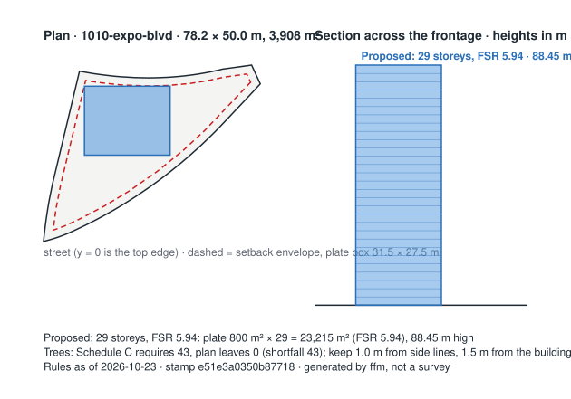
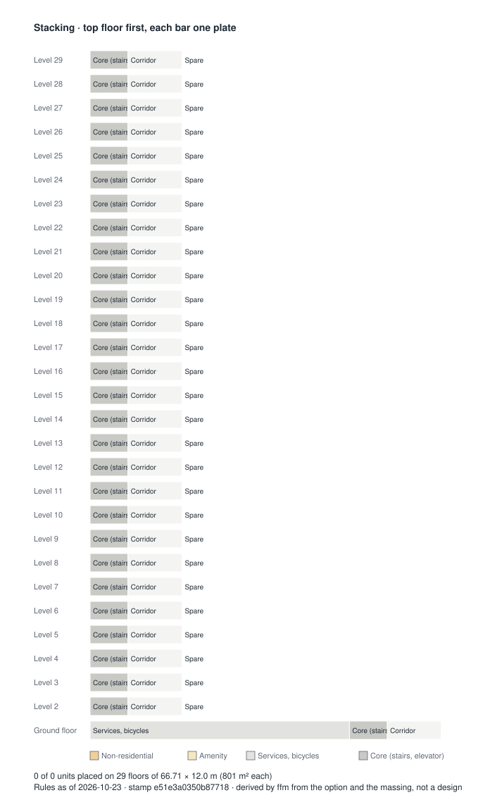
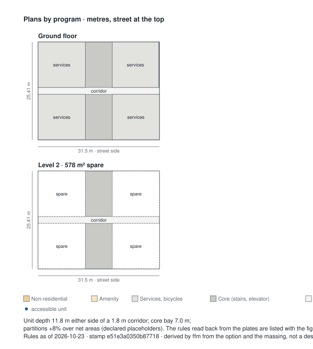
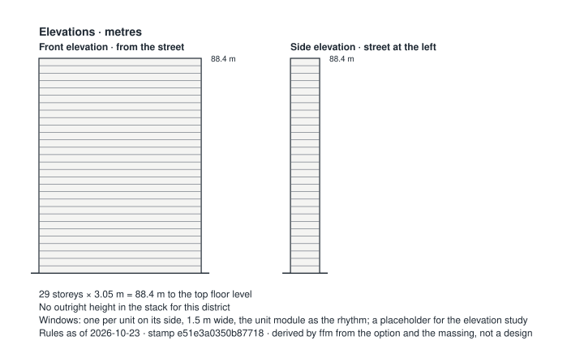
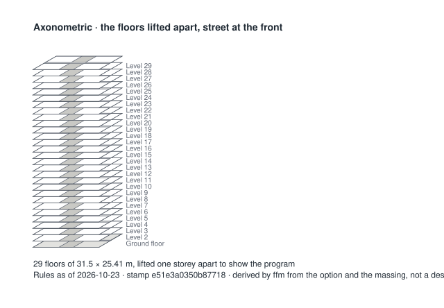
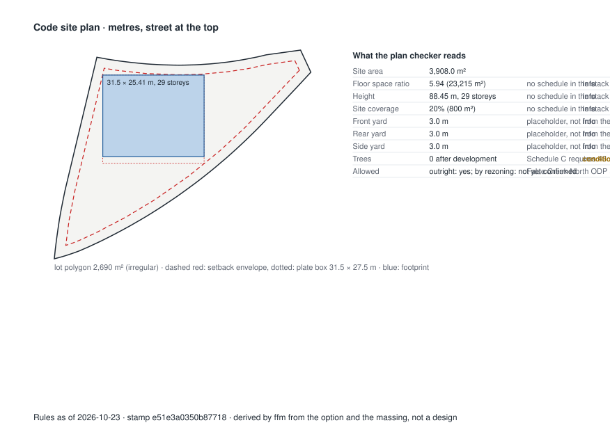

# First Read memo: 1010 Expo Blvd (formerly 1050 Expo Blvd), Vancouver, BC

**Option:** As permitted, DP issued 5 Feb 2025: 29-storey social housing tower (under construction, completion 2029)  
**Proponent:** City of Vancouver (Non-Market Housing Development and Operations) with BC Housing; operator BC Indigenous Housing Society (municipal housing provider)  
**Rules as of:** 2026-10-23 · **version stamp:** `e51e3a0350b87718` · engine 0.1.0  

> Deterministic output of the rule stack listed under *Sources*. Same inputs and rule set give the same memo. It is a feasibility screen, not legal, planning or funding advice; every number links to the document it came from, so check it there.

## 1. Is it allowed?
**Outright, under CD-1: yes.** 

**By rezoning (False Creek North ODP and CD-1 amendments approved after the 13 Jul 2023 public hearing; development permit through the SHORT program): not yet confirmed.**
- *Uncertain* — Transit-oriented area minimum allowable height and density: Whether the site lies in one of Vancouver's 29 transit-oriented areas is not confirmed.
- *Uncertain* — Family-unit requirement in rezonings: Unit mix missing.
- *Uncertain* — Social housing definition (Zoning and Development By-law s.2; DCL By-law 9755): Social housing definition cannot be confirmed: missing share of units for households below the Housing Income Limits, housing agreement term.
- *Uncertain* — Protection of Trees By-law 9958: minimum trees, protection distances, cash in lieu: Schedule C requires 43 trees on a 3,908 m² site; no tree survey is on file.

## 2. Does it fit the funders?
**Not yet confirmed.**
- *Uncertain* — BC Housing Community Housing Fund: eligibility and unit mix: Community Housing Fund: fit cannot be confirmed without the rent-tier split (market / rent-geared-to-income / deep subsidy units); land tenure (lease of at least 60 years at nominal value, or ownership). Site control (finalized) meets the readiness bar; Construction must be able to start within 18 months of award; Program status: 2025 call (RFP #1070-2526-022) cancelled Feb 2026; program page says it will post when next seeking proposals (as of 22 Sep 2026).
- *Info* — CMHC Affordable Housing Fund: readiness and submission mechanics: construction start months after approval: 6; intake: continuous; submission: online application with Project Assessment Workbook and Integrity Declaration; separate Required Documentation Checklist; criteria note: Affordability, accessibility and energy thresholds sit in the program scoring, not in the applicant guide; pull from cmhc.ca/ahf before encoding.

## 3. What is still unsure, and who resolves it?
| Item | Status | Who / what |
|---|---|---|
| Transit-oriented area minimum allowable height and density | Uncertain | Architect: check the City's transit-oriented areas map and record the tier. |
| Family-unit requirement in rezonings | Uncertain | Enter the unit counts by bedroom type. |
| Social housing definition (Zoning and Development By-law s.2; DCL By-law 9755) | Uncertain | Manager: supply share of units for households below the Housing Income Limits, housing agreement term. |
| Protection of Trees By-law 9958: minimum trees, protection distances, cash in lieu | Uncertain | Architect: obtain the arborist report and survey (every tree on the site, within 2 m of the boundary, and on the adjoining street). |
| BC Builds: eligibility and below-market requirement | Uncertain | Manager: state the below-market share and discount; BC Builds applies opportunity by opportunity, so check the current Property Opportunity Notices. |
| BC Housing Community Housing Fund: eligibility and unit mix | Uncertain | Manager: supply the missing figures; the indicative grant at 2025-26 rates would be set by unit count. |

## 4. Does the money work? (feasibility grade)
**Unlikely.** The gap is $151,374,523, 100% of the capital cost, more than the 15% a feasibility screen can call close. Placeholders in use: Soft costs, Contingency, Rent-geared-to-income, Operating cost, Replacement reserve.

- Capital cost **$151,374,523**: hard $112,129,276 (escalated ×1.0292), soft $28,032,319, contingency $11,212,928, land $0.
- Net operating income **not given a year**: rent not given less vacancy not given, operating cost not given and reserve not given.
- Funding **$0**: grants $0, equity $0, supportable debt not given at 6.19% over 40 years, 1.10 coverage.
- Gap **$151,374,523** (100% of the capital cost).

| Line | Figure | From | Note |
|---|---|---|---|
| Hard cost base | $4,693 per m² | `f.hard_cost_base` | average of Quadplex 01 ($425/sf), Quadplex 02 ($438/sf) and Townhouse ($446/sf) |
| Escalation to the latest index | ×1.0292 | `f.escalation_bcpi` | BCPI 109.2 (2026-04-01) over 106.1 (2024-07-01) |
| Hard cost | $112,129,276 | `f.hard_cost_base` | 23,215 m² × $4,693 × 1.0292 |
| Soft costs | $28,032,319 | `f.soft_costs` (placeholder) | 25% of hard cost |
| Contingency | $11,212,928 | `f.soft_costs` (placeholder) | 10% of hard cost |
| Land | $0 | `f.land` | nominal: the owner is a municipality and the tenure plan is a long lease or a transfer |
| Capital cost | $151,374,523 | the option | hard + soft + contingency + land |
| Market rent | not given a year | `f.rents` | CMHC October 2025, 0 units |
| Rent-geared-to-income | not given a year | `f.rents` (placeholder) | 30% of a household income taken at 50% of the fund's income limit (placeholder) |
| Deep-subsidy rent | not given a year | `f.rents` | the shelter rate, $500 a month |
| Vacancy | not given a year | `f.rents` | 3.7% of gross rent, the CMHC survey's rate |
| Operating cost | not given a year | `f.operating` (placeholder) | $6,500 per unit |
| Replacement reserve | not given a year | `f.operating` (placeholder) | $600 per unit |
| Net operating income | not given a year | the option | gross rent less vacancy, operating cost and reserve |
| Equity | $0 | the option | none entered |
| Supportable debt | not given | `f.mortgage` | no net operating income to carry debt |
| Funding | $0 | the option | grants + equity + supportable debt |
| Gap | $151,374,523 | the option | capital cost less funding; a negative gap is headroom |

> A feasibility screen, not a lender's model: hard costs from a Class D catalogue estimate escalated by the Statistics Canada index, rents from the CMHC survey, debt at the posted five-year rate under CMHC's coverage ratio. Placeholders are marked; replace them with the project's own budget before anyone relies on the gap.

## Massing derived from the rules
- **Proposed: 29 storeys, FSR 5.94** — plate 800 m² × 29 storeys = 23,215 m² (FSR 5.94), 88.45 m high, inside a 72.2 × 44.0 m setback envelope. Derived from: option.gfa_m2, option.storeys, option.setbacks_m, option.floor_to_floor_m.

`massing.json` carries the same geometry for the Revit script (`revit/ffm_massing_pyrevit.py`).

## Layouts derived from the option
29 floors of 66.71 × 12.0 m (801 m² each); a double-loaded corridor, units 5.1 m deep; 0 of 0 units placed.

| Block | Count | Area | From |
|---|---|---|---|
| Services, bicycles | 1 | 576 m² | placeholder: 40 m² services + 536 bicycle spaces × 1.0 m² |
| Parking | 63 | 1,890 m² | placeholder: below grade, not on the plates |

Adjacency rules, in plain words, read back from the plates:

- *info* — non residential: on the ground floor, facing the street. No non-residential space in the option
- *info* — amenity: on the ground floor, next to the entry. No amenity in the program
- *conditional* — services: on the ground floor, away from the street. On the ground floor but facing the street: the plate is single-loaded
- *pass* — core: at the centre of every floor, the corridor through it. One core bay at the centre of every floor, the corridor through it
- *conditional* — units: on both sides of the corridor, above whatever the ground floor gives to other uses. Units on the street side only: the plate is too shallow for a double-loaded corridor
- *info* — three bed plus: on the lowest residential floors. No three-bedroom units in the mix
- *info* — accessible: next to the core, on the lowest residential floor. No accessible units stated on the option

`layout.json` carries the blocks, the rules and every zone's coordinates; placeholders are listed in it under `assumptions`.

## Full ledger

### Layer A: Zoning district (City of Vancouver Zoning and Development By-law)

| Rule | Status | Finding | Numbers used | Source |
|---|---|---|---|---|
| Interim Rezoning Policy for Social Housing in Former Community Vision Areas (`cov.irp.social_housing_rezoning`, v 2023-11-01) | Not applicable | The site is outside the former Community Vision areas; social housing there is considered under the Affordable Housing Policies (1989) or an area plan. |  | [Interim Rezoning Policy for Social Housing, Seniors Housing, and Institutional, Cultural and Recreational Uses in Former Community Vision Areas (approved 1 Nov 2023, amended 31 Mar 2026), s.3.1.1; staff benchmark from the 998 E 19th Ave referral report](https://guidelines.vancouver.ca/policy-rezoning-former-community-visions-areas.pdf) |
| Off-street parking minimums (`cov.parking_minimums`, v 2024-06-26) | Info | No minimum off-street parking applies citywide since June 2024; the option provides 63 vehicle and 536 bicycle spaces, which are set by the Parking By-law at the development permit stage. | parking spaces = 63; bicycle spaces = 536 | [City of Vancouver, housing and transit-friendly actions passed June 2024 (minimum parking requirements eliminated citywide), Parking By-law amendments, June 2024](https://vancouver.ca/news-calendar/city-passes-housing-transit-friendly-action-june-2024.aspx) |
| RM-1 outright floor space ratio (`cov.rm1.outright_fsr`, v 2023-01-01) | Not applicable | Written for RM-1, RM-1N districts; this site is zoned CD-1. | district = CD-1 | [City of Vancouver referral report, 998 E 19th Ave (states RM-1 outright FSR 1.20); RM-1 District Schedule, Existing zoning; RM-1 District Schedule s.4.7](https://council.vancouver.ca/20240625/documents/rr1.pdf) |
| RM-1 outright maximum height (`cov.rm1.outright_height`, v 2023-01-01) | Not applicable | Written for RM-1, RM-1N districts; this site is zoned CD-1. | district = CD-1 | [City of Vancouver referral report, 998 E 19th Ave (states RM-1 outright height 10.7 m / 35 ft); RM-1 District Schedule, Existing zoning; RM-1 District Schedule s.4.3](https://council.vancouver.ca/20240625/documents/rr1.pdf) |

### Layer B: Provincial overrides (Bill 44 SSMUH, Bill 47 transit-oriented areas)

| Rule | Status | Finding | Numbers used | Source |
|---|---|---|---|---|
| Small-scale multi-unit housing minimum unit counts (`bc.ssmuh.minimum_units`, v 2024-06-30) | Not applicable | Written for R1-1, RS, RT districts; this site is zoned CD-1. | district = CD-1 | [Province of BC, Small-Scale Multi-Unit Housing overview webinar (22 Jan 2024) and SSMUH Provincial Policy Manual, Bill 44; Local Government Act Part 14 Division 5; manual Packages A to D](https://www2.gov.bc.ca/assets/gov/housing-and-tenancy/tools-for-government/local-governments-and-housing/webinars/lghi_webinar_2024-01-22_ssmuh-overview.pdf) |
| Transit-oriented area minimum allowable height and density (`bc.toa.minimum_density`, v 2024-06-30) | Uncertain | Whether the site lies in one of Vancouver's 29 transit-oriented areas is not confirmed. |  | [Province of BC webinar (Bill 47 transit-oriented areas); City of Vancouver release, June 2024, Bill 47; Local Government Act transit-oriented areas; Vancouver Charter amendments](https://vancouver.ca/news-calendar/city-passes-housing-transit-friendly-action-june-2024.aspx) |

### Layer C: City of Vancouver policies that attach to a rezoning

| Rule | Status | Finding | Numbers used | Source |
|---|---|---|---|---|
| Below-market rental housing policy for rezonings (secured market rental) (`cov.below_market_rental`, v 2023-01-01) | Not applicable | The below-market rental policy applies to 100% secured market rental rezonings; social housing is governed by the social housing definition instead. |  | [City of Vancouver, Policy: Below-Market Rental Housing for Rezonings, Policy requirements](https://guidelines.vancouver.ca/policy-below-market-rental-housing-for-rezonings.pdf) |
| Development cost levy and community amenity contribution treatment of social housing (`cov.dcl_cac_social_housing`, v 2023-01-01) | Info | Social housing is exempt from development cost levies and from community amenity contributions in a rezoning; the church use is also DCL-exempt. The exemption's value is worth stating in the memo. | dcl exempt = True; cac exempt = True | [998 E 19th Ave referral report: CAC exempt under the policy's social housing exemption; DCL exempt as church and social housing (estimated value $3,075,715 at 30 Sep 2023 rates), Public benefits](https://council.vancouver.ca/20240625/documents/rr1.pdf) |
| Family-unit requirement in rezonings (`cov.family_units`, v 1992-01-01) | Uncertain | Unit mix missing. |  | [High-Density Housing for Families with Children Guidelines (1992) as applied in rezonings; the 998 E 19th Ave referral report states the 35% policy minimum, Unit mix; family units 38 of 105 (36%) against a 35% minimum](https://council.vancouver.ca/20240625/documents/rr1.pdf) |
| Social housing definition (Zoning and Development By-law s.2; DCL By-law 9755) (`cov.social_housing_definition`, v 2023-01-01) | Uncertain | Social housing definition cannot be confirmed: missing share of units for households below the Housing Income Limits, housing agreement term. | share below hils = None; owner type at completion = city; housing agreement years = None | [998 E 19th Ave referral report: social housing as defined in the Vancouver Development Cost Levy By-law No. 9755 (at least 30% of units for households below the Housing Income Limits, rents not exceeding 30% of income, owned by a non-profit or government, secured by housing agreement for the longer of 60 years and the life of the building), Tenure and affordability; Housing Agreement and Section 219 covenant](https://council.vancouver.ca/20240625/documents/rr1.pdf) |
| Protection of Trees By-law 9958: minimum trees, protection distances, cash in lieu (`cov.trees.replacement`, v 2023-01-01) | Uncertain | Schedule C requires 43 trees on a 3,908 m² site; no tree survey is on file. | site area m2 = 3,908; schedule c required = 43; existing = 0; retained = 0; removed = 0; replacements proposed = 0; trees after = 0; shortfall = 43; cash in lieu cad = 43000; survey scope = every tree on the site, within 2 m of the boundary, and on the adjoining street | [City of Vancouver Protection of Trees By-law No. 9958 (consolidated), Schedule A (s.1.2), Schedule C (ss.5.1, 5.2, 6.2), s.6.2 cash in lieu, s.6.5 siting, s.7.2 arborist report](https://bylaws.vancouver.ca/9958c.PDF) |

### Layer D: Building code and funder design standards (flags, not checks, at this stage)

| Rule | Status | Finding | Numbers used | Source |
|---|---|---|---|---|
| Building code basis flags (BC Building Code 2024; Vancouver Building By-law 2025) (`bc.code_basis`, v 2025-09-15) | Info | 29 storeys puts the building under Part 3 of the BC Building Code 2024 and the Vancouver Building By-law 2025; wood frame is standard to 6 storeys and encapsulated mass timber is permitted to 18 under the VBBL; seismic changes apply to permits from 2026-09-15. | storeys = 29; part = 3 | [Province of BC, BC Building Code 2024; City of Vancouver, Guide to 2025 Vancouver Building By-law updates, Part 3 vs Part 9 basis (Div A 1.3.3.2); encapsulated mass timber](https://vancouver.ca/files/cov/guide-to-2025-vbbl-updates-v1.01.pdf) |
| BC Housing Design Guidelines: minimum net unit areas (`bch.design_guidelines.unit_areas`, v 2019-05-01) | Info | BC Housing minimum net unit areas apply if BC Housing funds the project. |  | [BC Housing Design Guidelines and Construction Standards (2019 edition; copy), Unit areas; building envelope; structure](https://compositedesign.ca/doc/bchousing/BCH-Design-Guidelines-Construction-Standards.pdf) |

### Layer E: Funding programs: eligibility criteria the memo tests (not the submission package)

| Rule | Status | Finding | Numbers used | Source |
|---|---|---|---|---|
| BC Builds: eligibility and below-market requirement (`bc.bcbuilds.eligibility`, v 2024-02-13) | Uncertain | BC Builds: fit cannot be confirmed without the share of units at least 20% below market. Non-residential space is 0.0% of area, under the 30% cap; Ground must break within 12 to 18 months of the conditional land contribution letter. | submission = Proposal in any format by email against each Property Opportunity Notice; optional capital and operating budget template | [BC Builds, developers and operators (page current as of 22 Sep 2026); Province of BC BC Builds announcement 2024, Applicant requirements; grants; timelines](https://www.bcbuildshomes.ca/developers-operators) |
| BC Housing Community Housing Fund: eligibility and unit mix (`bch.chf.eligibility`, v 2025-05-30) | Uncertain | Community Housing Fund: fit cannot be confirmed without the rent-tier split (market / rent-geared-to-income / deep subsidy units); land tenure (lease of at least 60 years at nominal value, or ownership). Site control (finalized) meets the readiness bar; Construction must be able to start within 18 months of award; Program status: 2025 call (RFP #1070-2526-022) cancelled Feb 2026; program page says it will post when next seeking proposals (as of 22 Sep 2026). | status = 2025 call (RFP #1070-2526-022) cancelled Feb 2026; program page says it will post when next seeking proposals (as of 22 Sep 2026); provisional grant per unit cad = 171211; indicative grant cad = None | [BC Housing, Community Housing Fund 2025 RFP #1070-2526-022 webinar slides; 2023 RFP #1070-2324-041; CHF program page, Eligibility; unit mix 30/50/20; minimum requirements; rated criteria](https://www.bchousing.org/sites/default/files/media/documents/CHF-RFP-2526-022A-Webinar-Slides.pdf) |
| BC Housing Project Development Fund (pre-development loans) (`bch.pdf.predevelopment_loan`, v 2025-01-01) | Info | max loan cad: 250000; eligible costs: due diligence, feasibility and design. | max loan cad = 250000; eligible costs = due diligence, feasibility and design | [UBCM resolution NR24 and the Province's response (Project Development Fund loans up to $250,000), Provincial response](https://www.ubcm.ca/node/111136) |
| CMHC Affordable Housing Fund: readiness and submission mechanics (`cmhc.ahf.readiness`, v 2024-03-13) | Info | construction start months after approval: 6; intake: continuous; submission: online application with Project Assessment Workbook and Integrity Declaration; separate Required Documentation Checklist; criteria note: Affordability, accessibility and energy thresholds sit in the program scoring, not in the applicant guide; pull from cmhc.ca/ahf before encoding. | construction start months after approval = 6; intake = continuous; submission = online application with Project Assessment Workbook and Integrity Declaration; separate Required Documentation Checklist; criteria note = Affordability, accessibility and energy thresholds sit in the program scoring, not in the applicant guide; pull from cmhc.ca/ahf before encoding | [CMHC, Affordable Housing Fund applicant guide, Minimum submission requirements; readiness](https://cmhc-schl.gc.ca/-/media/sites/cmhc/nhs/co-investment-fund/nhs-co-invest-fund-app-guide-en.ashx) |

### Layer F: Assumptions: costs, revenues and financing the pro-forma uses (dated, cited, refreshed)

| Rule | Status | Finding | Numbers used | Source |
|---|---|---|---|---|
| Construction price escalation (Statistics Canada BCPI, Vancouver, residential) (`f.escalation_bcpi`, v 2024-08-21) | Info | Building construction price index, Vancouver, residential buildings, division composite (2023=100): 109.4 in the third quarter of 2026, from 106.1 in the third quarter of 2024, the hard-cost base period; escalation 1.031 (a memo run on an earlier date uses the last quarter published on or before that date). | table = 18-10-0289-01; product id = 18100289; coordinate = 24.1.1.0.0.0.0.0.0.0; vector = v1617916836; series = Vancouver, British Columbia; Residential buildings; Division composite; base = 2023=100; latest period = 2026-07-01; latest value = 109.4; released = 2026-10-29 | [Statistics Canada, Table 18-10-0289-01 Building construction price indexes, by type of building and division (quarterly, 2023=100), released 29 Oct 2026, Vancouver, British Columbia; residential buildings; division composite (vector v1617916836)](https://www150.statcan.gc.ca/t1/tbl1/en/tv.action?pid=1810028901) |
| Hard construction cost, base ($/m², Vancouver) (`f.hard_cost_base`, v 2024-08-21) | Info | Hard cost base $4,693 per m² ($436 per build sq ft): the average of the three four-unit wood-frame designs in the Class D estimate for the Province's standardized housing designs, Vancouver baseline, August 2024, hard costs only. | value per m2 cad = 4693; value per sqft cad = 436; base period = 2024-07-01; basis = average of Quadplex 01 ($425/sf), Quadplex 02 ($438/sf) and Townhouse ($446/sf); the catalogue's ten designs run $401 to $585 per build sq ft; the report's regional review gives Vancouver $350 to $475 per sq ft; excludes = soft costs, utility connections, existing buildings, rock or shoring, pad-mounted transformers (the report's stated assumptions) | [SHP Class D Estimate Report, V3 (Chris Hill, CPA CMA, for the BC Ministry of Housing Standardized Designs Catalogue), 21 Aug 2024, Cost Estimate Summary (per build sf); Region Review; Assumptions](https://www2.gov.bc.ca/assets/gov/farming-natural-resources-and-industry/construction-industry/building-codes-and-standards/reports/bc_std_des_class_d_estimates_v1.pdf) |
| Land: nominal lease from a church, a society or a government; else the assessed value, entered (`f.land`, v 2026-10-01) | Info | Land is carried at a nominal value where the owner is a church, a non-profit society, a co-operative, a First Nation, the City or the Province and the tenure plan is a long lease or a transfer; otherwise the BC Assessment value or the agreed price is entered by hand, and until it is the pro-forma is unsure. | nominal value cad = 0 | [BC Assessment, property assessment search (assessed value of the parcel); the owner's tenure plan, Assessed value as of 1 July of the previous year](https://www.bcassessment.ca/) |
| Mortgage rate, amortization and debt coverage (Bank of Canada; CMHC MLI Select) (`f.mortgage`, v 2026-10-14) | Info | Conventional 5-year mortgage rate 6.19% (chartered banks, Bank of Canada series V80691335, 28 Oct 2026) as the ceiling; CMHC MLI Select terms for the debt test: a 1.10 debt coverage ratio and a 40-year amortization (50 years is available at 100 affordability points). | rate pct = 6.19; rate series = V80691335; rate date = 2026-10-28; amortization years = 40; debt coverage ratio = 1.1; insured rate note = an insured multi-unit loan is usually priced below the posted conventional rate; the posted rate is the conservative ceiling | [Bank of Canada, Valet API, series V80691335 Conventional mortgage, 5-year (weekly); CMHC, MLI Select product sheet, Conventional mortgage, 5-year; MLI Select: minimum debt coverage ratio 1.10 for standard rental, amortization to 50 years at 100 points](https://www.bankofcanada.ca/valet/observations/V80691335/json?recent=1) |
| Operating cost and replacement reserve per unit (`f.operating`, v 2026-10-01) | Info | Operating cost $6,500 per unit a year (management, maintenance, utilities, insurance, property tax where not exempt) and a $600 per unit replacement reserve: declared placeholders until the operator's budget replaces them. | operating cost per unit year cad = 6500; replacement reserve per unit year cad = 600 | Declared placeholder (no public source): to be replaced by the operator's budget or BC Housing's operating benchmarks where published |
| Rents by tier: CMHC average market rent, rent-geared-to-income, the shelter rate (`f.rents`, v 2026-01-29) | Info | Market rent from the CMHC Rental Market Survey of October 2025, Vancouver CMA, purpose-built apartments: two-bedroom $2,363 a month, all unit types $1,963, vacancy 3.7% (the other bedroom types are left to be typed from the CMHC data tables); rent-geared-to-income at 30% of a household income taken, as a placeholder, at half the Community Housing Fund's low-to-moderate income limit for the unit size; the deep-subsidy rent at the income assistance shelter rate of $500. | survey = October 2025; vacancy rate = 0.037; rgi rent share of income = 0.3; rgi income share of chf limit = 0.5; deep subsidy rent monthly cad = 500 | [CMHC, Rental Market Report, January 2026 (October 2025 survey), Vancouver CMA; Province of BC, income assistance shelter allowance (single person, maximum $500 from 1 Dec 2025), Vancouver: purpose-built rental vacancy 3.7%, average two-bedroom rent $2,363; summary by zone, all units $1,963](https://www.cmhc-schl.gc.ca/professionals/housing-markets-data-and-research/market-reports/rental-market-reports-major-centres) |
| Soft costs and contingency, as shares of hard cost (`f.soft_costs`, v 2026-10-01) | Info | Soft costs 25% of hard cost (design, permits, levies where they apply, financing, legal, insurance, marketing) and a 10% contingency: declared placeholders until a practitioner gives this project's figures. | soft cost share of hard = 0.25; contingency share of hard = 0.1 | Declared placeholder (no public source): to be replaced by the proponent's development budget |

## Inputs
- Site `1010-expo-blvd`: CD-1, 3,908.0 m², 78.2 × 50.0 m; owner: City of Vancouver (site transferred by Concord Pacific under the False Creek North social housing agreement, 2023).
- Option `1010-expo-blvd-as-permitted`: 29 storeys, 88.4 m, 23,215.0 m² GFA; units studio not given, one bed not given, two bed not given, three bed plus not given; tenure social housing.
- Site notes: A triangular surface parking lot between Expo Blvd, Pacific Blvd and the Cambie Bridge, inside the False Creek North ODP area (CD-1; by-law number to confirm). Site area is derived from the development application's floor area and FSR (23,215 m² at 5.94) and the frontage and depth are an equivalent rectangle, so the plan figure is a stand-in for the real triangle. No tree survey is in the public record; the lot is paved. Transit-oriented area tier is left null until the City's TOA map is checked (Stadium-Chinatown and Yaletown-Roundhouse stations are both within about 800 m). The rule stack has no CD-1 outright schedule, so the memo's 'outright: yes' means no coded outright limit was tested, not that a 29-storey tower is permitted outright: the ODP and CD-1 amendments of July 2023 were the rezoning.
- Option notes: Storeys, height, floor area, FSR and the 299 units are the City's application figures; 63 vehicle and 536 bicycle spaces, 112 family units and 15 accessible units are the architect's published figures. The bedroom mix is not public, so the unit counts are left null and the engine marks the family-unit rule uncertain; the referral report required 20% of units (60) at shelter rate but the share below HILs is not published. Setbacks and the 3.05 m floor-to-floor (88.4 m over 29 storeys) are placeholders for the massing only. Funding on the public record: federal Affordable Housing Fund and provincial Community Housing Fund (amounts reported jointly with 450 Pacific St) plus City DCC waivers and land.

## Sources
- Interim Rezoning Policy for Social Housing, Seniors Housing, and Institutional, Cultural and Recreational Uses in Former Community Vision Areas (approved 1 Nov 2023, amended 31 Mar 2026) — https://guidelines.vancouver.ca/policy-rezoning-former-community-visions-areas.pdf *(verify: Map 1 of the policy decides whether a site is inside a former Community Vision area; outside it the Affordable Housing Policies (1989) apply.)*
- City of Vancouver, housing and transit-friendly actions passed June 2024 (minimum parking requirements eliminated citywide) — https://vancouver.ca/news-calendar/city-passes-housing-transit-friendly-action-june-2024.aspx
- City of Vancouver referral report, 998 E 19th Ave (states RM-1 outright FSR 1.20); RM-1 District Schedule — https://council.vancouver.ca/20240625/documents/rr1.pdf *(verify: Confirm against the RM-1 district schedule in the consolidated Zoning and Development By-law before the user sessions: https://bylaws.vancouver.ca/zoning/zoning-by-law-consolidated.pdf)*
- City of Vancouver referral report, 998 E 19th Ave (states RM-1 outright height 10.7 m / 35 ft); RM-1 District Schedule — https://council.vancouver.ca/20240625/documents/rr1.pdf *(verify: Confirm against the RM-1 district schedule in the consolidated Zoning and Development By-law.)*
- Province of BC, Small-Scale Multi-Unit Housing overview webinar (22 Jan 2024) and SSMUH Provincial Policy Manual — https://www2.gov.bc.ca/assets/gov/housing-and-tenancy/tools-for-government/local-governments-and-housing/webinars/lghi_webinar_2024-01-22_ssmuh-overview.pdf
- Province of BC webinar (Bill 47 transit-oriented areas); City of Vancouver release, June 2024 — https://vancouver.ca/news-calendar/city-passes-housing-transit-friendly-action-june-2024.aspx *(verify: Tier storey figures are the Province's SkyTrain-station tiers as commonly reported; confirm against the Transit-Oriented Areas Designation Regulation before the user sessions.)*
- City of Vancouver, Policy: Below-Market Rental Housing for Rezonings — https://guidelines.vancouver.ca/policy-below-market-rental-housing-for-rezonings.pdf
- 998 E 19th Ave referral report: CAC exempt under the policy's social housing exemption; DCL exempt as church and social housing (estimated value $3,075,715 at 30 Sep 2023 rates) — https://council.vancouver.ca/20240625/documents/rr1.pdf *(verify: Current DCL rates and exemptions: City of Vancouver DCL bulletin (not yet opened in this project).)*
- High-Density Housing for Families with Children Guidelines (1992) as applied in rezonings; the 998 E 19th Ave referral report states the 35% policy minimum — https://council.vancouver.ca/20240625/documents/rr1.pdf
- 998 E 19th Ave referral report: social housing as defined in the Vancouver Development Cost Levy By-law No. 9755 (at least 30% of units for households below the Housing Income Limits, rents not exceeding 30% of income, owned by a non-profit or government, secured by housing agreement for the longer of 60 years and the life of the building) — https://council.vancouver.ca/20240625/documents/rr1.pdf
- City of Vancouver Protection of Trees By-law No. 9958 (consolidated) — https://bylaws.vancouver.ca/9958c.PDF
- Province of BC, BC Building Code 2024; City of Vancouver, Guide to 2025 Vancouver Building By-law updates — https://vancouver.ca/files/cov/guide-to-2025-vbbl-updates-v1.01.pdf
- BC Housing Design Guidelines and Construction Standards (2019 edition; copy) — https://compositedesign.ca/doc/bchousing/BCH-Design-Guidelines-Construction-Standards.pdf *(verify: The current edition on bchousing.org could not be fetched; confirm the figures against it before the user sessions.)*
- BC Builds, developers and operators (page current as of 22 Sep 2026); Province of BC BC Builds announcement 2024 — https://www.bcbuildshomes.ca/developers-operators
- BC Housing, Community Housing Fund 2025 RFP #1070-2526-022 webinar slides; 2023 RFP #1070-2324-041; CHF program page — https://www.bchousing.org/sites/default/files/media/documents/CHF-RFP-2526-022A-Webinar-Slides.pdf
- UBCM resolution NR24 and the Province's response (Project Development Fund loans up to $250,000) — https://www.ubcm.ca/node/111136
- CMHC, Affordable Housing Fund applicant guide — https://cmhc-schl.gc.ca/-/media/sites/cmhc/nhs/co-investment-fund/nhs-co-invest-fund-app-guide-en.ashx
- Statistics Canada, Table 18-10-0289-01 Building construction price indexes, by type of building and division (quarterly, 2023=100), released 29 Oct 2026 — https://www150.statcan.gc.ca/t1/tbl1/en/tv.action?pid=1810028901
- SHP Class D Estimate Report, V3 (Chris Hill, CPA CMA, for the BC Ministry of Housing Standardized Designs Catalogue), 21 Aug 2024 — https://www2.gov.bc.ca/assets/gov/farming-natural-resources-and-industry/construction-industry/building-codes-and-standards/reports/bc_std_des_class_d_estimates_v1.pdf *(verify: The catalogue's designs are two- to four-unit, three-storey wood-frame buildings; a six-storey apartment sits outside it. Replace with a quantity surveyor's Class D figure for the actual building type when one exists, and keep this as the floor.)*
- BC Assessment, property assessment search (assessed value of the parcel); the owner's tenure plan — https://www.bcassessment.ca/
- Bank of Canada, Valet API, series V80691335 Conventional mortgage, 5-year (weekly); CMHC, MLI Select product sheet — https://www.bankofcanada.ca/valet/observations/V80691335/json?recent=1 *(verify: Confirm the DCR and amortization against the current MLI Select guide before a submission.)*
- Declared placeholder (no public source): to be replaced by the operator's budget or BC Housing's operating benchmarks where published
- CMHC, Rental Market Report, January 2026 (October 2025 survey), Vancouver CMA; Province of BC, income assistance shelter allowance (single person, maximum $500 from 1 Dec 2025) — https://www.cmhc-schl.gc.ca/professionals/housing-markets-data-and-research/market-reports/rental-market-reports-major-centres *(verify: Type the bachelor, one-bedroom and three-bedroom averages from the CMHC Rental Market Survey data tables (Vancouver CMA, Table 1.1.2); the rent-geared-to-income income placeholder is declared, not sourced: replace it with the operator's tenant income profile.)*
- Declared placeholder (no public source): to be replaced by the proponent's development budget
- Shape Your City, 1050 Expo Boulevard development application DP-2023-00629 (29 storeys, 88.4 m, 23,215 m², FSR 5.94, 299 social housing units; DP issued 5 Feb 2025) — https://www.shapeyourcity.ca/1050-expo-blvd
- Shape Your City, False Creek North social housing (ODP and CD-1 amendments approved after the 13 Jul 2023 public hearing; 29 storeys, 88.1 m at 1050 Expo Blvd) — https://www.shapeyourcity.ca/false-creek-north-non-market-housing
- City of Vancouver, non-market housing projects (1010 Expo Blvd: 299 units, BC Indigenous Housing Society, under construction, completion 2029) — https://vancouver.ca/people-programs/non-market-housing-projects.aspx
- Journal of Commerce, Vancouver approves 661 new social housing units across three sites in North False Creek (Jul 2023) — https://canada.constructconnect.com/joc/news/government/2023/07/vancouver-approves-661-new-social-housing-units-across-three-sites-in-north-false-creek
- Shape Your City, 1050 Expo Boulevard development application DP-2023-00629 — https://www.shapeyourcity.ca/1050-expo-blvd
- Public Architecture + Design, 1010 Expo Boulevard (299 units, 112 family, 15 accessible; 63 vehicle and 536 bicycle spaces; Step Code 3) — https://www.publicarchitecture.ca/work/1010-expo-boulevard/
- Daily Hive, construction starts on two social housing towers next to Cambie Bridge's north end (6 Dec 2025; operator and funding) — https://dailyhive.com/vancouver/1050-expo-boulevard-95-nelson-street-vancouver-social-housing-firehall-8-tower-construction

## Version stamp
- Rules hash (SHA-256 over all rule files): `9209630adb35220b8e7e9d43f4b0b8c636e9557b8f7d61a6111e6aed3d9a7823`
- `a_zoning_district.json`: `ef2791008abaf57c…`
- `b_provincial.json`: `0fede33e5d62b1bd…`
- `c_city_policies.json`: `961f8f2e91ce2d3f…`
- `d_design_standards.json`: `dc53a9b24d809090…`
- `e_funding_programs.json`: `9267a33722068790…`
- `f_assumptions.json`: `942a6dbab04d93fc…`
- Stamp (hash of rules hash + rule versions in force on 2026-10-23): `e51e3a0350b87718`
