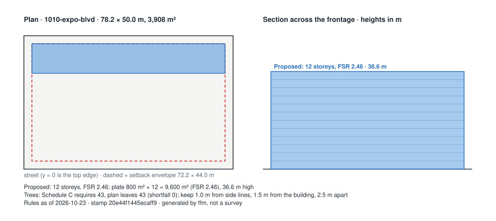

# First Read memo: 1010 Expo Blvd (formerly 1050 Expo Blvd), Vancouver, BC

**Option:** What-if (hypothetical, for the demo): twelve storeys with the full funder data supplied  
**Proponent:** City of Vancouver (Non-Market Housing Development and Operations) with BC Housing; operator BC Indigenous Housing Society (municipal housing provider)  
**Rules as of:** 2026-10-23 · **version stamp:** `20e44f1445ecaff9` · engine 0.1.0  

> Deterministic output of the rule stack listed under *Sources*. Same inputs and rule set give the same memo. It is a feasibility screen, not legal, planning or funding advice; every number links to the document it came from, so check it there.

## 1. Is it allowed?
**Outright, under CD-1: yes.** 

**By rezoning (False Creek North ODP and CD-1 amendments approved after the 13 Jul 2023 public hearing; development permit through the SHORT program): not yet confirmed.**
- *Uncertain* — Transit-oriented area minimum allowable height and density: Whether the site lies in one of Vancouver's 29 transit-oriented areas is not confirmed.
- *Uncertain* — Protection of Trees By-law 9958: minimum trees, protection distances, cash in lieu: Schedule C requires 43 trees on a 3,908 m² site; no tree survey is on file.

## 2. Does it fit the funders?
**Not yet confirmed.**
- *Pass* — BC Builds: eligibility and below-market requirement: BC Builds: fits the published criteria: non-residential space is 0.0% of area, under the 30% cap; ground must break within 12 to 18 months of the conditional land contribution letter.
- *Uncertain* — BC Housing Community Housing Fund: eligibility and unit mix: Community Housing Fund: fit cannot be confirmed without the land tenure (lease of at least 60 years at nominal value, or ownership). Unit mix matches 30/50/20 within tolerance; Site control (finalized) meets the readiness bar; Construction must be able to start within 18 months of award; Program status: 2025 call (RFP #1070-2526-022) cancelled Feb 2026; program page says it will post when next seeking proposals (as of 22 Sep 2026).

## 3. What is still unsure, and who resolves it?
| Item | Status | Who / what |
|---|---|---|
| Transit-oriented area minimum allowable height and density | Uncertain | Architect: check the City's transit-oriented areas map and record the tier. |
| Protection of Trees By-law 9958: minimum trees, protection distances, cash in lieu | Uncertain | Architect: obtain the arborist report and survey (every tree on the site, within 2 m of the boundary, and on the adjoining street). |
| BC Housing Community Housing Fund: eligibility and unit mix | Uncertain | Manager: supply the missing figures; the indicative grant at 2025-26 rates would be $20,545,320 for 120 units. |

## Massing derived from the rules
- **Proposed: 12 storeys, FSR 2.46** — plate 800 m² × 12 storeys = 9,600 m² (FSR 2.46), 36.6 m high, inside a 72.2 × 44.0 m setback envelope. Derived from: option.gfa_m2, option.storeys, option.setbacks_m, option.floor_to_floor_m.
- Note: Option height 36.6 m exceeds 12 x 3.05 m = 36.6 m; the extra 0.0 m is parapet, roof structure or taller ground floor, and the mass uses the stated height.

`massing.json` carries the same geometry for the Revit script (`revit/ffm_massing_pyrevit.py`).

## What changed since the previous memo
Previous stamp `20e44f1445ecaff9` (rules as of 2026-10-23) → current `20e44f1445ecaff9` (as of 2026-10-23). The rule files are unchanged; differences come from the as-of date or the inputs.

| Rule | Change | From | To | Now reads |
|---|---|---|---|---|
| bc.bcbuilds.eligibility | changed | uncertain | pass | BC Builds: fits the published criteria: non-residential space is 0.0% of area, under the 30% cap; ground must break within 12 to 18 months of the conditional land contribution letter. |
| bc.code_basis | finding changed | info | info | 12 storeys puts the building under Part 3 of the BC Building Code 2024 and the Vancouver Building By-law 2025; wood frame is standard to 6 storeys and encapsulated mass timber is permitted to 18 under the VBBL; seismic changes apply to permits from 2026-09-15. |
| bch.chf.eligibility | finding changed | uncertain | uncertain | Community Housing Fund: fit cannot be confirmed without the land tenure (lease of at least 60 years at nominal value, or ownership). Unit mix matches 30/50/20 within tolerance; Site control (finalized) meets the readiness bar; Construction must be able to start within 18 months of award; Program status: 2025 call (RFP #1070-2526-022) cancelled Feb 2026; program page says it will post when next seeking proposals (as of 22 Sep 2026). |
| bch.design_guidelines.unit_areas | finding changed | info | info | BC Housing minimum net unit areas are studio 33, one-bedroom 49, two-bedroom 67, three-bedroom 86 m²; the option averages 80 m² gross per unit, so net areas should be checked at the plan stage. |
| cov.family_units | changed | uncertain | pass | 48 of 120 units (40.0%) have two or more bedrooms, against a 35.0% minimum. |
| cov.parking_minimums | finding changed | info | info | No minimum off-street parking applies citywide since June 2024; the option provides 30 vehicle and 220 bicycle spaces, which are set by the Parking By-law at the development permit stage. |
| cov.social_housing_definition | changed | uncertain | pass | Meets the City's social housing definition: 30.0% of units for households below HILs (minimum 30.0%), owned by a city, secured for 60 years. |

## Full ledger

### Layer A: Zoning district (City of Vancouver Zoning and Development By-law)

| Rule | Status | Finding | Numbers used | Source |
|---|---|---|---|---|
| Interim Rezoning Policy for Social Housing in Former Community Vision Areas (`cov.irp.social_housing_rezoning`, v 2023-11-01) | Not applicable | The site is outside the former Community Vision areas; social housing there is considered under the Affordable Housing Policies (1989) or an area plan. |  | [Interim Rezoning Policy for Social Housing, Seniors Housing, and Institutional, Cultural and Recreational Uses in Former Community Vision Areas (approved 1 Nov 2023, amended 31 Mar 2026), s.3.1.1; staff benchmark from the 998 E 19th Ave referral report](https://guidelines.vancouver.ca/policy-rezoning-former-community-visions-areas.pdf) |
| Off-street parking minimums (`cov.parking_minimums`, v 2024-06-26) | Info | No minimum off-street parking applies citywide since June 2024; the option provides 30 vehicle and 220 bicycle spaces, which are set by the Parking By-law at the development permit stage. | parking spaces = 30; bicycle spaces = 220 | [City of Vancouver, housing and transit-friendly actions passed June 2024 (minimum parking requirements eliminated citywide), Parking By-law amendments, June 2024](https://vancouver.ca/news-calendar/city-passes-housing-transit-friendly-action-june-2024.aspx) |
| RM-1 outright floor space ratio (`cov.rm1.outright_fsr`, v 2023-01-01) | Not applicable | Written for RM-1, RM-1N districts; this site is zoned CD-1. | district = CD-1 | [City of Vancouver referral report, 998 E 19th Ave (states RM-1 outright FSR 1.20); RM-1 District Schedule, Existing zoning; RM-1 District Schedule s.4.7](https://council.vancouver.ca/20240625/documents/rr1.pdf) |
| RM-1 outright maximum height (`cov.rm1.outright_height`, v 2023-01-01) | Not applicable | Written for RM-1, RM-1N districts; this site is zoned CD-1. | district = CD-1 | [City of Vancouver referral report, 998 E 19th Ave (states RM-1 outright height 10.7 m / 35 ft); RM-1 District Schedule, Existing zoning; RM-1 District Schedule s.4.3](https://council.vancouver.ca/20240625/documents/rr1.pdf) |

### Layer B: Provincial overrides (Bill 44 SSMUH, Bill 47 transit-oriented areas)

| Rule | Status | Finding | Numbers used | Source |
|---|---|---|---|---|
| Small-scale multi-unit housing minimum unit counts (`bc.ssmuh.minimum_units`, v 2024-06-30) | Not applicable | Written for R1-1, RS, RT districts; this site is zoned CD-1. | district = CD-1 | [Province of BC, Small-Scale Multi-Unit Housing overview webinar (22 Jan 2024) and SSMUH Provincial Policy Manual, Bill 44; Local Government Act Part 14 Division 5; manual Packages A to D](https://www2.gov.bc.ca/assets/gov/housing-and-tenancy/tools-for-government/local-governments-and-housing/webinars/lghi_webinar_2024-01-22_ssmuh-overview.pdf) |
| Transit-oriented area minimum allowable height and density (`bc.toa.minimum_density`, v 2024-06-30) | Uncertain | Whether the site lies in one of Vancouver's 29 transit-oriented areas is not confirmed. |  | [Province of BC webinar (Bill 47 transit-oriented areas); City of Vancouver release, June 2024, Bill 47; Local Government Act transit-oriented areas; Vancouver Charter amendments](https://vancouver.ca/news-calendar/city-passes-housing-transit-friendly-action-june-2024.aspx) |

### Layer C: City of Vancouver policies that attach to a rezoning

| Rule | Status | Finding | Numbers used | Source |
|---|---|---|---|---|
| Below-market rental housing policy for rezonings (secured market rental) (`cov.below_market_rental`, v 2023-01-01) | Not applicable | The below-market rental policy applies to 100% secured market rental rezonings; social housing is governed by the social housing definition instead. |  | [City of Vancouver, Policy: Below-Market Rental Housing for Rezonings, Policy requirements](https://guidelines.vancouver.ca/policy-below-market-rental-housing-for-rezonings.pdf) |
| Development cost levy and community amenity contribution treatment of social housing (`cov.dcl_cac_social_housing`, v 2023-01-01) | Info | Social housing is exempt from development cost levies and from community amenity contributions in a rezoning; the church use is also DCL-exempt. The exemption's value is worth stating in the memo. | dcl exempt = True; cac exempt = True | [998 E 19th Ave referral report: CAC exempt under the policy's social housing exemption; DCL exempt as church and social housing (estimated value $3,075,715 at 30 Sep 2023 rates), Public benefits](https://council.vancouver.ca/20240625/documents/rr1.pdf) |
| Family-unit requirement in rezonings (`cov.family_units`, v 1992-01-01) | Pass | 48 of 120 units (40.0%) have two or more bedrooms, against a 35.0% minimum. | units total = 120; two plus bed units = 48; two plus bed share = 0.4; three plus bed units = 12; three plus bed share = 0.1; min two plus bed share = 0.35; min three plus bed share = None | [High-Density Housing for Families with Children Guidelines (1992) as applied in rezonings; the 998 E 19th Ave referral report states the 35% policy minimum, Unit mix; family units 38 of 105 (36%) against a 35% minimum](https://council.vancouver.ca/20240625/documents/rr1.pdf) |
| Social housing definition (Zoning and Development By-law s.2; DCL By-law 9755) (`cov.social_housing_definition`, v 2023-01-01) | Pass | Meets the City's social housing definition: 30.0% of units for households below HILs (minimum 30.0%), owned by a city, secured for 60 years. | share below hils = 0.3; owner type at completion = city; housing agreement years = 60 | [998 E 19th Ave referral report: social housing as defined in the Vancouver Development Cost Levy By-law No. 9755 (at least 30% of units for households below the Housing Income Limits, rents not exceeding 30% of income, owned by a non-profit or government, secured by housing agreement for the longer of 60 years and the life of the building), Tenure and affordability; Housing Agreement and Section 219 covenant](https://council.vancouver.ca/20240625/documents/rr1.pdf) |
| Protection of Trees By-law 9958: minimum trees, protection distances, cash in lieu (`cov.trees.replacement`, v 2023-01-01) | Uncertain | Schedule C requires 43 trees on a 3,908 m² site; no tree survey is on file. | site area m2 = 3,908; schedule c required = 43; existing = 0; retained = 0; removed = 0; replacements proposed = 43; trees after = 43; shortfall = 0; cash in lieu cad = 0; survey scope = every tree on the site, within 2 m of the boundary, and on the adjoining street | [City of Vancouver Protection of Trees By-law No. 9958 (consolidated), Schedule A (s.1.2), Schedule C (ss.5.1, 5.2, 6.2), s.6.2 cash in lieu, s.6.5 siting, s.7.2 arborist report](https://bylaws.vancouver.ca/9958c.PDF) |

### Layer D: Building code and funder design standards (flags, not checks, at this stage)

| Rule | Status | Finding | Numbers used | Source |
|---|---|---|---|---|
| Building code basis flags (BC Building Code 2024; Vancouver Building By-law 2025) (`bc.code_basis`, v 2025-09-15) | Info | 12 storeys puts the building under Part 3 of the BC Building Code 2024 and the Vancouver Building By-law 2025; wood frame is standard to 6 storeys and encapsulated mass timber is permitted to 18 under the VBBL; seismic changes apply to permits from 2026-09-15. | storeys = 12; part = 3 | [Province of BC, BC Building Code 2024; City of Vancouver, Guide to 2025 Vancouver Building By-law updates, Part 3 vs Part 9 basis (Div A 1.3.3.2); encapsulated mass timber](https://vancouver.ca/files/cov/guide-to-2025-vbbl-updates-v1.01.pdf) |
| BC Housing Design Guidelines: minimum net unit areas (`bch.design_guidelines.unit_areas`, v 2019-05-01) | Info | BC Housing minimum net unit areas are studio 33, one-bedroom 49, two-bedroom 67, three-bedroom 86 m²; the option averages 80 m² gross per unit, so net areas should be checked at the plan stage. | average gross area per unit m2 = 80 | [BC Housing Design Guidelines and Construction Standards (2019 edition; copy), Unit areas; building envelope; structure](https://compositedesign.ca/doc/bchousing/BCH-Design-Guidelines-Construction-Standards.pdf) |

### Layer E: Funding programs: eligibility criteria the memo tests (not the submission package)

| Rule | Status | Finding | Numbers used | Source |
|---|---|---|---|---|
| BC Builds: eligibility and below-market requirement (`bc.bcbuilds.eligibility`, v 2024-02-13) | Pass | BC Builds: fits the published criteria: non-residential space is 0.0% of area, under the 30% cap; ground must break within 12 to 18 months of the conditional land contribution letter. | submission = Proposal in any format by email against each Property Opportunity Notice; optional capital and operating budget template | [BC Builds, developers and operators (page current as of 22 Sep 2026); Province of BC BC Builds announcement 2024, Applicant requirements; grants; timelines](https://www.bcbuildshomes.ca/developers-operators) |
| BC Housing Community Housing Fund: eligibility and unit mix (`bch.chf.eligibility`, v 2025-05-30) | Uncertain | Community Housing Fund: fit cannot be confirmed without the land tenure (lease of at least 60 years at nominal value, or ownership). Unit mix matches 30/50/20 within tolerance; Site control (finalized) meets the readiness bar; Construction must be able to start within 18 months of award; Program status: 2025 call (RFP #1070-2526-022) cancelled Feb 2026; program page says it will post when next seeking proposals (as of 22 Sep 2026). | status = 2025 call (RFP #1070-2526-022) cancelled Feb 2026; program page says it will post when next seeking proposals (as of 22 Sep 2026); provisional grant per unit cad = 171211; indicative grant cad = 20545320 | [BC Housing, Community Housing Fund 2025 RFP #1070-2526-022 webinar slides; 2023 RFP #1070-2324-041; CHF program page, Eligibility; unit mix 30/50/20; minimum requirements; rated criteria](https://www.bchousing.org/sites/default/files/media/documents/CHF-RFP-2526-022A-Webinar-Slides.pdf) |
| BC Housing Project Development Fund (pre-development loans) (`bch.pdf.predevelopment_loan`, v 2025-01-01) | Info | max loan cad: 250000; eligible costs: due diligence, feasibility and design. | max loan cad = 250000; eligible costs = due diligence, feasibility and design | [UBCM resolution NR24 and the Province's response (Project Development Fund loans up to $250,000), Provincial response](https://www.ubcm.ca/node/111136) |
| CMHC Affordable Housing Fund: readiness and submission mechanics (`cmhc.ahf.readiness`, v 2024-03-13) | Info | construction start months after approval: 6; intake: continuous; submission: online application with Project Assessment Workbook and Integrity Declaration; separate Required Documentation Checklist; criteria note: Affordability, accessibility and energy thresholds sit in the program scoring, not in the applicant guide; pull from cmhc.ca/ahf before encoding. | construction start months after approval = 6; intake = continuous; submission = online application with Project Assessment Workbook and Integrity Declaration; separate Required Documentation Checklist; criteria note = Affordability, accessibility and energy thresholds sit in the program scoring, not in the applicant guide; pull from cmhc.ca/ahf before encoding | [CMHC, Affordable Housing Fund applicant guide, Minimum submission requirements; readiness](https://cmhc-schl.gc.ca/-/media/sites/cmhc/nhs/co-investment-fund/nhs-co-invest-fund-app-guide-en.ashx) |

## Inputs
- Site `1010-expo-blvd`: CD-1, 3,908.0 m², 78.2 × 50.0 m; owner: City of Vancouver (site transferred by Concord Pacific under the False Creek North social housing agreement, 2023).
- Option `1010-expo-blvd-what-if-12-storey`: 12 storeys, 36.6 m, 9,600.0 m² GFA; units studio 30, one bed 42, two bed 36, three bed plus 12; tenure social housing.
- Site notes: A triangular surface parking lot between Expo Blvd, Pacific Blvd and the Cambie Bridge, inside the False Creek North ODP area (CD-1; by-law number to confirm). Site area is derived from the development application's floor area and FSR (23,215 m² at 5.94) and the frontage and depth are an equivalent rectangle, so the plan figure is a stand-in for the real triangle. No tree survey is in the public record; the lot is paved. Transit-oriented area tier is left null until the City's TOA map is checked (Stadium-Chinatown and Yaletown-Roundhouse stations are both within about 800 m). The rule stack has no CD-1 outright schedule, so the memo's 'outright: yes' means no coded outright limit was tested, not that a 29-storey tower is permitted outright: the ODP and CD-1 amendments of July 2023 were the rezoning.
- Option notes: Hypothetical option written to show the engine reacting on a CD-1 site: a 12-storey, 120-unit version of the tower with a stated bedroom mix (40% two-bed-plus, 10% three-bed-plus), a 30/50/20 rent-tier split, 30% of units below HILs, a 60-year housing agreement, 6 accessible units, 43 replacement trees to meet Schedule C on the paved lot, and a stated land tenure. None of these figures come from the City, BC Housing or the operator.

## Sources
- Interim Rezoning Policy for Social Housing, Seniors Housing, and Institutional, Cultural and Recreational Uses in Former Community Vision Areas (approved 1 Nov 2023, amended 31 Mar 2026) — https://guidelines.vancouver.ca/policy-rezoning-former-community-visions-areas.pdf *(verify: Map 1 of the policy decides whether a site is inside a former Community Vision area; outside it the Affordable Housing Policies (1989) apply.)*
- City of Vancouver, housing and transit-friendly actions passed June 2024 (minimum parking requirements eliminated citywide) — https://vancouver.ca/news-calendar/city-passes-housing-transit-friendly-action-june-2024.aspx
- City of Vancouver referral report, 998 E 19th Ave (states RM-1 outright FSR 1.20); RM-1 District Schedule — https://council.vancouver.ca/20240625/documents/rr1.pdf *(verify: Confirm against the RM-1 district schedule in the consolidated Zoning and Development By-law before the user sessions: https://bylaws.vancouver.ca/zoning/zoning-by-law-consolidated.pdf)*
- City of Vancouver referral report, 998 E 19th Ave (states RM-1 outright height 10.7 m / 35 ft); RM-1 District Schedule — https://council.vancouver.ca/20240625/documents/rr1.pdf *(verify: Confirm against the RM-1 district schedule in the consolidated Zoning and Development By-law.)*
- Province of BC, Small-Scale Multi-Unit Housing overview webinar (22 Jan 2024) and SSMUH Provincial Policy Manual — https://www2.gov.bc.ca/assets/gov/housing-and-tenancy/tools-for-government/local-governments-and-housing/webinars/lghi_webinar_2024-01-22_ssmuh-overview.pdf
- Province of BC webinar (Bill 47 transit-oriented areas); City of Vancouver release, June 2024 — https://vancouver.ca/news-calendar/city-passes-housing-transit-friendly-action-june-2024.aspx *(verify: Tier storey figures are the Province's SkyTrain-station tiers as commonly reported; confirm against the Transit-Oriented Areas Designation Regulation before the user sessions.)*
- City of Vancouver, Policy: Below-Market Rental Housing for Rezonings — https://guidelines.vancouver.ca/policy-below-market-rental-housing-for-rezonings.pdf
- 998 E 19th Ave referral report: CAC exempt under the policy's social housing exemption; DCL exempt as church and social housing (estimated value $3,075,715 at 30 Sep 2023 rates) — https://council.vancouver.ca/20240625/documents/rr1.pdf *(verify: Current DCL rates and exemptions: City of Vancouver DCL bulletin (not yet opened in this project).)*
- High-Density Housing for Families with Children Guidelines (1992) as applied in rezonings; the 998 E 19th Ave referral report states the 35% policy minimum — https://council.vancouver.ca/20240625/documents/rr1.pdf
- 998 E 19th Ave referral report: social housing as defined in the Vancouver Development Cost Levy By-law No. 9755 (at least 30% of units for households below the Housing Income Limits, rents not exceeding 30% of income, owned by a non-profit or government, secured by housing agreement for the longer of 60 years and the life of the building) — https://council.vancouver.ca/20240625/documents/rr1.pdf
- City of Vancouver Protection of Trees By-law No. 9958 (consolidated) — https://bylaws.vancouver.ca/9958c.PDF
- Province of BC, BC Building Code 2024; City of Vancouver, Guide to 2025 Vancouver Building By-law updates — https://vancouver.ca/files/cov/guide-to-2025-vbbl-updates-v1.01.pdf
- BC Housing Design Guidelines and Construction Standards (2019 edition; copy) — https://compositedesign.ca/doc/bchousing/BCH-Design-Guidelines-Construction-Standards.pdf *(verify: The current edition on bchousing.org could not be fetched; confirm the figures against it before the user sessions.)*
- BC Builds, developers and operators (page current as of 22 Sep 2026); Province of BC BC Builds announcement 2024 — https://www.bcbuildshomes.ca/developers-operators
- BC Housing, Community Housing Fund 2025 RFP #1070-2526-022 webinar slides; 2023 RFP #1070-2324-041; CHF program page — https://www.bchousing.org/sites/default/files/media/documents/CHF-RFP-2526-022A-Webinar-Slides.pdf
- UBCM resolution NR24 and the Province's response (Project Development Fund loans up to $250,000) — https://www.ubcm.ca/node/111136
- CMHC, Affordable Housing Fund applicant guide — https://cmhc-schl.gc.ca/-/media/sites/cmhc/nhs/co-investment-fund/nhs-co-invest-fund-app-guide-en.ashx
- Shape Your City, 1050 Expo Boulevard development application DP-2023-00629 (29 storeys, 88.4 m, 23,215 m², FSR 5.94, 299 social housing units; DP issued 5 Feb 2025) — https://www.shapeyourcity.ca/1050-expo-blvd
- Shape Your City, False Creek North social housing (ODP and CD-1 amendments approved after the 13 Jul 2023 public hearing; 29 storeys, 88.1 m at 1050 Expo Blvd) — https://www.shapeyourcity.ca/false-creek-north-non-market-housing
- City of Vancouver, non-market housing projects (1010 Expo Blvd: 299 units, BC Indigenous Housing Society, under construction, completion 2029) — https://vancouver.ca/people-programs/non-market-housing-projects.aspx
- Journal of Commerce, Vancouver approves 661 new social housing units across three sites in North False Creek (Jul 2023) — https://canada.constructconnect.com/joc/news/government/2023/07/vancouver-approves-661-new-social-housing-units-across-three-sites-in-north-false-creek
- Derived by hand from the as-permitted option for demonstration — https://www.shapeyourcity.ca/1050-expo-blvd

## Version stamp
- Rules hash (SHA-256 over all rule files): `14450d4face5e50cd1cccd94ba3236ecd49379484bbeb612cf300342bdc9fe9c`
- `a_zoning_district.json`: `ef2791008abaf57c…`
- `b_provincial.json`: `0fede33e5d62b1bd…`
- `c_city_policies.json`: `961f8f2e91ce2d3f…`
- `d_design_standards.json`: `dc53a9b24d809090…`
- `e_funding_programs.json`: `9267a33722068790…`
- Stamp (hash of rules hash + rule versions in force on 2026-10-23): `20e44f1445ecaff9`
