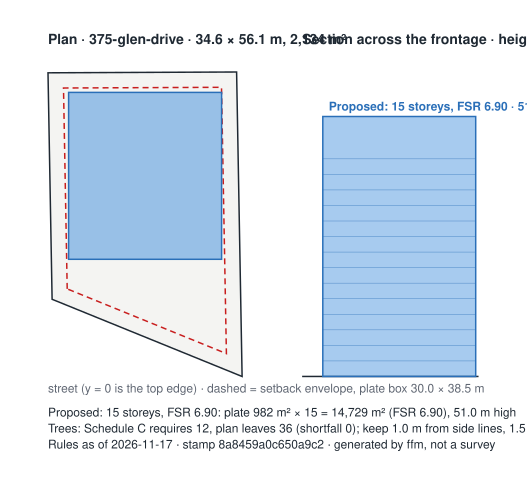
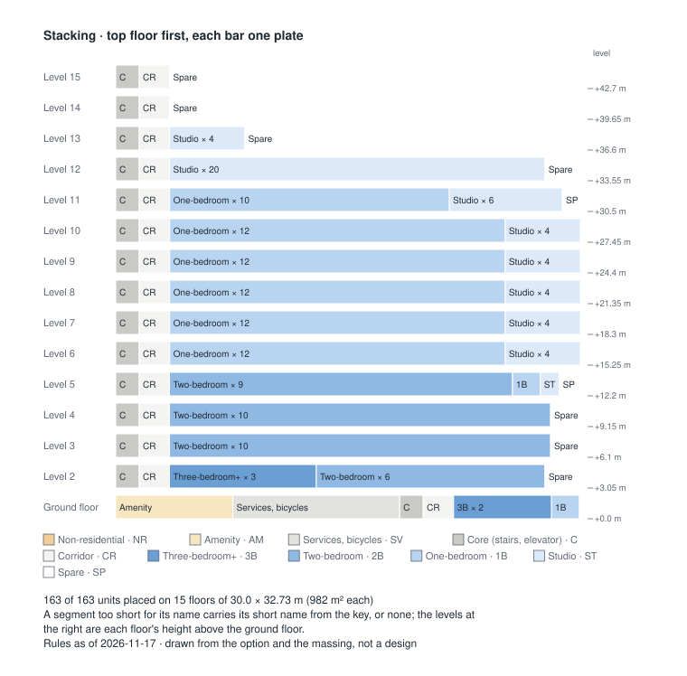
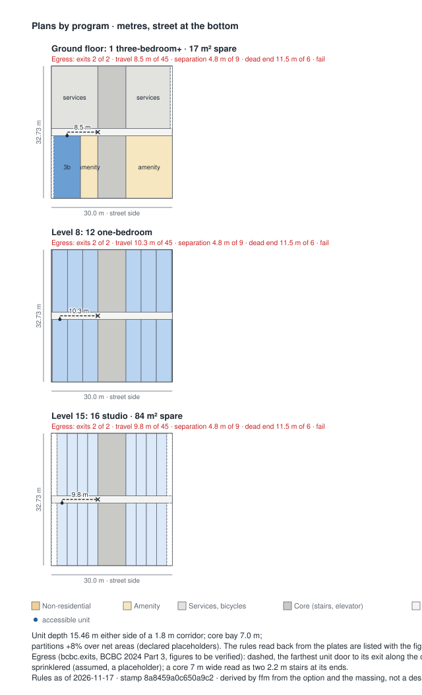
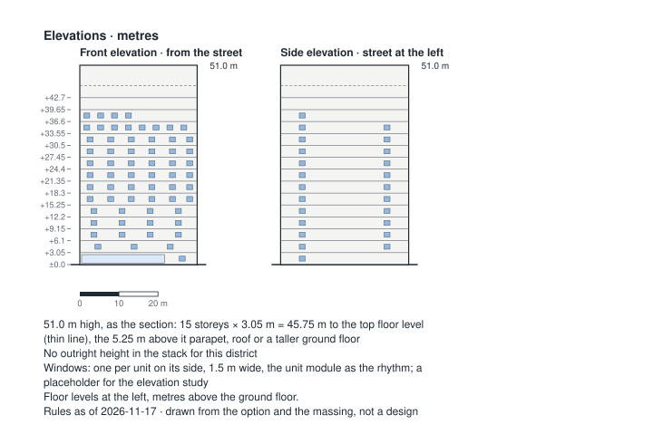
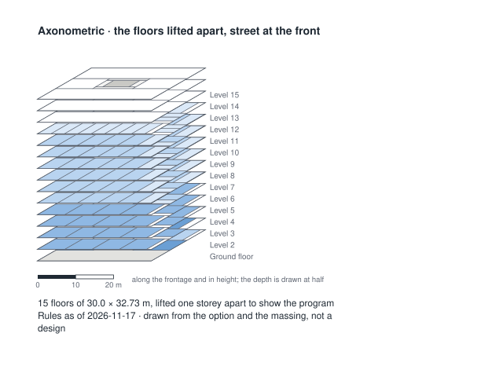
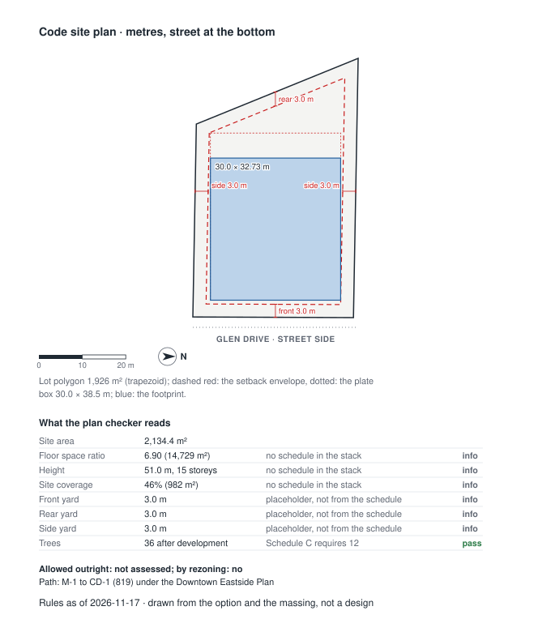

# First Read memo: 375 Glen Drive, Vancouver, BC

**Option:** 375 Glen Drive, as referred to public hearing (rezoned as 1015 East Hastings St; referral report, 5 Jan 2021): 15 and 13 storeys, 163 homes, an 80-bed shelter  
**Proponent:** BC Housing with the Vancouver Aboriginal Friendship Centre Society, on City land (non profit society)  
**Rules as of:** 2026-11-17 · **version stamp:** `8a8459a0c650a9c2` · engine 0.1.0  

> Deterministic output of the rule stack listed under *Sources*. Same inputs and rule set give the same memo. It is a feasibility screen, not legal, planning or funding advice; every number links to the document it came from, so check it there. An independent student tool: not affiliated with, reviewed by or a position of BC Housing, the Province, CMHC or the City of Vancouver.

## 1. Is it allowed?
**Outright, under CD-1 (819): not assessed.**  Not assessed: CD-1 (819)'s by-law is not in the rules; the envelope is the option's own figure, not a permitted one.

**By rezoning (M-1 to CD-1 (819) under the Downtown Eastside Plan): no.**
- *Fail* — Family-unit requirement in rezonings: Only 40 of 163 units (24.5%) have two or more bedrooms, below the 35.0% minimum; only 5 (3.1%) have three or more, below the 5.0% minimum.
- *Uncertain* — Protection of Trees By-law 9958: minimum trees, protection distances, cash in lieu: Schedule C requires 12 trees on a 2,134 m² site; no tree survey is on file.

## 2. Does it fit the funders?
**Does not meet the criteria of the Community Housing Fund.** The Community Housing Fund's 2025 call was cancelled in February 2026, so no intake is open now.
- *Fail* — BC Housing Community Housing Fund: eligibility and unit mix: Community Housing Fund: does not meet the criteria: unit mix market 54.6%, rgi 22.7%, deep subsidy 22.7% is not 30/50/20. Its 2025 call was cancelled in February 2026, so no intake is open now; the program page says it will post when next seeking proposals (as of 22 Sep 2026).

## 3. What is still unsure, and who resolves it?
| Item | Status | Who / what |
|---|---|---|
| CD-1 (819) is not in the rules | Uncertain | Architect: save CD-1 (819)'s by-law (cd1-bylaws.vancouver.ca) into inbox/ and have its height, floor area and yards entered as rules (or read it with Claude at stop 3 and confirm its clauses). |
| Yards not checked: no CD-1 (819) yard rule in the rules | Uncertain | Architect: read the yard clauses in CD-1 (819)'s by-law and set the setbacks to them, or confirm the figures drawn are a relaxation to ask for. |
| Family-unit requirement in rezonings | Fail | Change the unit mix: add family units until both minimums are met. |
| Protection of Trees By-law 9958: minimum trees, protection distances, cash in lieu | Uncertain | Architect: obtain the arborist report and survey (every tree on the site, within 2 m of the boundary, and on the adjoining street). |
| BC Builds: eligibility and below-market requirement | Uncertain | Manager: state the below-market share and discount; BC Builds applies opportunity by opportunity, so check the current Property Opportunity Notices. |
| BC Housing Community Housing Fund: eligibility and unit mix | Fail | Manager: resolve the failing criteria or target another program. |

## 4. Does the money work? (feasibility grade)
**Needs more sources.** The gap is $45,563,403, 47% of the capital cost, more than the 15% line (this tool's screening line, not a funder's rule). Placeholders in use: Soft costs, Contingency, Rent-geared-to-income, Operating cost, Replacement reserve.

**For the development manager:** Look for more sources as well: other grants (CMHC's Affordable Housing Fund among them), more equity, a land contribution or a partner. A revised memo counts what is found as other grants or equity.

- Capital cost **$96,218,453**: hard $71,272,928 (escalated ×1.0311), soft $17,818,232, contingency $7,127,293, land $0.
- Net operating income **$1,692,063 a year**: rent $2,958,840 less vacancy $109,477, operating cost $1,059,500 and reserve $97,800.
- Funding **$50,655,050**: grants $27,907,393, equity $0, supportable debt $22,747,657 at 6.19% repaid over 40 years, the loan the lender sizes so net income is 1.10 times the payment.
- Gap **$45,563,403** (47% of the capital cost).

| Line | Figure | From | Note |
|---|---|---|---|
| Hard cost base | $4,693 per m² | `f.hard_cost_base` | average of Quadplex 01 ($425/sf), Quadplex 02 ($438/sf) and Townhouse ($446/sf) |
| Escalation to the index in force on the run date | ×1.0311 | `f.escalation_bcpi` | BCPI 109.4 (2026-07-01, the last quarter published 120 days before the run date 2026-11-17) over 106.1 (2024-07-01) |
| Hard cost | $71,272,928 | `f.hard_cost_base` | 14,729 m² × $4,693 × 1.0311 |
| Soft costs | $17,818,232 | `f.soft_costs` (placeholder) | 25% of hard cost |
| Contingency | $7,127,293 | `f.soft_costs` (placeholder) | 10% of hard cost |
| Land | $0 | `f.land` | nominal: the owner is a municipality, and this screen carries the land of a church, a society or a government at $0 on a long lease or a transfer (F3) |
| Capital cost | $96,218,453 | the option | hard + soft + contingency + land |
| Market rent | $2,188,214 a year | `f.rents` | CMHC October 2025, 89 units; some unit types priced at the CMHC all-units average: the table has no figure for them |
| Rent-geared-to-income | $548,626 a year | `f.rents` (placeholder) | 30% of a household income taken at 50% of the fund's income limit (placeholder) |
| Deep-subsidy rent | $222,000 a year | `f.rents` | the shelter rate, $500 a month |
| Vacancy | $109,477 a year | `f.rents` | 3.7% of gross rent, the CMHC survey's rate |
| Operating cost | $1,059,500 a year | `f.operating` (placeholder) | $6,500 per unit |
| Replacement reserve | $97,800 a year | `f.operating` (placeholder) | $600 per unit |
| Net operating income | $1,692,063 a year | the option | gross rent less vacancy, operating cost and reserve |
| Community Housing Fund grant | $27,907,393 | `bch.chf.eligibility` | $171,211 per unit × 163; indicative, the fund is between calls |
| Equity | $0 | the option | none entered |
| Supportable debt | $22,747,657 | `f.mortgage` | the largest loan the net operating income carries: the lender wants net income 1.10 times the loan payment (the debt coverage ratio), at 6.19% repaid over 40 years (the amortization), $1,538,239 a year in payments |
| Funding | $50,655,050 | the option | grants + equity + supportable debt |
| Gap | $45,563,403 | the option | capital cost less funding; a negative gap is headroom, and a gap above the 15% line (this tool's screening line, not a funder's rule) of the capital cost reads Needs more sources |

> A feasibility screen, not a lender's model: hard costs from a Class D catalogue estimate escalated by the Statistics Canada index, rents from the CMHC survey, debt at the posted five-year rate under CMHC's coverage ratio. Placeholders are marked; replace them with the project's own budget before anyone relies on the gap.

## Massing derived from the rules
- **Proposed: 15 storeys, FSR 6.90** — plate 982 m² × 15 storeys = 14,729 m² (FSR 6.90), 51.0 m high, inside a 30.0 × 38.5 m setback envelope. Derived from: option.gfa_m2, option.storeys, option.setbacks_m, option.floor_to_floor_m.
- Note: Lot is not a clean rectangle: frontage x depth = 1,941 m² against a recorded 2,134 m²; the plan uses the rectangle, the FSR uses the recorded area.
- Note: The lot polygon measures 1,926 m² against a recorded site area of 2,134 m²; the FSR uses the recorded area, the plan the polygon. Check which is the development site.
- Note: Option height 51.0 m exceeds 15 x 3.05 m = 45.8 m; the extra 5.2 m is parapet, roof structure or taller ground floor, and the mass uses the stated height.

`massing.json` carries the same geometry for the Revit script (`revit/ffm_massing_pyrevit.py`).

## Layouts derived from the option
15 floors of 30.0 × 32.73 m (982 m² each); a point tower, the homes round a corridor ringing the core, 11.06 m deep in front and behind and 9.7 m beside; 163 of 163 units placed.

| Block | Count | Area | From |
|---|---|---|---|
| Three-bedroom+ | 5 | 511 m² | `bch.design_guidelines.unit_areas`: 5 × 94.6 m² net (86 m² minimum + 10%), 102.2 m² gross with partitions |
| Two-bedroom | 35 | 2,786 m² | `bch.design_guidelines.unit_areas`: 35 × 73.7 m² net (67 m² minimum + 10%), 79.6 m² gross with partitions |
| One-bedroom | 72 | 4,190 m² | `bch.design_guidelines.unit_areas`: 72 × 53.9 m² net (49 m² minimum + 10%), 58.2 m² gross with partitions |
| Studio | 51 | 1,999 m² | `bch.design_guidelines.unit_areas`: 51 × 36.3 m² net (33 m² minimum + 10%), 39.2 m² gross with partitions |
| Amenity | 1 | 244 m² | placeholder: 1.5 m² per unit, at least 40 m² |
| Services, bicycles | 1 | 348 m² | placeholder: 40 m² services + 308 bicycle spaces × 1.0 m² |
| Parking | 59 | 1,770 m² | placeholder: below grade, not on the plates |

Adjacency rules, in plain words, read back from the plates:

- *info* — non residential: on the ground floor, facing the street. No non-residential space in the option
- *pass* — amenity: on the ground floor, next to the entry. On the ground floor beside the core, where the entry is
- *conditional* — services: on the ground floor, away from the street. On the ground floor but facing the street: the lane side has no room left beside the core
- *pass* — core: at the centre of every floor, the corridor through it. One 7 × 7 m core at the centre of every floor holding a scissor stair, the corridor round it and the homes round that
- *pass* — units: on both sides of the corridor, above whatever the ground floor gives to other uses. Units on both sides of the corridor
- *pass* — three bed plus: on the lowest residential floors. Three-bedroom units on levels 1 to 2
- *info* — accessible: next to the core, on the lowest residential floor. No accessible units stated on the option
- Note: Lot is not a clean rectangle: frontage x depth = 1,941 m² against a recorded 2,134 m²; the plan uses the rectangle, the FSR uses the recorded area.
- Note: The lot polygon measures 1,926 m² against a recorded site area of 2,134 m²; the FSR uses the recorded area, the plan the polygon. Check which is the development site.
- Note: Option height 51.0 m exceeds 15 x 3.05 m = 45.8 m; the extra 5.2 m is parapet, roof structure or taller ground floor, and the mass uses the stated height.

### Egress

Egress (sprinklered, BCBC 2024 Part 3): pass; 15 floors: 15 pass; farthest travel 10.6 m, limit 45 m; the core's two exits are a scissor stair, its doors on the core's opposite faces, 14.0 m apart as smoke would go round the core (3.4.2.3.(3)); the two stairs need a smoke-tight fire separation between them, rated as the floors, with no openings. Read against `bcbc.exits` (BC Building Code 2024, Div B 3.4.2.1, 3.4.2.3, 3.4.2.5, 3.3.1.9; figures entered from recollection and to be verified against the code text). Sprinklered is assumed (a declared placeholder; `sprinklered: false` on the option switches the limits). Exits are the core zones, a core 7 m wide or wider read as two 2.2 m stairs at its ends (a placeholder); travel runs from a unit's door along the corridor to the nearest core.

- *pass* — Ground floor: 2 exits, 2 required · travel 8.6 m, limit 45 m · separation 14.0 m, at least 9 m · dead end 1.8 m, limit 6 m.
- *pass* — Level 2: 2 exits, 2 required · travel 8.8 m, limit 45 m · separation 14.0 m, at least 9 m · dead end 1.8 m, limit 6 m.
- *pass* — Level 3: 2 exits, 2 required · travel 8.8 m, limit 45 m · separation 14.0 m, at least 9 m · dead end 1.8 m, limit 6 m.
- *pass* — Level 4: 2 exits, 2 required · travel 8.8 m, limit 45 m · separation 14.0 m, at least 9 m · dead end 1.8 m, limit 6 m.
- *pass* — Level 5: 2 exits, 2 required · travel 8.8 m, limit 45 m · separation 14.0 m, at least 9 m · dead end 1.8 m, limit 6 m.
- *pass* — Level 6: 2 exits, 2 required · travel 10.5 m, limit 45 m · separation 14.0 m, at least 9 m · dead end 1.8 m, limit 6 m.
- *pass* — Level 7: 2 exits, 2 required · travel 10.5 m, limit 45 m · separation 14.0 m, at least 9 m · dead end 1.8 m, limit 6 m.
- *pass* — Level 8: 2 exits, 2 required · travel 10.5 m, limit 45 m · separation 14.0 m, at least 9 m · dead end 1.8 m, limit 6 m.
- *pass* — Level 9: 2 exits, 2 required · travel 10.5 m, limit 45 m · separation 14.0 m, at least 9 m · dead end 1.8 m, limit 6 m.
- *pass* — Level 10: 2 exits, 2 required · travel 10.5 m, limit 45 m · separation 14.0 m, at least 9 m · dead end 1.8 m, limit 6 m.
- *pass* — Level 11: 2 exits, 2 required · travel 10.5 m, limit 45 m · separation 14.0 m, at least 9 m · dead end 1.8 m, limit 6 m.
- *pass* — Level 12: 2 exits, 2 required · travel 10.6 m, limit 45 m · separation 14.0 m, at least 9 m · dead end 1.8 m, limit 6 m.
- *pass* — Level 13: 2 exits, 2 required · travel 10.6 m, limit 45 m · separation 14.0 m, at least 9 m · dead end 1.8 m, limit 6 m.
- *pass* — Level 14: 2 exits, 2 required · separation 14.0 m, at least 9 m · dead end 1.8 m, limit 6 m. No units on this floor: travel distance measured from unit doors only, the other uses' travel is not measured.
- *pass* — Level 15: 2 exits, 2 required · separation 14.0 m, at least 9 m · dead end 1.8 m, limit 6 m. No units on this floor: travel distance measured from unit doors only, the other uses' travel is not measured.

`layout.json` carries the blocks, the rules and every zone's coordinates; placeholders are listed in it under `assumptions`.

## Full ledger

22 of the 36 rules in force apply to this site and are listed. The other 14 are written for other districts or are not in force on this date; `ledger.json` lists them with their reasons.

### Layer A: Zoning district (City of Vancouver Zoning and Development By-law)

| Rule | Status | Finding | Numbers used | Source |
|---|---|---|---|---|
| Interim Rezoning Policy for Social Housing in Former Community Vision Areas (`cov.irp.social_housing_rezoning`, v 2023-11-01) | Not applicable | The site is outside the former Community Vision areas; social housing there is considered under the Affordable Housing Policies (1989) or an area plan. |  | [Interim Rezoning Policy for Social Housing, Seniors Housing, and Institutional, Cultural and Recreational Uses in Former Community Vision Areas (approved 1 Nov 2023, amended 31 Mar 2026), s.3.1.1; staff benchmark from the 998 E 19th Ave referral report](https://guidelines.vancouver.ca/policy-rezoning-former-community-visions-areas.pdf) |
| Off-street parking minimums (`cov.parking_minimums`, v 2024-06-26) | Info | No minimum off-street parking applies citywide since June 2024; the option provides 59 vehicle and 308 bicycle spaces. Bicycle spaces are set by the Parking By-law at the development permit stage. | parking spaces = 59; bicycle spaces = 308 | [City of Vancouver, housing and transit-friendly actions passed June 2024 (minimum parking requirements eliminated citywide), Parking By-law amendments, June 2024](https://vancouver.ca/news-calendar/city-passes-housing-transit-friendly-action-june-2024.aspx) |

### Layer B: Provincial overrides (Bill 44 SSMUH, Bill 47 transit-oriented areas)

| Rule | Status | Finding | Numbers used | Source |
|---|---|---|---|---|
| Transit-oriented area minimum allowable height and density (`bc.toa.minimum_density`, v 2024-06-30) | Not applicable | The site is outside the transit-oriented areas; no provincial minimum height applies. |  | [Province of BC webinar (Bill 47 transit-oriented areas); City of Vancouver release, June 2024, Bill 47; Local Government Act transit-oriented areas; Vancouver Charter amendments](https://vancouver.ca/news-calendar/city-passes-housing-transit-friendly-action-june-2024.aspx) |

### Layer C: City of Vancouver policies that attach to a rezoning

| Rule | Status | Finding | Numbers used | Source |
|---|---|---|---|---|
| Below-market rental housing policy for rezonings (secured market rental) (`cov.below_market_rental`, v 2023-01-01) | Not applicable | The below-market rental policy applies to 100% secured market rental rezonings; social housing is governed by the social housing definition instead. |  | [City of Vancouver, Policy: Below-Market Rental Housing for Rezonings, Policy requirements](https://guidelines.vancouver.ca/policy-below-market-rental-housing-for-rezonings.pdf) |
| Development cost levy and community amenity contribution treatment of social housing (`cov.dcl_cac_social_housing`, v 2023-01-01) | Info | Social housing is exempt from development cost levies and from community amenity contributions in a rezoning. The exemption's value is worth stating in the memo. | dcl exempt = True; cac exempt = True | [998 E 19th Ave referral report: CAC exempt under the policy's social housing exemption; DCL exempt as church and social housing (estimated value $3,075,715 at 30 Sep 2023 rates), Public benefits](https://council.vancouver.ca/20240625/documents/rr1.pdf) |
| Family-unit requirement in rezonings (`cov.family_units`, v 2026-10-27) | Fail | Only 40 of 163 units (24.5%) have two or more bedrooms, below the 35.0% minimum; only 5 (3.1%) have three or more, below the 5.0% minimum. | units total = 163; two plus bed units = 40; two plus bed share = 0.245; three plus bed units = 5; three plus bed share = 0.031; min two plus bed share = 0.35; min three plus bed share = 0.05 | [City of Vancouver, Housing options for families: at least 35% two-bedroom-plus units including at least 5% three-bedroom-plus in rezonings; City-wide Design and Development Guidelines replace the 1992 guidelines, Amendment effective 27 Oct 2026](https://vancouver.ca/people-programs/housing-options-for-families.aspx) |
| Social housing definition (Zoning and Development By-law s.2; DCL By-law 9755) (`cov.social_housing_definition`, v 2023-01-01) | Pass | Meets the City's social housing definition: 45.0% of units for households below HILs (minimum 30.0%), owned by a province, secured for 99 years. | share below hils = 0.45; owner type at completion = province; housing agreement years = 99 | [998 E 19th Ave referral report: social housing as defined in the Vancouver Development Cost Levy By-law No. 9755 (at least 30% of units for households below the Housing Income Limits, rents not exceeding 30% of income, owned by a non-profit or government, secured by housing agreement for the longer of 60 years and the life of the building), Tenure and affordability; Housing Agreement and Section 219 covenant](https://council.vancouver.ca/20240625/documents/rr1.pdf) |
| Protection of Trees By-law 9958: minimum trees, protection distances, cash in lieu (`cov.trees.replacement`, v 2023-01-01) | Uncertain | Schedule C requires 12 trees on a 2,134 m² site; no tree survey is on file. | site area m2 = 2,134.4; schedule c required = 12; existing = 0; retained = 0; removed = 0; replacements proposed = 36; trees after = 36; shortfall = 0; cash in lieu cad = 0; survey scope = every tree on the site, within 2 m of the boundary, and on the adjoining street | [City of Vancouver Protection of Trees By-law No. 9958 (consolidated), Schedule A (s.1.2), Schedule C (ss.5.1, 5.2, 6.2), s.6.2 cash in lieu, s.6.5 siting, s.7.2 arborist report](https://bylaws.vancouver.ca/9958c.PDF) |

### Layer D: Building code and funder design standards (flags, not checks, at this stage)

| Rule | Status | Finding | Numbers used | Source |
|---|---|---|---|---|
| Building code basis flags (BC Building Code 2024; Vancouver Building By-law 2025) (`bc.code_basis`, v 2025-09-15) | Info | 15 storeys puts the building under Part 3 of the BC Building Code 2024 and the Vancouver Building By-law 2025; wood frame is standard to 6 storeys and encapsulated mass timber is permitted to 18 under the VBBL; seismic changes apply to permits from 2026-09-15. | storeys = 15; part = 3 | [Province of BC, BC Building Code 2024; City of Vancouver, Guide to 2025 Vancouver Building By-law updates, Part 3 vs Part 9 basis (Div A 1.3.3.2); encapsulated mass timber](https://vancouver.ca/files/cov/guide-to-2025-vbbl-updates-v1.01.pdf) |
| Exits from a floor area: number, separation, travel distance, dead-end corridors (BC Building Code 2024, Part 3) (`bcbc.exits`, v 2025-03-10) | Info | two exits over floor area: 150 m²; two exits over occupant load: 60; separation minimum: 9 m; separation share of diagonal: 50%; travel limit sprinklered: 45 m; travel limit unsprinklered: 30 m; dead end maximum: 6 m; occupant load persons per sleeping room: 2. | two exits over floor area m2 = 150; two exits over occupant load = 60; separation min m = 9; separation share of diagonal = 0.5; travel limit sprinklered m = 45; travel limit unsprinklered m = 30; dead end max m = 6; occupant load persons per sleeping room = 2 | [BC Building Code 2024, Division B, Part 3 (Safety within floor areas; Exits), Div B 3.4.2.1 (minimum number of exits: two, unless the floor area is not more than 150 m² and the occupant load not more than 60); 3.4.2.3 (least distance between two required exits: one half the maximum overall diagonal dimension of the floor area, but need not be more than 9 m for a sprinklered floor area or one with a public corridor); 3.4.2.4 and 3.4.2.5 (travel distance, measured from a suite door to the nearest exit where suites open on a public corridor; 45 m in a sprinklered floor area, 30 m otherwise, residential occupancy); 3.3.1.9 (dead-end corridors not more than 6 m long); 3.1.17.1 (occupant load of a dwelling unit: two persons per sleeping room)](https://www.bccodes.ca/building-code.html) |
| BC Housing Design Guidelines: minimum net unit areas (`bch.design_guidelines.unit_areas`, v 2019-05-01) | Info | BC Housing minimum net unit areas apply if BC Housing funds the project. |  | [BC Housing Design Guidelines and Construction Standards (2019 edition; copy), Unit areas; building envelope; structure](https://compositedesign.ca/doc/bchousing/BCH-Design-Guidelines-Construction-Standards.pdf) |

### Layer E: Funding programs: eligibility criteria the memo tests (not the submission package)

| Rule | Status | Finding | Numbers used | Source |
|---|---|---|---|---|
| BC Builds: eligibility and below-market requirement (`bc.bcbuilds.eligibility`, v 2024-02-13) | Uncertain | BC Builds: whether it meets the criteria cannot be confirmed without the share of units at least 20% below market. Non-residential space is 0.0% of area, under the 30% cap; ground must break within 12 to 18 months of the conditional land contribution letter. | submission = Proposal in any format by email against each Property Opportunity Notice; optional capital and operating budget template | [BC Builds, developers and operators (page current as of 22 Sep 2026); Province of BC BC Builds announcement 2024, Applicant requirements; grants; timelines](https://www.bcbuildshomes.ca/developers-operators) |
| BC Housing Community Housing Fund: eligibility and unit mix (`bch.chf.eligibility`, v 2025-05-30) | Fail | Community Housing Fund: does not meet the criteria: unit mix market 54.6%, rgi 22.7%, deep subsidy 22.7% is not 30/50/20. Its 2025 call was cancelled in February 2026, so no intake is open now; the program page says it will post when next seeking proposals (as of 22 Sep 2026). | status = 2025 call (RFP #1070-2526-022) cancelled Feb 2026; program page says it will post when next seeking proposals (as of 22 Sep 2026); provisional grant per unit cad = 171211; indicative grant cad = 27907393 | [BC Housing, Community Housing Fund 2025 RFP #1070-2526-022 webinar slides; 2023 RFP #1070-2324-041; CHF program page, Eligibility; unit mix 30/50/20; minimum requirements; rated criteria](https://www.bchousing.org/sites/default/files/media/documents/CHF-RFP-2526-022A-Webinar-Slides.pdf) |
| BC Housing Project Development Fund (pre-development loans) (`bch.pdf.predevelopment_loan`, v 2025-01-01) | Info | maximum loan: $250,000; eligible costs: due diligence, feasibility and design. | max loan cad = 250000; eligible costs = due diligence, feasibility and design | [UBCM resolution NR24 and the Province's response (Project Development Fund loans up to $250,000), Provincial response](https://www.ubcm.ca/node/111136) |
| CMHC Affordable Housing Fund: readiness and submission mechanics (`cmhc.ahf.readiness`, v 2024-03-13) | Info | construction start months after approval: 6; intake: continuous; submission: online application with Project Assessment Workbook and Integrity Declaration; separate Required Documentation Checklist. | construction start months after approval = 6; intake = continuous; submission = online application with Project Assessment Workbook and Integrity Declaration; separate Required Documentation Checklist; criteria note = Affordability, accessibility and energy thresholds sit in the program scoring, not in the applicant guide; pull from cmhc.ca/ahf before encoding | [CMHC, Affordable Housing Fund applicant guide, Minimum submission requirements; readiness](https://cmhc-schl.gc.ca/-/media/sites/cmhc/nhs/co-investment-fund/nhs-co-invest-fund-app-guide-en.ashx) |

### Layer F: Assumptions: costs, revenues and financing the pro-forma uses (dated, cited, refreshed)

| Rule | Status | Finding | Numbers used | Source |
|---|---|---|---|---|
| Construction price escalation (Statistics Canada BCPI, Vancouver, residential) (`f.escalation_bcpi`, v 2024-08-21) | Info | Building construction price index, Vancouver, residential buildings, division composite (2023=100): 109.4 in the third quarter of 2026, from 106.1 in the third quarter of 2024, the hard-cost base period; escalation 1.031 (a memo run on an earlier date uses the last quarter published on or before that date). | table = 18-10-0289-01; product id = 18100289; coordinate = 24.1.1.0.0.0.0.0.0.0; vector = v1617916836; series = Vancouver, British Columbia; Residential buildings; Division composite; base = 2023=100; latest period = 2026-07-01; latest value = 109.4; released = 2026-10-29 | [Statistics Canada, Table 18-10-0289-01 Building construction price indexes, by type of building and division (quarterly, 2023=100), released 29 Oct 2026, Vancouver, British Columbia; residential buildings; division composite (vector v1617916836)](https://www150.statcan.gc.ca/t1/tbl1/en/tv.action?pid=1810028901) |
| Hard construction cost, base ($/m², Vancouver) (`f.hard_cost_base`, v 2024-08-21) | Info | Hard cost base $4,693 per m² ($436 per build sq ft): the average of the three four-unit wood-frame designs in the Class D estimate for the Province's standardized housing designs, Vancouver baseline, August 2024, hard costs only. | value per m2 cad = 4693; value per sqft cad = 436; base period = 2024-07-01; basis = average of Quadplex 01 ($425/sf), Quadplex 02 ($438/sf) and Townhouse ($446/sf); the catalogue's ten designs run $401 to $585 per build sq ft; the report's regional review gives Vancouver $350 to $475 per sq ft; excludes = soft costs, utility connections, existing buildings, rock or shoring, pad-mounted transformers (the report's stated assumptions) | [SHP Class D Estimate Report, V3 (Chris Hill, CPA CMA, for the BC Ministry of Housing Standardized Designs Catalogue), 21 Aug 2024, Cost Estimate Summary (per build sf); Region Review; Assumptions](https://www2.gov.bc.ca/assets/gov/farming-natural-resources-and-industry/construction-industry/building-codes-and-standards/reports/bc_std_des_class_d_estimates_v1.pdf) |
| Land: nominal lease from a church, a society or a government; else the assessed value, entered (`f.land`, v 2026-10-01) | Info | Land is carried at a nominal value where the owner is a church, a non-profit society, a co-operative, a First Nation, the City or the Province and the tenure plan is a long lease or a transfer; otherwise the BC Assessment value or the agreed price is entered by hand, and until it is the pro-forma is unsure. | nominal value cad = 0 | [BC Assessment, property assessment search (assessed value of the parcel); the owner's tenure plan, Assessed value as of 1 July of the previous year](https://www.bcassessment.ca/) |
| Mortgage rate, amortization and debt coverage (Bank of Canada; CMHC MLI Select) (`f.mortgage`, v 2026-10-14) | Info | Conventional 5-year mortgage rate 6.19% (chartered banks, Bank of Canada series V80691335, 28 Oct 2026) as the ceiling; CMHC MLI Select terms for the debt test: a 1.10 debt coverage ratio and a 40-year amortization (50 years is available at 100 affordability points). | rate pct = 6.19; rate series = V80691335; rate date = 2026-10-28; amortization years = 40; debt coverage ratio = 1.1; insured rate note = an insured multi-unit loan is usually priced below the posted conventional rate; the posted rate is the conservative ceiling | [Bank of Canada, Valet API, series V80691335 Conventional mortgage, 5-year (weekly); CMHC, MLI Select product sheet, Conventional mortgage, 5-year; MLI Select: minimum debt coverage ratio 1.10 for standard rental, amortization to 50 years at 100 points](https://www.bankofcanada.ca/valet/observations/V80691335/json?recent=1) |
| Operating cost and replacement reserve per unit (`f.operating`, v 2026-10-01) | Info | Operating cost $6,500 per unit a year (management, maintenance, utilities, insurance, property tax where not exempt) and a $600 per unit replacement reserve: declared placeholders until the operator's budget replaces them. | operating cost per unit year cad = 6500; replacement reserve per unit year cad = 600 | Declared placeholder (no public source): to be replaced by the operator's budget or BC Housing's operating benchmarks where published |
| Rents by tier: CMHC average market rent, rent-geared-to-income, the shelter rate (`f.rents`, v 2026-01-29) | Info | Market rent from the CMHC Rental Market Survey of October 2025, Vancouver CMA, purpose-built apartments: two-bedroom $2,363 a month, all unit types $1,963, vacancy 3.7% (the other bedroom types are left to be typed from the CMHC data tables); rent-geared-to-income at 30% of a household income taken, as a placeholder, at half the Community Housing Fund's low-to-moderate income limit for the unit size; the deep-subsidy rent at the income assistance shelter rate of $500. | survey = October 2025; vacancy rate = 0.037; rgi rent share of income = 0.3; rgi income share of chf limit = 0.5; deep subsidy rent monthly cad = 500 | [CMHC, Rental Market Report, January 2026 (October 2025 survey), Vancouver CMA; Province of BC, income assistance shelter allowance (single person, maximum $500 from 1 Dec 2025), Vancouver: purpose-built rental vacancy 3.7%, average two-bedroom rent $2,363; summary by zone, all units $1,963](https://www.cmhc-schl.gc.ca/professionals/housing-markets-data-and-research/market-reports/rental-market-reports-major-centres) |
| Soft costs and contingency, as shares of hard cost (`f.soft_costs`, v 2026-10-01) | Info | Soft costs 25% of hard cost (design, permits, levies where they apply, financing, legal, insurance, marketing) and a 10% contingency: declared placeholders until a practitioner gives this project's figures. | soft cost share of hard = 0.25; contingency share of hard = 0.1 | Declared placeholder (no public source): to be replaced by the proponent's development budget |

## Words in this memo
- **FSR**: floor space ratio: the building's floor area divided by the site's area. FSR 3.0 on a 1,000 m² lot is 3,000 m² of floor.
- **Outright**: what the zoning district allows with a permit and no vote of Council.
- **Rezoning**: asking Council to change what the land may hold, after a public hearing; what it allows is negotiated, not read from a table.
- **CD-1**: a zoning district written for one site, with its own by-law.
- **RGI**: rent geared to income: the tenant pays a share of household income, about 30%, whatever the home would rent for.
- **Deep subsidy**: homes for the lowest incomes, such as people on income or disability assistance or a basic pension; the rent is a small fixed amount.
- **HILs**: Housing Income Limits: the highest household income, set by BC Housing by home size and place, at which a household qualifies for subsidized housing.
- **Net operating income**: the rent left each year after vacancy, running costs and the reserve, before any loan payment.
- **Debt coverage**: how many times the yearly net income covers the yearly loan payment; a lender asks for more than once.
- **Plate**: one floor of the building, as an outline.
- **Setback**: the strip of the lot along each property line that must stay unbuilt.
- **Placeholder**: a figure the tool assumes until the project's own replaces it; every one is marked.

## Inputs
- Site `375-glen-drive`: CD-1 (819), 2,134.4 m², 34.6 × 56.1 m; owner: City of Vancouver.
- Option `375-glen-drive-as-proposed`: 15 storeys, 51.0 m, 14,729.0 m² GFA; units studio 51, one bed 72, two bed 35, three bed plus 5; tenure social housing.
- Site notes: Found by First Read on the address '375 Glen Drive': the City's property address '375 Glen Drive, Vancouver, BC (City of Vancouver property address, Strathcona)'. Zoning district CD-1 (819) (CD-1 by-law 819) from the City's zoning districts dataset at that point. A CD-1 district has no general schedule: its limits are in CD-1 by-law No. 819. Lot area 1,941.7 m² from the parcel polygon (4 vertices, not a rectangle: the frontage and depth are an equivalent rectangle with the same area); frontage taken as the side along Glen Drive from OpenStreetMap, 36.2 m away. A corner lot: E Hastings St also runs beside it, 33.3 m from the centre. The frontage is taken on Glen Drive (34.6 m); the front could instead be the 56.1 m side on E Hastings St Confirm which side is the front: it sets the yards, the envelope and the massing. Four sides but not square-cornered (86% of its 60.4 x 37.2 m bounding rectangle), 1,942 m2. The massing uses the polygon itself: the setback envelope follows the lot lines and the plate is the largest rectangle inside it. Transit-oriented area, the Community Vision map, water and sewer, trees and the owner are not in these datasets: answer them, or leave them 'not sure'. Answers added by hand for the 17 Nov 2026 demonstration: owner City of Vancouver (Daily Hive, 17 Feb 2021); not a former Community Vision area (the site is inside the Downtown Eastside Plan area; confirm on the City's map); transit-oriented area No (no SkyTrain station within 800 m; confirm on the City's TOA map); frequent bus stop Yes (E Hastings St; confirm against TransLink's frequent transit network). Site area set by hand to 2,134.4 m2: the draft CD-1 by-law (s.5.1) says the floor space ratio must be computed on the site as it was at the rezoning application, before any dedications. The City's parcel today is 1,941.7 m2, the figure the lookup found; the referral report requires a 5 m dedication to CN Rail along the western property line, which accounts for the difference. The parcel polygon is today's, so the massing warns that it is smaller than the recorded area. The report gives the lot as about 50 m on Hastings St and 37 m on Glen Drive, with no trees on the site or the street, and Hastings St as Frequent Transit Network. area_plan set by hand to downtown_eastside: the referral report places the site in the Hastings East sub-area of the Downtown Eastside Plan.
- Option notes: From the referral report: a 15-storey wing on the lane (110 social housing homes, 25 of them supportive) and a 13-storey wing on Glen Drive (53 secured market rental homes); 14,729 m2 at FSR 6.90 on 2,134.4 m2; height to 51.0 m at the parapet above the rooftop amenity; 10 ft floor to floor; 59 vehicle and 308 bicycle spaces; about 36 trees proposed; an 80-bed shelter and a 423 m2 social enterprise; a Housing Agreement for the longer of 99 years and the life of the building; the social housing owned by BC Housing. Unit mix: the 25 supportive homes are 21 studios and 4 one-bedrooms (report); the 85 other social homes 15/35/30/5 and the 53 market rentals 15/33/5 (the application as reported by Daily Hive); the report confirms 35 two-bedroom and 5 three-bedroom homes in all. Rents: a third of the 110 social homes at the shelter rate (including all 25 supportive), a third geared to income up to HILs, a third at the low end of market; entered as 37/37/36, the rounding is assumed, and the 53 market rentals are added to the market tier. Assumptions, not from the report: the floor area is not split between residential and the shelter, so both are left blank; the setbacks are placeholders for the massing; the 15 storeys are drawn as one block although the Glen Drive wing is 13; the Community Housing Fund is the nearest program in the rule stack (the report says the partners were still seeking senior government contributions); tenure is entered as social housing although 53 of the 163 homes are market rental. The building permit (BP-2021-05332, full construction 18 Oct 2023) differs: 16 storeys (15 under the Zoning and Development By-law), 25 supportive + 87 affordable + 56 market rental + 2 townhouses = 170 homes, $55,000,000.

## Sources
- Interim Rezoning Policy for Social Housing, Seniors Housing, and Institutional, Cultural and Recreational Uses in Former Community Vision Areas (approved 1 Nov 2023, amended 31 Mar 2026) — https://guidelines.vancouver.ca/policy-rezoning-former-community-visions-areas.pdf *(verify: Map 1 of the policy decides whether a site is inside a former Community Vision area; outside it the Affordable Housing Policies (1989) apply.)*
- City of Vancouver, housing and transit-friendly actions passed June 2024 (minimum parking requirements eliminated citywide) — https://vancouver.ca/news-calendar/city-passes-housing-transit-friendly-action-june-2024.aspx
- City of Vancouver referral report, 998 E 19th Ave (states RM-1 outright FSR 1.20); RM-1 District Schedule — https://council.vancouver.ca/20240625/documents/rr1.pdf *(verify: Confirm against the RM-1 district schedule in the consolidated Zoning and Development By-law before the user sessions: https://bylaws.vancouver.ca/zoning/zoning-by-law-consolidated.pdf)*
- City of Vancouver referral report, 998 E 19th Ave (states RM-1 outright height 10.7 m / 35 ft); RM-1 District Schedule — https://council.vancouver.ca/20240625/documents/rr1.pdf *(verify: Confirm against the RM-1 district schedule in the consolidated Zoning and Development By-law.)*
- City of Vancouver Zoning and Development By-law, RM-3 District Schedule — https://bylaws.vancouver.ca/zoning/zoning-by-law-district-schedule-rm-3.pdf *(verify: Entered from recollection of the schedule on 16 Nov 2026, not read from the PDF; confirm every figure against https://bylaws.vancouver.ca/zoning/zoning-by-law-district-schedule-rm-3.pdf before relying on it)*
- City of Vancouver Zoning and Development By-law, RM-3A District Schedule — https://bylaws.vancouver.ca/zoning/zoning-by-law-district-schedule-rm-3a.pdf *(verify: Entered from recollection of the schedule on 16 Nov 2026, not read from the PDF; confirm every figure against https://bylaws.vancouver.ca/zoning/zoning-by-law-district-schedule-rm-3a.pdf before relying on it)*
- City of Vancouver Zoning and Development By-law, RM-4 District Schedule — https://bylaws.vancouver.ca/zoning/zoning-by-law-district-schedule-rm-4.pdf *(verify: Entered from recollection of the schedule on 16 Nov 2026, not read from the PDF; confirm every figure against https://bylaws.vancouver.ca/zoning/zoning-by-law-district-schedule-rm-4.pdf before relying on it)*
- City of Vancouver Zoning and Development By-law, RT-4 District Schedule — https://bylaws.vancouver.ca/zoning/zoning-by-law-district-schedule-rt-4.pdf *(verify: Entered from recollection of the schedule on 16 Nov 2026, not read from the PDF; confirm every figure against https://bylaws.vancouver.ca/zoning/zoning-by-law-district-schedule-rt-4.pdf before relying on it)*
- City of Vancouver Zoning and Development By-law, RT-3 District Schedule (consolidation dated June 2026) — https://bylaws.vancouver.ca/zoning/zoning-by-law-district-schedule-rt-3.pdf
- Province of BC, Small-Scale Multi-Unit Housing overview webinar (22 Jan 2024) and SSMUH Provincial Policy Manual — https://www2.gov.bc.ca/assets/gov/housing-and-tenancy/tools-for-government/local-governments-and-housing/webinars/lghi_webinar_2024-01-22_ssmuh-overview.pdf
- Province of BC webinar (Bill 47 transit-oriented areas); City of Vancouver release, June 2024 — https://vancouver.ca/news-calendar/city-passes-housing-transit-friendly-action-june-2024.aspx *(verify: Tier storey figures are the Province's SkyTrain-station tiers as commonly reported; confirm against the Transit-Oriented Areas Designation Regulation before the user sessions.)*
- City of Vancouver, Policy: Below-Market Rental Housing for Rezonings — https://guidelines.vancouver.ca/policy-below-market-rental-housing-for-rezonings.pdf
- 998 E 19th Ave referral report: CAC exempt under the policy's social housing exemption; DCL exempt as church and social housing (estimated value $3,075,715 at 30 Sep 2023 rates) — https://council.vancouver.ca/20240625/documents/rr1.pdf *(verify: Current DCL rates and exemptions: City of Vancouver DCL bulletin (not yet opened in this project).)*
- City of Vancouver, Housing options for families: at least 35% two-bedroom-plus units including at least 5% three-bedroom-plus in rezonings; City-wide Design and Development Guidelines replace the 1992 guidelines — https://vancouver.ca/people-programs/housing-options-for-families.aspx
- 998 E 19th Ave referral report: social housing as defined in the Vancouver Development Cost Levy By-law No. 9755 (at least 30% of units for households below the Housing Income Limits, rents not exceeding 30% of income, owned by a non-profit or government, secured by housing agreement for the longer of 60 years and the life of the building) — https://council.vancouver.ca/20240625/documents/rr1.pdf
- City of Vancouver Protection of Trees By-law No. 9958 (consolidated) — https://bylaws.vancouver.ca/9958c.PDF
- Province of BC, BC Building Code 2024; City of Vancouver, Guide to 2025 Vancouver Building By-law updates — https://vancouver.ca/files/cov/guide-to-2025-vbbl-updates-v1.01.pdf
- BC Building Code 2024, Division B, Part 3 (Safety within floor areas; Exits) — https://www.bccodes.ca/building-code.html *(verify: The figures and clause numbers were entered from recollection of the NBC 2020 / BCBC 2024 clauses (3.4.2.1, 3.4.2.3, 3.4.2.4, 3.4.2.5, 3.3.1.9, 3.1.17.1), not read from the code text, and must be confirmed against it; in particular the exact wording of 3.4.2.3 (the 9 m cap is quoted as applying to a sprinklered floor area), the sentence of 3.3.1.9 that sets the 6 m dead end, the in-force date of BCBC 2024 (entered as 10 March 2025), and the Province's single-exit-stair provisions for residential buildings up to six storeys, which this rule does not model.)*
- BC Housing Design Guidelines and Construction Standards (2019 edition; copy) — https://compositedesign.ca/doc/bchousing/BCH-Design-Guidelines-Construction-Standards.pdf *(verify: The current edition on bchousing.org could not be fetched; confirm the figures against it before the user sessions.)*
- BC Builds, developers and operators (page current as of 22 Sep 2026); Province of BC BC Builds announcement 2024 — https://www.bcbuildshomes.ca/developers-operators
- BC Housing, Community Housing Fund 2025 RFP #1070-2526-022 webinar slides; 2023 RFP #1070-2324-041; CHF program page — https://www.bchousing.org/sites/default/files/media/documents/CHF-RFP-2526-022A-Webinar-Slides.pdf
- UBCM resolution NR24 and the Province's response (Project Development Fund loans up to $250,000) — https://www.ubcm.ca/node/111136
- CMHC, Affordable Housing Fund applicant guide — https://cmhc-schl.gc.ca/-/media/sites/cmhc/nhs/co-investment-fund/nhs-co-invest-fund-app-guide-en.ashx
- Statistics Canada, Table 18-10-0289-01 Building construction price indexes, by type of building and division (quarterly, 2023=100), released 29 Oct 2026 — https://www150.statcan.gc.ca/t1/tbl1/en/tv.action?pid=1810028901
- SHP Class D Estimate Report, V3 (Chris Hill, CPA CMA, for the BC Ministry of Housing Standardized Designs Catalogue), 21 Aug 2024 — https://www2.gov.bc.ca/assets/gov/farming-natural-resources-and-industry/construction-industry/building-codes-and-standards/reports/bc_std_des_class_d_estimates_v1.pdf *(verify: The catalogue's designs are two- to four-unit, three-storey wood-frame buildings; a six-storey apartment sits outside it. Replace with a quantity surveyor's Class D figure for the actual building type when one exists, and keep this as the floor.)*
- BC Assessment, property assessment search (assessed value of the parcel); the owner's tenure plan — https://www.bcassessment.ca/
- Bank of Canada, Valet API, series V80691335 Conventional mortgage, 5-year (weekly); CMHC, MLI Select product sheet — https://www.bankofcanada.ca/valet/observations/V80691335/json?recent=1 *(verify: Confirm the DCR and amortization against the current MLI Select guide before a submission.)*
- Declared placeholder (no public source): to be replaced by the operator's budget or BC Housing's operating benchmarks where published
- CMHC, Rental Market Report, January 2026 (October 2025 survey), Vancouver CMA; Province of BC, income assistance shelter allowance (single person, maximum $500 from 1 Dec 2025) — https://www.cmhc-schl.gc.ca/professionals/housing-markets-data-and-research/market-reports/rental-market-reports-major-centres *(verify: Type the bachelor, one-bedroom and three-bedroom averages from the CMHC Rental Market Survey data tables (Vancouver CMA, Table 1.1.2); the rent-geared-to-income income placeholder is declared, not sourced: replace it with the operator's tenant income profile.)*
- Declared placeholder (no public source): to be replaced by the proponent's development budget
- City of Vancouver Open Data: property addresses — https://opendata.vancouver.ca/explore/dataset/property-addresses/
- City of Vancouver Open Data: zoning districts and labels — https://opendata.vancouver.ca/explore/dataset/zoning-districts-and-labels/
- City of Vancouver Open Data: property parcel polygons — https://opendata.vancouver.ca/explore/dataset/property-parcel-polygons/
- City of Vancouver Open Data: public streets, building footprints 2009, public trees (Open Government Licence – Vancouver) — https://opendata.vancouver.ca/explore/
- Daily Hive, City Council approves First Nations shelter and social housing in Downtown Eastside (17 Feb 2021): owner, lot 22,970 sq ft — https://dailyhive.com/vancouver/1015-east-hastings-street-vancouver-first-nations-shelter-social-housing
- City of Vancouver Open Data, issued building permits: BP-2021-05332, 375 Glen Drive — https://opendata.vancouver.ca/explore/dataset/issued-building-permits/
- City of Vancouver referral report, CD-1 Rezoning: 1015 East Hastings Street (5 Jan 2021), read from the PDF Kai saved on 17 Nov 2026 — https://council.vancouver.ca/20210119/documents/rr5.pdf
- Daily Hive, Rentals to help fund new Vancouver social housing and shelter for Indigenous people (4 Jul 2020) — https://dailyhive.com/vancouver/1015-east-hastings-street-vancouver-shelter-social-housing
- Daily Hive, City Council approves First Nations shelter and social housing in Downtown Eastside (17 Feb 2021) — https://dailyhive.com/vancouver/1015-east-hastings-street-vancouver-first-nations-shelter-social-housing

## Version stamp
- Rules hash (SHA-256 over all rule files): `c22d992157a0fb74e68bc1843ab8faaf4f79f1da662aeb5da24277a72085c40d`
- `a_zoning_district.json`: `34cf7331061aa33c…`
- `b_provincial.json`: `0fede33e5d62b1bd…`
- `c_city_policies.json`: `961f8f2e91ce2d3f…`
- `d_design_standards.json`: `666cc2f2cc440570…`
- `e_funding_programs.json`: `9267a33722068790…`
- `f_assumptions.json`: `942a6dbab04d93fc…`
- Stamp (hash of rules hash + rule versions in force on 2026-11-17): `8a8459a0c650a9c2`
