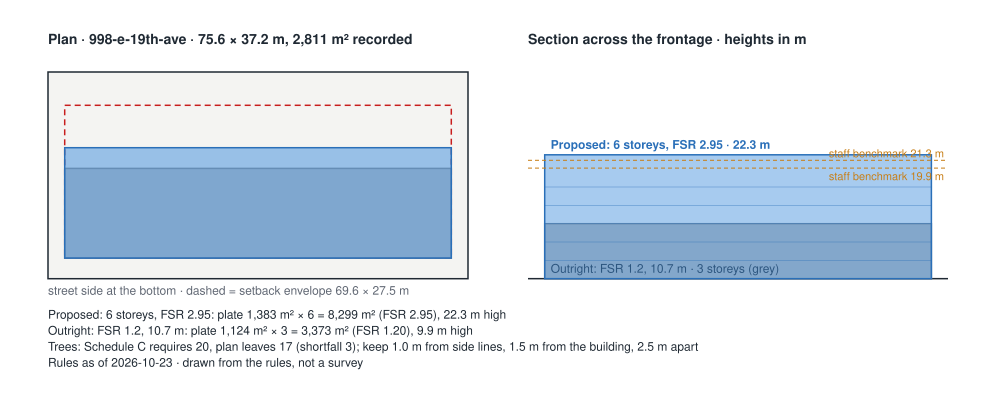
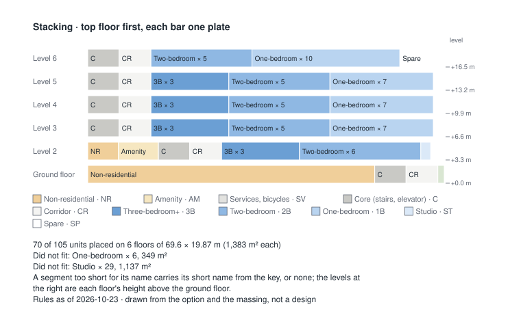
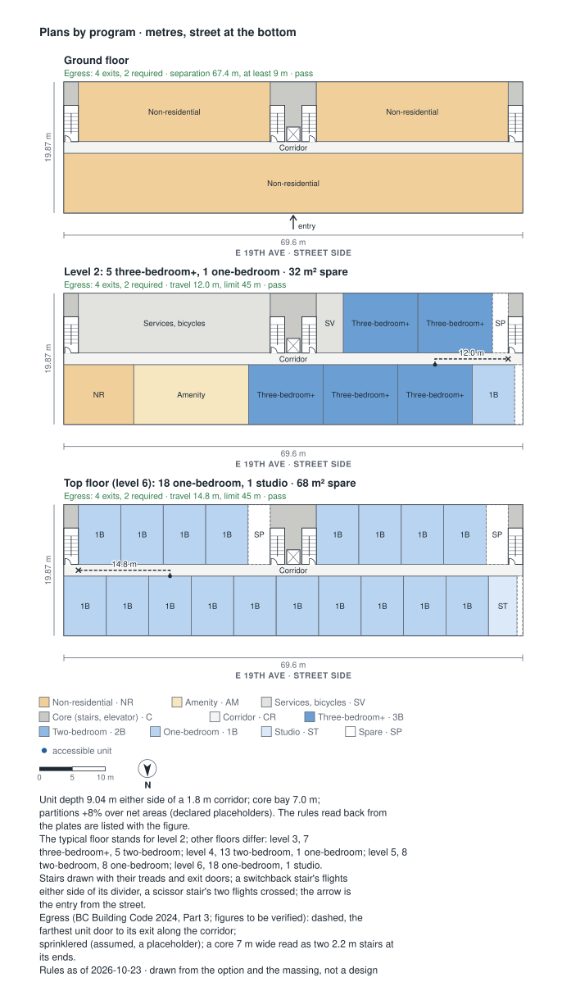
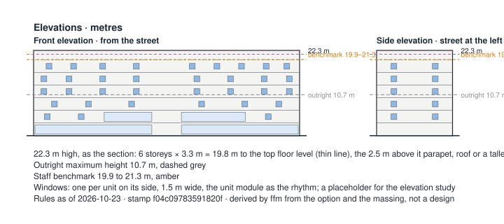
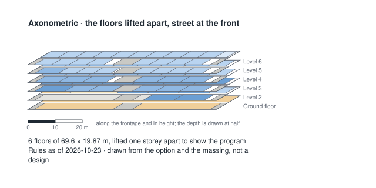
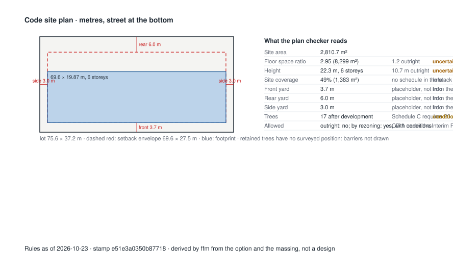

# First Read memo: 998 E 19th Ave, Vancouver, BC V5V 1K7

**Option:** As approved by Council, 25 Jul 2024: six-storey social housing  
**Proponent:** Catalyst Community Developments Society (non profit society)  
**Rules as of:** 2026-10-23 · **version stamp:** `d8114c4301640d47` · engine 0.1.0  

> Deterministic output of the rule stack listed under *Sources*. Same inputs and rule set give the same memo. It is a feasibility screen, not legal, planning or funding advice; every number links to the document it came from, so check it there. An independent student tool: not affiliated with, reviewed by or a position of BC Housing, the Province, CMHC or the City of Vancouver.

## 1. Is it allowed?
**Outright, under RM-1: no.** FSR 2.95 exceeds the outright maximum of 1.2, so it is not allowed outright; rezoning is required (CD-1 under the Interim Rezoning Policy for Social Housing), where density is negotiated. (cov.rm1.outright_fsr) Height 22.3 m exceeds the outright maximum of 10.7 m, so it is not allowed outright; rezoning is required (CD-1 under the Interim Rezoning Policy for Social Housing), where height is negotiated. (cov.rm1.outright_height)

**By rezoning (CD-1 under the Interim Rezoning Policy for Social Housing): yes, with conditions.**
- *Conditional* — Interim Rezoning Policy for Social Housing in Former Community Vision Areas: Eligible for consideration as 100% social housing under the policy; height 22.3 m is above the staff benchmark of 19.9 to 21.3 m. The policy sets no maximum, so the number is negotiated with staff.
- *Conditional* — Protection of Trees By-law 9958: minimum trees, protection distances, cash in lieu: Schedule C requires 20 trees on 2,811 m²; the option keeps 1 of 9 and plants 16, leaving 17, a shortfall of 3: plant 3 more at the by-law setbacks or pay $3,000 cash in lieu; the final count is set at the development permit.

## 2. Does it fit the funders?
**Whether it passes this screen's eligibility checks for BC Builds and the Community Housing Fund is not yet confirmed.** The Community Housing Fund's 2025 call did not proceed (February 2026), so no intake is open now. The first layout places 70 of 105 homes on the plates as drawn (answer 3); this answer counts all 105.
- *Uncertain* — BC Builds: eligibility and below-market requirement: BC Builds: whether it meets the criteria cannot be confirmed without the share of units at least 20% below market. Non-residential space is 15.1% of area, under the 30% cap; ground must break within 12 to 18 months of the conditional land contribution letter.
- *Uncertain* — BC Housing Community Housing Fund: eligibility and unit mix: Community Housing Fund: whether it meets the criteria cannot be confirmed without the rent-tier split (market / rent-geared-to-income / deep subsidy units); accessible unit count (5% minimum); land tenure (lease of at least 60 years at nominal value, or ownership). Site control (letter of intent) meets the readiness bar; construction must be able to start within 18 months of award. Its 2025 call did not proceed (February 2026), so no intake is open now; the program page says it will post when next seeking proposals (as of 22 Sep 2026).

Other programs written for this kind of housing, listed from their own pages and **not tested**:
- **The Indigenous Housing Fund** (if the housing is Indigenous-led, or partnered with an Indigenous housing provider or Nation): affordable rental homes for Indigenous families, Elders, individuals and people with disabilities, on and off reserve; every home rent geared to income (fixed rents may be considered on reserve). A project enters by BC Housing's request for proposals. No intake is open now (closed: no call is posted on the program page (read 23 Nov 2026)).
- **The Women's Transition Housing Fund** (if the housing is for women, gender-diverse people and children leaving violence): housing with supports for women and their children who are at risk of, or have experienced, violence, in four streams: safe homes (stays of about 10 days), transition houses (about 30 days), second-stage housing (up to about 18 months) and long-term rental housing. A project enters by agreement with BC Housing: the framework names no application route, so ask BC Housing. Intake: not stated on the program page (read 23 Nov 2026).
- **Build Canada Homes**: a federal Crown corporation that brings financing, land and partnerships to affordable housing; it counts housing as affordable at no more than 30% of a household's before-tax income. A project enters not stated on the page read; CMHC's Affordable Housing Fund page directs organizations to it. Intake: not stated on the page read (23 Nov 2026).
- **The City of Vancouver Community Housing Incentive Program**: a City grant toward building non-market housing, for non-profit and co-op organizations building on their own land in Vancouver; stream 1 for self-sustaining projects that leverage senior-government funding, stream 2 for deeply affordable projects that rely on senior-government operating subsidies. A project enters by the City's funding call, then Council approves each grant. No intake is open now (closed: no funding call is open at this time (program page, read 23 Nov 2026)).

*This screen tests the criteria of BC Builds and the Community Housing Fund. Also written for this housing, listed and not tested: Build Canada Homes and the City of Vancouver Community Housing Incentive Program. Would be, depending on an answer not given: the Indigenous Housing Fund and the Women's Transition Housing Fund. A program not in the rules may fit as well.*

## 3. What is still unsure, and who resolves it?
| Item | Status | Who / what |
|---|---|---|
| Yards not checked: no RM-1 yard rule in the rules | Uncertain | Architect: read the yard clauses in the RM-1 schedule and set the setbacks to them, or confirm the figures drawn are a relaxation to ask for. Ask: the City of Vancouver's Development and Building Services Centre, a project facilitator. |
| Heritage register and designation | Uncertain | Architect: check the Vancouver Heritage Register and any heritage designation or revitalization agreement for this address. Ask: the City of Vancouver's heritage planners (the Heritage Register and designations). |
| Interim Rezoning Policy for Social Housing in Former Community Vision Areas | Conditional | Manager and architect: expect staff to test the scheme against the RM-4 benchmark; prepare the shadow and daylight case. Ask: the City of Vancouver's rezoning centre, a rezoning planner (a pre-application enquiry). |
| Protection of Trees By-law 9958: minimum trees, protection distances, cash in lieu | Conditional | Architect: find room for the missing trees (1 m from side lines, 1.5 m from the building, 2.5 m apart) or budget the cash in lieu. Ask: a certified arborist, then the City staff who review trees with the development permit. |
| BC Builds: eligibility and below-market requirement | Uncertain | Manager: state the below-market share and discount; BC Builds applies opportunity by opportunity, so check the current Property Opportunity Notices. Ask: BC Builds, through the address on each Property Opportunity Notice. |
| BC Housing Community Housing Fund: eligibility and unit mix | Uncertain | Manager: supply what is missing (rent-tier split; accessible unit count; land tenure). Ask: BC Housing, a development manager in Development and Asset Strategies. |
| Homes that do not fit the plates | Conditional | Architect: 70 of 105 homes fit the plates on 6 floors at the unit sizes assumed; did not fit: 6 one-bedroom, 29 studio. More storeys, a larger plate, smaller homes or a smaller program. The funders' checks and the money count all 105. |

## 4. Does the money work? (feasibility grade)
**Needs more sources.** The gap is $30,499,464, 56% of the capital cost, more than the 15% line (this tool's screening line, not a funder's rule). No Community Housing Fund grant is counted: the rent tiers are not entered, so the fund's 30 / 50 / 20 mix is not tested (answer 2). Placeholders in use: Soft costs, Contingency, Operating cost, Replacement reserve.

**For the development manager:** Look for more sources as well: other grants (answer 2 lists the programs and whether each is taking proposals; a municipal grant, a capital campaign or a foundation), more equity, a land contribution or a partner. A revised memo counts what is found as other grants or equity.

- Capital cost **$54,114,027**: hard $40,084,465 (escalated ×1.0292), soft $10,021,116, contingency $4,008,446, land $0.
- Net operating income **$1,756,547 a year**: rent $2,598,180 less vacancy $96,133, operating cost $682,500 and reserve $63,000.
- Funding **$23,614,563**: grants $0, equity $0, supportable debt $23,614,563 at 6.19% repaid over 40 years, the loan the lender sizes so net income is 1.10 times the payment.
- Gap **$30,499,464** (56% of the capital cost).
- Not counted: Community Housing Fund grant ($18,696,195 at the provisional rate), because the rent tiers are not entered, so the fund's 30 / 50 / 20 mix is not tested (answer 2).
- Left to a person: a hard cost for this building (1,250 m² that is not homes, priced as if it were): the base is a small wood-frame catalogue figure, so enter a cost consultant's rate a square metre; rent tiers (no market / RGI / deep-subsidy split on the option: all units priced at market).

### What it takes to run, a year

| | A year | |
|---|---:|---|
| Market rent, 105 homes | $2,598,180 | $2,062 a month a home (the rules' figure) |
| Vacancy | -$96,133 | the CMHC survey's rate, on all tiers |
| Operating cost | -$682,500 | $6,500 a home a year (placeholder) |
| Replacement reserve | -$63,000 |  |
| Support staffing | none |  |
| **Left after running costs** | **$1,756,547** | before any operating subsidy or loan payment |
| Loan payment | -$1,596,861 | on the loan the funding counts (the capital figures above) |
| **Subsidy needed to run it** | **$0** | none: the rents cover the running costs; before any loan payment |
| **Subsidy needed if the capital still missing were borrowed** | **$1,902,745** | $1,510 a home a month: the payment on $54,114,027 at 6.19% over 40 years is $3,659,292 a year. An illustration on this screen's mortgage terms, not a funder's financing |
| **The same, on BC Builds' published take-out terms** | **$1,336,771** | $1,061 a home a month: 4.55% over 35 years is $3,093,318 a year. The program's page gives the rate; whether this project gets that loan is the program's to say |

> The rents and the running cost are placeholders until the operator's own are entered (the option's operating figures); support staffing and an operating subsidy are never assumed. A funder compares the subsidy a home a month, or a bed a month for a shelter.

| Line | Figure | From | Note |
|---|---|---|---|
| Hard cost base | $4,693 per m² | `f.hard_cost_base` | average of Quadplex 01 ($425/sf), Quadplex 02 ($438/sf) and Townhouse ($446/sf); NOT written for this building: 1,250 m² that is not homes, priced as if it were |
| Escalation to the index in force on the run date | ×1.0292 | `f.escalation_bcpi` | BCPI 109.2 (2026-04-01, the last quarter published 120 days before the run date 2026-10-23) over 106.1 (2024-07-01); the rule's newest observation is 109.4 (2026-07-01), published after that date |
| Hard cost | $40,084,465 | `f.hard_cost_base` | 8,299 m² × $4,693 × 1.0292 |
| Soft costs | $10,021,116 | `f.soft_costs` (placeholder) | 25% of hard cost |
| Contingency | $4,008,446 | `f.soft_costs` (placeholder) | 10% of hard cost |
| Land | $0 | `f.land` | nominal: the owner is a church, and this screen carries the land of a church, a society or a government at $0 on a long lease or a transfer (F3) |
| Capital cost | $54,114,027 | the option | hard + soft + contingency + land |
| Market rent | $2,598,180 a year | `f.rents` | CMHC October 2025, 105 units; some unit types priced at the CMHC all-units average: the table has no figure for them |
| Rent-geared-to-income | $0 a year | `f.rgi_rents` | 30% of an income of 70% of the Housing Income Limit (Vancouver), the way BC Housing's call documents estimate it: $1,015 a month for one bedroom or less, $1,260 for two, $1,505 for three; an estimate, so enter the operator's own rent when there is one |
| Deep-subsidy rent | $0 a year | `f.rgi_rents` | the income assistance shelter allowance, $500 a month for one bedroom or less and $695 for two; $769 for three, 30% of the deep-subsidy income limit |
| Vacancy | $96,133 a year | `f.rents` | 3.7% of gross rent, the CMHC survey's rate |
| Operating cost | $682,500 a year | `f.operating` (placeholder) | $6,500 per unit |
| Replacement reserve | $63,000 a year | `f.operating` (placeholder) | $600 per unit |
| Support staffing | not given a year | the option | none entered |
| Net operating income | $1,756,547 a year | the option | gross rent less vacancy, operating cost, reserve and support staffing, before any operating subsidy |
| Operating subsidy | not given a year | the option | none entered |
| Community Housing Fund grant | $0 | `bch.chf.eligibility` | not counted: the rent tiers are not entered, so the fund's 30 / 50 / 20 mix is not tested (answer 2); $178,059 per unit × 105 = $18,696,195 is what the 2026-27 provisional rate would give if it did |
| Equity | $0 | the option | none entered |
| Supportable debt | $23,614,563 | `f.mortgage` | the largest loan the net operating income carries: the lender wants net income 1.10 times the loan payment (the debt coverage ratio), at 6.19% repaid over 40 years (the amortization), $1,596,861 a year in payments |
| Funding | $23,614,563 | the option | grants + equity + supportable debt |
| Gap | $30,499,464 | the option | capital cost less funding; a negative gap is headroom, and a gap above the 15% line (this tool's screening line, not a funder's rule) of the capital cost reads Needs more sources |

> A feasibility screen, not a lender's model: hard costs from a Class D catalogue estimate escalated by the Statistics Canada index, rents from the CMHC survey, debt at the posted five-year rate under CMHC's coverage ratio. Placeholders are marked; replace them with the project's own budget before anyone relies on the gap.

## Massing derived from the rules
- **Proposed: 6 storeys, FSR 2.95** — plate 1,383 m² × 6 storeys = 8,299 m² (FSR 2.95), 22.3 m high, inside a 69.6 × 27.5 m setback envelope. Derived from: option.gfa_m2, option.storeys, option.setbacks_m, option.floor_to_floor_m.
- **Outright: FSR 1.2, 10.7 m** — plate 1,124 m² × 3 storeys = 3,373 m² (FSR 1.20), 9.9 m high, inside a 69.6 × 27.5 m setback envelope. Derived from: cov.rm1.outright_fsr, cov.rm1.outright_height, option.setbacks_m, option.floor_to_floor_m.
- Staff benchmark under cov.irp.social_housing_rezoning: 19.9 to 21.3 m, about FSR 3.0.
- Note: Option height 22.3 m exceeds 6 x 3.3 m = 19.8 m; the extra 2.5 m is parapet, roof structure or taller ground floor, and the mass uses the stated height.

`massing.json` carries the same geometry for the Revit script (`revit/ffm_massing_pyrevit.py`).

## Layouts derived from the option
6 floors of 69.6 × 19.87 m (1,383 m² each); a double-loaded corridor, units 9.04 m deep; 70 of 105 units placed.

| Block | Count | Area | From |
|---|---|---|---|
| Three-bedroom+ | 12 | 1,226 m² | `bch.design_guidelines.unit_areas`: 12 × 94.6 m² net (86 m² minimum + 10%), 102.2 m² gross with partitions |
| Two-bedroom | 26 | 2,070 m² | `bch.design_guidelines.unit_areas`: 26 × 73.7 m² net (67 m² minimum + 10%), 79.6 m² gross with partitions |
| One-bedroom | 37 | 2,153 m² | `bch.design_guidelines.unit_areas`: 37 × 53.9 m² net (49 m² minimum + 10%), 58.2 m² gross with partitions |
| Studio | 30 | 1,176 m² | `bch.design_guidelines.unit_areas`: 30 × 36.3 m² net (33 m² minimum + 10%), 39.2 m² gross with partitions |
| Non-residential | 1 | 1,250 m² | `option.non_residential_gfa_m2`: the option's non-residential floor area (childcare, a hall, shops) |
| Amenity | 1 | 158 m² | placeholder: 1.5 m² per unit, at least 40 m² |
| Services, bicycles | 1 | 300 m² | placeholder: 40 m² services + 260 bicycle spaces × 1.0 m² |
| Parking | 68 | 2,040 m² | placeholder: below grade, not on the plates |

Adjacency rules, in plain words, read back from the plates:

- *conditional* — non residential: on the ground floor, facing the street. Some of it had to go above the ground floor: the ground plate is too small for the brief
- *conditional* — amenity: on the ground floor, next to the entry. Part of the amenity is above the ground floor
- *conditional* — services: on the ground floor, away from the street. Services could not all stay on the ground floor
- *pass* — core: at the centre of every floor, the corridor through it. One core bay at the centre of every floor, the corridor through it, and an exit stair at each end of the corridor
- *conditional* — units: on both sides of the corridor, above whatever the ground floor gives to other uses. Units on both sides of the corridor; 6 one-bedroom (349 m²) did not fit, 29 studio (1,137 m²) did not fit: more storeys, a larger plate or a smaller program
- *pass* — three bed plus: from the lowest residential floor up, stacked in the same bays. Three-bedroom homes stacked in 3 bays, levels 2 to 5
- *info* — accessible: next to the core, on the lowest residential floor. No accessible units stated on the option

Did not fit on the plates: One-bedroom × 6 (349 m²); Studio × 29 (1,137 m²). More storeys, a larger plate or a smaller program.
- Note: 300 m² of the services and bicycle storage do not fit on the ground floor; they are taken below grade with the parking, which is not on the plates.
- Note: The homes are stacked in bays, the same type above the same type; placed floor by floor with nothing lined up, the plates would hold 71 homes against 70.
- Note: Option height 22.3 m exceeds 6 x 3.3 m = 19.8 m; the extra 2.5 m is parapet, roof structure or taller ground floor, and the mass uses the stated height.

### Egress

Egress (sprinklered, BCBC 2024 Part 3): pass; 6 floors: 6 pass; farthest travel 15.2 m, limit 45 m. Read against `bcbc.exits` (BC Building Code 2024, Div B 3.4.2.1, 3.4.2.3, 3.4.2.5, 3.3.1.9; figures entered from recollection and to be verified against the code text). Sprinklered is assumed (a declared placeholder; `sprinklered: false` on the option switches the limits). Exits are the core zones, a core 7 m wide or wider read as two 2.2 m stairs at its ends (a placeholder); travel runs from a unit's door along the corridor to the nearest core.

- *pass* — Ground floor: 4 exits, 2 required · separation 67.4 m, at least 9 m · dead end 0.0 m, limit 6 m. No units on this floor: travel distance measured from unit doors only, the other uses' travel is not measured.
- *pass* — Level 2: 4 exits, 2 required · travel 14.1 m, limit 45 m · separation 67.4 m, at least 9 m · dead end 0.0 m, limit 6 m.
- *pass* — Level 3: 4 exits, 2 required · travel 15.2 m, limit 45 m · separation 67.4 m, at least 9 m · dead end 0.0 m, limit 6 m.
- *pass* — Level 4: 4 exits, 2 required · travel 15.2 m, limit 45 m · separation 67.4 m, at least 9 m · dead end 0.0 m, limit 6 m.
- *pass* — Level 5: 4 exits, 2 required · travel 15.2 m, limit 45 m · separation 67.4 m, at least 9 m · dead end 0.0 m, limit 6 m.
- *pass* — Level 6: 4 exits, 2 required · travel 14.4 m, limit 45 m · separation 67.4 m, at least 9 m · dead end 0.0 m, limit 6 m.

`layout.json` carries the blocks, the rules and every zone's coordinates; placeholders are listed in it under `assumptions`.

## Full ledger

36 of the 144 rules in force apply to this site and are listed. The other 108 are written for other districts or are not in force on this date; `ledger.json` lists them with their reasons.

### Layer A: Zoning district (City of Vancouver Zoning and Development By-law)

| Rule | Status | Finding | Numbers used | Source |
|---|---|---|---|---|
| Interim Rezoning Policy for Social Housing in Former Community Vision Areas (`cov.irp.social_housing_rezoning`, v 2023-11-01) | Conditional | Eligible for consideration as 100% social housing under the policy; height 22.3 m is above the staff benchmark of 19.9 to 21.3 m. The policy sets no maximum, so the number is negotiated with staff. | benchmark fsr = 3; height m = 22.3; fsr = 2.953 | [Interim Rezoning Policy for Social Housing, Seniors Housing, and Institutional, Cultural and Recreational Uses in Former Community Vision Areas (approved 1 Nov 2023, amended 31 Mar 2026), s.3.1.1; staff benchmark from the 998 E 19th Ave referral report](https://guidelines.vancouver.ca/policy-rezoning-former-community-visions-areas.pdf) |
| Off-street parking minimums (`cov.parking_minimums`, v 2024-06-26) | Info | No minimum off-street parking applies citywide since June 2024; the option provides 68 vehicle and 260 bicycle spaces. Bicycle spaces are set by the Parking By-law at the development permit stage. | parking spaces = 68; bicycle spaces = 260 | [City of Vancouver, housing and transit-friendly actions passed June 2024 (minimum parking requirements eliminated citywide), Parking By-law amendments, June 2024](https://vancouver.ca/news-calendar/city-passes-housing-transit-friendly-action-june-2024.aspx) |
| RM-1 outright floor space ratio (`cov.rm1.outright_fsr`, v 2023-01-01) | Fail | FSR 2.95 exceeds the outright maximum of 1.2, so it is not allowed outright; rezoning is required (CD-1 under the Interim Rezoning Policy for Social Housing), where density is negotiated. | fsr = 2.953; max fsr outright = 1.2; gfa m2 = 8,299; site area m2 = 2,810.7 | [City of Vancouver referral report, 998 E 19th Ave (states RM-1 outright FSR 1.20); RM-1 District Schedule, Existing zoning; RM-1 District Schedule s.4.7](https://council.vancouver.ca/20240625/documents/rr1.pdf) |
| RM-1 outright maximum height (`cov.rm1.outright_height`, v 2023-01-01) | Fail | Height 22.3 m exceeds the outright maximum of 10.7 m, so it is not allowed outright; rezoning is required (CD-1 under the Interim Rezoning Policy for Social Housing), where height is negotiated. | height m = 22.3; max height m outright = 10.7; storeys = 6 | [City of Vancouver referral report, 998 E 19th Ave (states RM-1 outright height 10.7 m / 35 ft); RM-1 District Schedule, Existing zoning; RM-1 District Schedule s.4.3](https://council.vancouver.ca/20240625/documents/rr1.pdf) |

### Layer B: Provincial overrides (Bill 44 SSMUH, Bill 47 transit-oriented areas)

| Rule | Status | Finding | Numbers used | Source |
|---|---|---|---|---|
| Transit-oriented area minimum allowable height and density (`bc.toa.minimum_density`, v 2024-06-30) | Not applicable | The site is outside the transit-oriented areas; no provincial minimum height applies. |  | [Province of BC webinar (Bill 47 transit-oriented areas); City of Vancouver release, June 2024, Bill 47; Local Government Act transit-oriented areas; Vancouver Charter amendments](https://vancouver.ca/news-calendar/city-passes-housing-transit-friendly-action-june-2024.aspx) |

### Layer C: City of Vancouver policies that attach to a rezoning

| Rule | Status | Finding | Numbers used | Source |
|---|---|---|---|---|
| Below-market rental housing policy for rezonings (secured market rental) (`cov.below_market_rental`, v 2023-01-01) | Not applicable | The below-market rental policy applies to 100% secured market rental rezonings; social housing is governed by the social housing definition instead. |  | [City of Vancouver, Policy: Below-Market Rental Housing for Rezonings, Policy requirements](https://guidelines.vancouver.ca/policy-below-market-rental-housing-for-rezonings.pdf) |
| Development cost levy and community amenity contribution treatment of social housing (`cov.dcl_cac_social_housing`, v 2023-01-01) | Info | Social housing is exempt from development cost levies and from community amenity contributions in a rezoning; the existing church use is also DCL-exempt. The exemption's value is worth stating in the memo. | dcl exempt = True; cac exempt = True | [998 E 19th Ave referral report: CAC exempt under the policy's social housing exemption; DCL exempt as church and social housing (estimated value $3,075,715 at 30 Sep 2023 rates), Public benefits](https://council.vancouver.ca/20240625/documents/rr1.pdf) |
| Downtown Eastside Plan: family-unit target in rezonings (`cov.dtes.family_units`, v 2014-03-15) | Not applicable | The site is not recorded inside the Downtown Eastside Plan area (site.area_plan); the city-wide family-unit rule applies. |  | [City of Vancouver referral report, CD-1 Rezoning: 1015 East Hastings Street (5 Jan 2021), stating the Downtown Eastside Plan's family housing target, Policy context: 'a family housing target of 25% two- and three-bedroom units (except seniors and supportive housing)'; Housing, Unit Mix: 25% of all units for social housing and market rental housing designed for families, met by 35 two-bedroom and 5 three-bedroom units of 163](https://council.vancouver.ca/20210119/documents/rr5.pdf) |
| Family-unit requirement in rezonings (`cov.family_units`, v 1992-01-01) | Pass | 38 of 105 units (36.2%) have two or more bedrooms, against a 35.0% minimum. | units total = 105; two plus bed units = 38; two plus bed share = 0.362; three plus bed units = 12; three plus bed share = 0.114; min two plus bed share = 0.35; min three plus bed share = None | [High-Density Housing for Families with Children Guidelines (1992) as applied in rezonings; the 998 E 19th Ave referral report states the 35% policy minimum, Unit mix; family units 38 of 105 (36%) against a 35% minimum](https://council.vancouver.ca/20240625/documents/rr1.pdf) |
| Social housing definition (Zoning and Development By-law s.2; DCL By-law 9755) (`cov.social_housing_definition`, v 2023-01-01) | Pass | Meets the City's social housing definition: 30.0% of units for households below HILs (minimum 30.0%), owned by a non profit society, secured for 60 years. | share below hils = 0.3; owner type at completion = non_profit_society; housing agreement years = 60 | [998 E 19th Ave referral report: social housing as defined in the Vancouver Development Cost Levy By-law No. 9755 (at least 30% of units for households below the Housing Income Limits, rents not exceeding 30% of income, owned by a non-profit or government, secured by housing agreement for the longer of 60 years and the life of the building), Tenure and affordability; Housing Agreement and Section 219 covenant](https://council.vancouver.ca/20240625/documents/rr1.pdf) |
| Protection of Trees By-law 9958: minimum trees, protection distances, cash in lieu (`cov.trees.replacement`, v 2023-01-01) | Conditional | Schedule C requires 20 trees on 2,811 m²; the option keeps 1 of 9 and plants 16, leaving 17, a shortfall of 3: plant 3 more at the by-law setbacks or pay $3,000 cash in lieu; the final count is set at the development permit. | site area m2 = 2,810.7; schedule c required = 20; existing = 9; retained = 1; removed = 8; replacements proposed = 16; trees after = 17; shortfall = 3; cash in lieu cad = 3000; survey scope = every tree on the site, within 2 m of the boundary, and on the adjoining street | [City of Vancouver Protection of Trees By-law No. 9958 (consolidated), Schedule A (s.1.2), Schedule C (ss.5.1, 5.2, 6.2), s.6.2 cash in lieu, s.6.5 siting, s.7.2 arborist report](https://bylaws.vancouver.ca/9958c.PDF) |

### Layer D: Building code and funder design standards (flags, not checks, at this stage)

| Rule | Status | Finding | Numbers used | Source |
|---|---|---|---|---|
| Building code basis flags (BC Building Code 2024; Vancouver Building By-law 2025) (`bc.code_basis`, v 2025-09-15) | Info | 6 storeys puts the building under Part 3 of the BC Building Code 2024 and the Vancouver Building By-law 2025; wood frame is standard to 6 storeys and encapsulated mass timber is permitted to 18 under the VBBL; seismic changes apply to permits from 2026-09-15. | storeys = 6; part = 3 | [Province of BC, BC Building Code 2024; City of Vancouver, Guide to 2025 Vancouver Building By-law updates, Part 3 vs Part 9 basis (Div A 1.3.3.2); encapsulated mass timber](https://vancouver.ca/files/cov/guide-to-2025-vbbl-updates-v1.01.pdf) |
| Exits from a floor area: number, separation, travel distance, dead-end corridors (BC Building Code 2024, Part 3) (`bcbc.exits`, v 2025-03-10) | Info | two exits over floor area: 150 m²; two exits over occupant load: 60; separation minimum: 9 m; separation share of diagonal: 50%; travel limit sprinklered: 45 m; travel limit unsprinklered: 30 m; dead end maximum: 6 m; occupant load persons per sleeping room: 2. | two exits over floor area m2 = 150; two exits over occupant load = 60; separation min m = 9; separation share of diagonal = 0.5; travel limit sprinklered m = 45; travel limit unsprinklered m = 30; dead end max m = 6; occupant load persons per sleeping room = 2 | [BC Building Code 2024, Division B, Part 3 (Safety within floor areas; Exits), Div B 3.4.2.1 (minimum number of exits: two, unless the floor area is not more than 150 m² and the occupant load not more than 60); 3.4.2.3 (least distance between two required exits: one half the maximum overall diagonal dimension of the floor area, but need not be more than 9 m for a sprinklered floor area or one with a public corridor); 3.4.2.4 and 3.4.2.5 (travel distance, measured from a suite door to the nearest exit where suites open on a public corridor; 45 m in a sprinklered floor area, 30 m otherwise, residential occupancy); 3.3.1.9 (dead-end corridors not more than 6 m long); 3.1.17.1 (occupant load of a dwelling unit: two persons per sleeping room)](https://www.bccodes.ca/building-code.html) |
| BC Housing Design Guidelines: minimum net unit areas (`bch.design_guidelines.unit_areas`, v 2019-05-01) | Info | BC Housing minimum net unit areas are studio 33, one-bedroom 49, two-bedroom 67, three-bedroom 86 m²; the option averages 67 m² gross per unit, so net areas should be checked at the plan stage. | average gross area per unit m2 = 67.1 | [BC Housing Design Guidelines and Construction Standards (2019 edition; copy), Unit areas; building envelope; structure](https://compositedesign.ca/doc/bchousing/BCH-Design-Guidelines-Construction-Standards.pdf) |
| BC Housing Shelter Design Guidelines: floor area for each bed (`bch.shelter.bed_space`, v 2017-09-01) | Not applicable | Not for this option: this standard is for a shelter's sleeping rooms, and the option is independent rental. | housing type = independent | [BC Housing, Shelter Design Guidelines, September 2017, 6 Shelter sleeping accommodation; 6.1 Multi-bed configurations (four beds a room at most, 4.6 m² a bed space); 6.2 Dormitory room configurations (upgraded shelters: eight single beds a room at most)](https://www.bchousing.org/sites/default/files/media/documents/Shelter-Design-Guidelines.pdf) |

### Layer E: Funding programs: eligibility criteria the memo tests, and the other programs it lists without testing

| Rule | Status | Finding | Numbers used | Source |
|---|---|---|---|---|
| BC Builds: eligibility and below-market requirement (`bc.bcbuilds.eligibility`, v 2026-01-01) | Uncertain | BC Builds: whether it meets the criteria cannot be confirmed without the share of units at least 20% below market. Non-residential space is 15.1% of area, under the 30% cap; ground must break within 12 to 18 months of the conditional land contribution letter. | submission = Proposal in any format by email against each Property Opportunity Notice; optional capital and operating budget template | [BC Builds, Residential Developers & Non-Profit Housing Operators (program page), Non-profits; Program details; Eligibility; Project requirements; Lease terms; Financing rates; BC Housing Glossary, Middle Income Limits (effective 1 Jan 2026: $143,900 and $212,240, up from $136,210 and $201,030)](https://www.bcbuildshomes.ca/developers-operators) |
| BC Housing Community Housing Fund: eligibility and unit mix (`bch.chf.eligibility`, v 2026-04-01) | Uncertain | Community Housing Fund: whether it meets the criteria cannot be confirmed without the rent-tier split (market / rent-geared-to-income / deep subsidy units); accessible unit count (5% minimum); land tenure (lease of at least 60 years at nominal value, or ownership). Site control (letter of intent) meets the readiness bar; construction must be able to start within 18 months of award. Its 2025 call did not proceed (February 2026), so no intake is open now; the program page says it will post when next seeking proposals (as of 22 Sep 2026). | status = 2025 call (RFP #1070-2526-022) cancelled Feb 2026; program page says it will post when next seeking proposals (as of 22 Sep 2026); provisional grant per unit cad = 178059; grant fiscal year = 2026-27; indicative grant cad = 18696195 | [BC Housing, Community Housing Fund Program (program page) and Glossary (income limits effective 1 Jan 2026); 2025 call webinar slides (RFP #1070-2526-022, 16 Jun 2025); 2023 call overview (RFP #1070-2324-041), Program page: rental mix requirements. Slides: p.5 who can apply, p.6 funding and financing (grant a home), p.11 the three rent categories, p.18 rated criteria and thresholds. 2023 call: s.4.1 to 4.2 mandatory requirements (land holding, start within 18 months, at least 5% accessible homes), s.4.3.1 (non-residential space not more than 30%), s.5.1.2 (60-year lease at a nominal value), Appendix 12](https://www.bchousing.org/projects-partners/funding-programs/CHF) |
| BC Housing Emergency Shelter Program: what a shelter is under it (`bch.esp.program`, v 2019-01-01) | Not applicable | Not for this option: the program is for a shelter, and the option is independent rental. | match = False; housing type = independent | [BC Housing, Emergency Shelter Program (services page), Types of shelters; Services](https://www.bchousing.org/housing-assistance/homelessness-services/emergency-shelter-program) |
| BC Housing HEARTH (Homeless Encampment Action Response Temporary Housing): how it works (`bch.hearth.program`, v 2023-01-01) | Not applicable | Not for this option: the program is for a shelter or transitional housing, and the option is independent rental. | match = False; housing type = independent | [BC Housing, Encampment & Homelessness Response: HEART & HEARTH, How the program works; HEARTH](https://www.bchousing.org/projects-partners/housing-provider-info/HEART-HEARTH) |
| BC Housing Indigenous Housing Fund: who it is for (`bch.ihf.program`, v 2018-01-01) | Info | Would be a program for this housing if it is Indigenous-led, or partnered with an Indigenous housing provider or Nation (not said on the option): affordable rental homes for Indigenous families, Elders, individuals and people with disabilities, on and off reserve; every home rent geared to income (fixed rents may be considered on reserve). It funds building the homes (the Province's funding programs page: "funding to build and to support the creation of" them). A project enters by BC Housing's request for proposals. No intake is open now (closed: no call is posted on the program page (read 23 Nov 2026)). Its criteria are not tested here. | match = if; ended = False; housing type = independent; what = affordable rental homes for Indigenous families, Elders, individuals and people with disabilities, on and off reserve; every home rent geared to income (fixed rents may be considered on reserve); funds = building the homes (the Province's funding programs page: "funding to build and to support the creation of" them); how a project enters = by BC Housing's request for proposals; proponents unverified = Indigenous non-profit housing providers, First Nations and Indigenous governments, and non-profit providers or developers partnered with them (BC Housing's 2023 fact sheet, read as a copy on another site; the 2023 call's dates are from a provincial news release as a search summarised it) | [BC Housing, Indigenous Housing Fund Program (program page) and Funding Programs (overview page), Opening paragraphs; Rent structure](https://www.bchousing.org/projects-partners/funding-programs/IHF) |
| BC Housing Project Development Fund (pre-development loans) (`bch.pdf.predevelopment_loan`, v 2025-01-01) | Info | maximum loan: $250,000; eligible costs: due diligence, feasibility and design. | max loan cad = 250000; eligible costs = due diligence, feasibility and design | [UBCM resolution NR24 and the Province's response (Project Development Fund loans up to $250,000), Provincial response](https://www.ubcm.ca/node/111136) |
| BC Housing Rapid Response to Homelessness (modular supportive housing): complete (`bch.rrh.program`, v 2017-01-01) | Not applicable | Not for this option: the program is for supportive housing, and the option is independent rental. | match = False; housing type = independent | [BC Housing, Rapid Response to Homelessness (program page), Whole page](https://www.bchousing.org/projects-partners/funding-programs/RRH) |
| BC Housing Supportive Housing Fund: who it is for (`bch.shf.program`, v 2018-01-01) | Not applicable | Not for this option: the program is for supportive housing, and the option is independent rental. | match = False; housing type = independent | [BC Housing, Supportive Housing Fund Program (program page); Supportive Housing (who it houses), Whole page](https://www.bchousing.org/projects-partners/funding-programs/SHF) |
| BC Housing Women's Transition Housing Fund: who it is for (`bch.wthf.program`, v 2018-01-01) | Info | Would be a program for this housing if it is for women, gender-diverse people and children leaving violence (not said on the option): housing with supports for women and their children who are at risk of, or have experienced, violence, in four streams: safe homes (stays of about 10 days), transition houses (about 30 days), second-stage housing (up to about 18 months) and long-term rental housing. It funds 1,500 new homes from 2018, and the service agreement each provider runs them under. A project enters by agreement with BC Housing: the framework names no application route, so ask BC Housing. The building is owned by the Provincial Rental Housing Corporation for the buildings and land created under the fund, leased to non-profit societies and co-operatives. Rents: 30% of income in second-stage and long-term rental housing, by BC Housing's rent scale; a resident on income assistance pays the maximum shelter component. Intake: not stated on the program page (read 23 Nov 2026). Its criteria are not tested here. | match = if; ended = False; housing type = independent; what = housing with supports for women and their children who are at risk of, or have experienced, violence, in four streams: safe homes (stays of about 10 days), transition houses (about 30 days), second-stage housing (up to about 18 months) and long-term rental housing; funds = 1,500 new homes from 2018, and the service agreement each provider runs them under; how a project enters = by agreement with BC Housing: the framework names no application route, so ask BC Housing; owner = the Provincial Rental Housing Corporation for the buildings and land created under the fund, leased to non-profit societies and co-operatives; rents = 30% of income in second-stage and long-term rental housing, by BC Housing's rent scale; a resident on income assistance pays the maximum shelter component | [BC Housing, Women's Transition Housing Fund Program (program page), Whole page](https://www.bchousing.org/projects-partners/funding-programs/WTHF) |
| Build Canada Homes (federal): where CMHC now points applicants (`canada.bch.program`, v 2025-12-19) | Info | A program for this kind of housing (independent rental): a federal Crown corporation that brings financing, land and partnerships to affordable housing; it counts housing as affordable at no more than 30% of a household's before-tax income. It funds flexible financing, land and partnerships; no application terms were read. A project enters not stated on the page read; CMHC's Affordable Housing Fund page directs organizations to it. Intake: not stated on the page read (23 Nov 2026). Its criteria are not tested here. | match = True; ended = False; housing type = independent; what = a federal Crown corporation that brings financing, land and partnerships to affordable housing; it counts housing as affordable at no more than 30% of a household's before-tax income; funds = flexible financing, land and partnerships; no application terms were read; how a project enters = not stated on the page read; CMHC's Affordable Housing Fund page directs organizations to it | [Build Canada Homes (home page), Our priorities; Affordability, defined](https://www.bch-mc.ca/) |
| Reaching Home (Canada's Homelessness Strategy): capital investments (`canada.reaching_home.capital`, v 2026-04-17) | Not applicable | Not for this option: the program is for a shelter, transitional housing or supportive housing, and the option is independent rental. | match = False; housing type = independent | [Housing, Infrastructure and Communities Canada, Reaching Home directives (modified 17 Apr 2026), 3.4 Capital investments](https://housing-infrastructure.canada.ca/homelessness-sans-abri/directives-eng.html) |
| CMHC Affordable Housing Fund: readiness and submission mechanics (`cmhc.ahf.readiness`, v 2025-12-19) | Info | intake: closed 19 Dec 2025: the application portal is closed and all program funding is committed; CMHC directs organizations to Build Canada Homes; what: low-interest and forgivable loans and contributions for new affordable and community housing, shelters, transitional and supportive housing included; no new applications; construction start months after approval: 6. | intake = closed 19 Dec 2025: the application portal is closed and all program funding is committed; CMHC directs organizations to Build Canada Homes; what = low-interest and forgivable loans and contributions for new affordable and community housing, shelters, transitional and supportive housing included; no new applications; construction start months after approval = 6 | [CMHC, Affordable Housing Fund (program page: application portal closed), Important notice](https://www.cmhc-schl.gc.ca/professionals/project-funding-and-mortgage-financing/funding-programs/all-funding-programs/affordable-housing-fund) |
| City of Vancouver Community Housing Incentive Program (CHIP): who it is for (`cov.chip.program`, v 2019-01-01) | Info | A program for this kind of housing (independent rental): a City grant toward building non-market housing, for non-profit and co-op organizations building on their own land in Vancouver; stream 1 for self-sustaining projects that leverage senior-government funding, stream 2 for deeply affordable projects that rely on senior-government operating subsidies. It funds a capital grant, funded by the Empty Homes Tax. A project enters by the City's funding call, then Council approves each grant. No intake is open now (closed: no funding call is open at this time (program page, read 23 Nov 2026)). Its criteria are not tested here. | match = True; ended = False; housing type = independent; what = a City grant toward building non-market housing, for non-profit and co-op organizations building on their own land in Vancouver; stream 1 for self-sustaining projects that leverage senior-government funding, stream 2 for deeply affordable projects that rely on senior-government operating subsidies; funds = a capital grant, funded by the Empty Homes Tax; how a project enters = by the City's funding call, then Council approves each grant; amounts unverified = the 2025 call's maximums were reported as $10,000 a home at the Housing Income Limits and $25,000 a home at the shelter rate in stream 2, and up to $65,000 a home in stream 1's 2024 call (from the City's guidelines as a search summarised them; not read here and not counted in the money) | [City of Vancouver, Community Housing Incentive Program (program page), What you need to know](https://vancouver.ca/people-programs/community-housing-incentive-program.aspx) |

### Layer F: Assumptions: costs, revenues and financing the pro-forma uses (dated, cited, refreshed)

| Rule | Status | Finding | Numbers used | Source |
|---|---|---|---|---|
| Construction price escalation (Statistics Canada BCPI, Vancouver, residential) (`f.escalation_bcpi`, v 2024-08-21) | Info | Building construction price index, Vancouver, residential buildings, division composite (2023=100): 109.4 in the third quarter of 2026, from 106.1 in the third quarter of 2024, the hard-cost base period; escalation 1.031 (a memo run on an earlier date uses the last quarter published on or before that date). | table = 18-10-0289-01; product id = 18100289; coordinate = 24.1.1.0.0.0.0.0.0.0; vector = v1617916836; series = Vancouver, British Columbia; Residential buildings; Division composite; base = 2023=100; latest period = 2026-07-01; latest value = 109.4; released = 2026-10-29 | [Statistics Canada, Table 18-10-0289-01 Building construction price indexes, by type of building and division (quarterly, 2023=100), released 29 Oct 2026, Vancouver, British Columbia; residential buildings; division composite (vector v1617916836)](https://www150.statcan.gc.ca/t1/tbl1/en/tv.action?pid=1810028901) |
| Hard construction cost, base ($/m², Vancouver) (`f.hard_cost_base`, v 2024-08-21) | Info | Hard cost base $4,693 per m² ($436 per build sq ft): the average of the three four-unit wood-frame designs in the Class D estimate for the Province's standardized housing designs, Vancouver baseline, August 2024, hard costs only. | value per m2 cad = 4693; value per sqft cad = 436; base period = 2024-07-01; basis = average of Quadplex 01 ($425/sf), Quadplex 02 ($438/sf) and Townhouse ($446/sf); the catalogue's ten designs run $401 to $585 per build sq ft; the report's regional review gives Vancouver $350 to $475 per sq ft; excludes = soft costs, utility connections, existing buildings, rock or shoring, pad-mounted transformers (the report's stated assumptions) | [SHP Class D Estimate Report, V3 (Chris Hill, CPA CMA, for the BC Ministry of Housing Standardized Designs Catalogue), 21 Aug 2024, Cost Estimate Summary (per build sf); Region Review; Assumptions](https://www2.gov.bc.ca/assets/gov/farming-natural-resources-and-industry/construction-industry/building-codes-and-standards/reports/bc_std_des_class_d_estimates_v1.pdf) |
| Land: nominal lease from a church, a society or a government; else the assessed value, entered (`f.land`, v 2026-10-01) | Info | Land is carried at a nominal value where the owner is a church, a non-profit society, a co-operative, a First Nation, the City or the Province and the tenure plan is a long lease or a transfer; otherwise the BC Assessment value or the agreed price is entered by hand, and until it is the pro-forma is unsure. | nominal value cad = 0 | [BC Assessment, property assessment search (assessed value of the parcel); the owner's tenure plan, Assessed value as of 1 July of the previous year](https://www.bcassessment.ca/) |
| Mortgage rate, amortization and debt coverage (Bank of Canada; CMHC MLI Select) (`f.mortgage`, v 2026-10-14) | Info | Conventional 5-year mortgage rate 6.19% (chartered banks, Bank of Canada series V80691335, 28 Oct 2026) as the ceiling; CMHC MLI Select terms for the debt test: a 1.10 debt coverage ratio and a 40-year amortization (50 years is available at 100 affordability points). | rate pct = 6.19; rate series = V80691335; rate date = 2026-10-28; amortization years = 40; debt coverage ratio = 1.1; insured rate note = an insured multi-unit loan is usually priced below the posted conventional rate; the posted rate is the conservative ceiling | [Bank of Canada, Valet API, series V80691335 Conventional mortgage, 5-year (weekly); CMHC, MLI Select product sheet, Conventional mortgage, 5-year; MLI Select: minimum debt coverage ratio 1.10 for standard rental, amortization to 50 years at 100 points](https://www.bankofcanada.ca/valet/observations/V80691335/json?recent=1) |
| Operating cost and replacement reserve per unit (`f.operating`, v 2026-10-01) | Info | Operating cost $6,500 per unit a year (management, maintenance, utilities, insurance, property tax where not exempt) and a $600 per unit replacement reserve: declared placeholders until the operator's budget replaces them. | operating cost per unit year cad = 6500; replacement reserve per unit year cad = 600 | Declared placeholder (no public source): to be replaced by the operator's budget or BC Housing's operating benchmarks where published |
| Rents by tier: CMHC average market rent, rent-geared-to-income, the shelter rate (`f.rents`, v 2026-01-29) | Info | Market rent from the CMHC Rental Market Survey of October 2025, Vancouver CMA, purpose-built apartments: two-bedroom $2,363 a month, all unit types $1,963, vacancy 3.7% (the other bedroom types are left to be typed from the CMHC data tables); rent-geared-to-income at 30% of a household income taken, as a placeholder, at half the Community Housing Fund's low-to-moderate income limit for the unit size; the deep-subsidy rent at the income assistance shelter rate of $500. | survey = October 2025; vacancy rate = 0.037; rgi rent share of income = 0.3; rgi income share of chf limit = 0.5; deep subsidy rent monthly cad = 500 | [CMHC, Rental Market Report, January 2026 (October 2025 survey), Vancouver CMA; Province of BC, income assistance shelter allowance (single person, maximum $500 from 1 Dec 2025), Vancouver: purpose-built rental vacancy 3.7%, average two-bedroom rent $2,363; summary by zone, all units $1,963](https://www.cmhc-schl.gc.ca/professionals/housing-markets-data-and-research/market-reports/rental-market-reports-major-centres) |
| Rent-geared-to-income and deep-subsidy rents, estimated the way BC Housing's call documents do (`f.rgi_rents`, v 2025-12-01) | Info | Rent geared to income estimated at 30% of an income of 70% of the Housing Income Limit (Vancouver, in use from 1 Dec 2025: $58,000 for one bedroom or less, $72,000 for two, $86,000 for three): $1,015, $1,260 and $1,505 a month; deep-subsidy rent at the income assistance shelter allowance, $500 and $695, and for three bedrooms 30% of the deep-subsidy income limit, $769 a month. | hils area = Vancouver; housing income limit four bed plus cad = 107500; rgi income share of hil = 0.7; rgi rent share of income = 0.3; deep subsidy basis = one and two bedrooms: the income assistance shelter allowance for the household size, as the 2023 call printed it ($500, $695); three bedrooms and more: 30% of the 2026 deep-subsidy income limit for two bedrooms and more ($30,745) | [BC Housing, Housing Income Limits (published October 2025, for use from 1 December 2025); Community Housing Fund request for proposals #1070-2324-041, Appendix 12 (RGI rent estimation tables), HILs: Lower Mainland planning area, Vancouver row (the City of Vancouver is in the Vancouver HILs area, p.6). Appendix 12: rent-geared-to-income revenue on tenants averaging 70% of the Housing Income Limit; deep-subsidy revenue on the shelter allowance, and for three bedrooms and more on 30% of the deep-subsidy income limit](https://www.bchousing.org/sites/default/files/media/documents/Housing-Income-Limits-Dec-2025.pdf) |
| Soft costs and contingency, as shares of hard cost (`f.soft_costs`, v 2026-10-01) | Info | Soft costs 25% of hard cost (design, permits, levies where they apply, financing, legal, insurance, marketing) and a 10% contingency: declared placeholders until a practitioner gives this project's figures. | soft cost share of hard = 0.25; contingency share of hard = 0.1 | Declared placeholder (no public source): to be replaced by the proponent's development budget |

## Words in this memo
- **FSR**: floor space ratio: the building's floor area divided by the site's area. FSR 3.0 on a 1,000 m² lot is 3,000 m² of floor.
- **Outright**: what the zoning district allows with a permit and no vote of Council.
- **Rezoning**: asking Council to change what the land may hold, after a public hearing; what it allows is negotiated, not read from a table.
- **CD-1**: a zoning district written for one site, with its own by-law.
- **RGI**: rent geared to income: the tenant pays a share of household income, about 30%, whatever the home would rent for.
- **Deep subsidy**: homes for the lowest incomes, such as people on income or disability assistance or a basic pension; the rent is a small fixed amount.
- **HILs**: Housing Income Limits: the highest household income, set by BC Housing by home size and place, at which a household qualifies for subsidized housing.
- **Net operating income**: the rent left each year after vacancy, running costs and the reserve, before any loan payment.
- **Debt coverage**: how many times the yearly net income covers the yearly loan payment; a lender asks for more than once.
- **Plate**: one floor of the building, as an outline.
- **Setback**: the strip of the lot along each property line that must stay unbuilt.
- **Placeholder**: a figure the tool assumes until the project's own replaces it; every one is marked.

## Inputs
- Site `998-e-19th-ave`: RM-1, 2,810.7 m², 75.6 × 37.2 m; owner: Vancouver First Church of the Nazarene.
- Option `998-e-19th-ave-as-approved`: 6 storeys, 22.3 m, 8,299.0 m² GFA; units studio 30, one bed 37, two bed 26, three bed plus 12; tenure social housing.
- Site notes: Transit-oriented area set to No from the designation's distances: the nearest SkyTrain stations (VCC-Clark, Broadway-City Hall, Main Street-Science World) are all more than 800 m away and no bus exchange is within 400 m; confirm on the City's TOA map. Red pine DBH is a placeholder (the referral report names the species but not the diameter); replace from the arborist report before the user session. Context for the figures: the lot sits on the south side of E 19th Ave at Windsor St (the cross street is drawn on the left as seen from the street; verify against the survey), with a lane behind and a neighbouring parcel to the west; street and lane widths are typical, not surveyed, and the on-site tree positions are not in the public record, so the figures place them schematically.
- Option notes: Numbers are the City's as-submitted statistics from the referral report. Rent-tier split, accessible-unit count and setbacks are not in the report and are placeholders or left null so the engine marks them uncertain.

## Sources
- City of Vancouver Zoning and Development By-law, C-2 District Schedule (consolidation dated October 2026) — https://bylaws.vancouver.ca/zoning/zoning-by-law-district-schedule-C-2.pdf
- City of Vancouver Zoning and Development By-law, C-2A District Schedule (consolidation dated October 2026) — https://bylaws.vancouver.ca/zoning/zoning-by-law-district-schedule-c-2a.pdf
- City of Vancouver Zoning and Development By-law, C-2B District Schedule (consolidation dated October 2026) — https://bylaws.vancouver.ca/zoning/zoning-by-law-district-schedule-c-2b.pdf
- City of Vancouver Zoning and Development By-law, C-2C District Schedule (consolidation dated October 2026) — https://bylaws.vancouver.ca/zoning/zoning-by-law-district-schedule-c-2c.pdf
- City of Vancouver Zoning and Development By-law, C-2C1 District Schedule (consolidation dated October 2026) — https://bylaws.vancouver.ca/zoning/zoning-by-law-district-schedule-c-2c1.pdf
- City of Vancouver CD-1 (324) By-law No. 7248, 800-1100 Pacific Boulevard (consolidated to By-law No. 14009, 23 Apr 2024) — https://cd1-bylaws.vancouver.ca/cd-1(324).pdf
- City of Vancouver referral report, CD-1 Rezoning: 1015 East Hastings Street (report dated 5 Jan 2021, Council 19 Jan 2021), Appendix A: draft CD-1 by-law provisions — https://council.vancouver.ca/20210119/documents/rr5.pdf *(verify: Read on 17 Nov 2026 from the draft provisions in the referral report (rr5.pdf, saved by hand), not from the enacted by-law, which can differ; the City's CD-1 index (https://cd1-bylaws.vancouver.ca/index.htm) lists CD-1 (819) as 1015 East Hastings Street with no PDF posted, and https://cd1-bylaws.vancouver.ca/cd-1(819).PDF returns 404, so ask the City (rezoning@vancouver.ca) for the enacted by-law and confirm every figure against it before relying on it)*
- City of Vancouver, Downtown-Eastside/Oppenheimer Official Development Plan (consolidation dated May 2026) — https://bylaws.vancouver.ca/odp/odp-downtown-eastside-oppenheimer.pdf
- City of Vancouver Zoning and Development By-law, FM-1 District Schedule (consolidation dated October 2026) — https://bylaws.vancouver.ca/zoning/zoning-by-law-district-schedule-fm-1.pdf
- Interim Rezoning Policy for Social Housing, Seniors Housing, and Institutional, Cultural and Recreational Uses in Former Community Vision Areas (approved 1 Nov 2023, amended 31 Mar 2026) — https://guidelines.vancouver.ca/policy-rezoning-former-community-visions-areas.pdf *(verify: Map 1 of the policy decides whether a site is inside a former Community Vision area; outside it the Affordable Housing Policies (1989) apply.)*
- City of Vancouver Zoning and Development By-law, M-1 District Schedule (consolidation dated November 2025) — https://bylaws.vancouver.ca/zoning/zoning-by-law-district-schedule-m-1.pdf
- City of Vancouver, housing and transit-friendly actions passed June 2024 (minimum parking requirements eliminated citywide) — https://vancouver.ca/news-calendar/city-passes-housing-transit-friendly-action-june-2024.aspx
- City of Vancouver Zoning and Development By-law, R1-1 District Schedule (consolidation dated June 2026) — https://bylaws.vancouver.ca/zoning/zoning-by-law-district-schedule-r1-1.pdf
- City of Vancouver referral report, 998 E 19th Ave (states RM-1 outright FSR 1.20); RM-1 District Schedule — https://council.vancouver.ca/20240625/documents/rr1.pdf *(verify: Confirm against the RM-1 district schedule in the consolidated Zoning and Development By-law before the user sessions: https://bylaws.vancouver.ca/zoning/zoning-by-law-consolidated.pdf)*
- City of Vancouver referral report, 998 E 19th Ave (states RM-1 outright height 10.7 m / 35 ft); RM-1 District Schedule — https://council.vancouver.ca/20240625/documents/rr1.pdf *(verify: Confirm against the RM-1 district schedule in the consolidated Zoning and Development By-law.)*
- City of Vancouver Zoning and Development By-law, RM-10 District Schedule (consolidation dated October 2026) — https://bylaws.vancouver.ca/zoning/zoning-by-law-district-schedule-rm-10.pdf
- City of Vancouver Zoning and Development By-law, RM-11 District Schedule (consolidation dated October 2026) — https://bylaws.vancouver.ca/zoning/zoning-by-law-district-schedule-rm-11.pdf
- City of Vancouver Zoning and Development By-law, RM-12 District Schedule (consolidation dated October 2026) — https://bylaws.vancouver.ca/zoning/zoning-by-law-district-schedule-rm-12.pdf
- City of Vancouver Zoning and Development By-law, RM-3 District Schedule (consolidation dated October 2026) — https://bylaws.vancouver.ca/zoning/zoning-by-law-district-schedule-rm-3.pdf
- City of Vancouver Zoning and Development By-law, RM-3A District Schedule (consolidation dated October 2026) — https://bylaws.vancouver.ca/zoning/zoning-by-law-district-schedule-rm-3a.pdf
- City of Vancouver Zoning and Development By-law, RM-4 District Schedule (consolidation dated October 2026) — https://bylaws.vancouver.ca/zoning/zoning-by-law-district-schedule-rm-4.pdf
- City of Vancouver Zoning and Development By-law, RM-5, RM-5A, RM-5B, RM-5C and RM-5D Districts Schedule (consolidation dated October 2026) — https://bylaws.vancouver.ca/zoning/zoning-by-law-district-schedule-rm-5-all-districts.pdf
- City of Vancouver Zoning and Development By-law, RM-6 District Schedule (consolidation dated October 2026) — https://bylaws.vancouver.ca/zoning/zoning-by-law-district-schedule-rm-6.pdf
- City of Vancouver Zoning and Development By-law, RM-7 and RM-7A Districts Schedule (consolidation dated October 2026) — https://bylaws.vancouver.ca/zoning/zoning-by-law-district-schedule-rm-7-7a.pdf
- City of Vancouver Zoning and Development By-law, RM-7 District Schedule (consolidation dated October 2026) — https://bylaws.vancouver.ca/zoning/zoning-by-law-district-schedule-rm-7-7a.pdf
- City of Vancouver Zoning and Development By-law, RM-7A District Schedule (consolidation dated October 2026) — https://bylaws.vancouver.ca/zoning/zoning-by-law-district-schedule-rm-7-7a.pdf
- City of Vancouver Zoning and Development By-law, RM-8 and RM-8A Districts Schedule (consolidation dated October 2026) — https://bylaws.vancouver.ca/zoning/zoning-by-law-district-schedule-rm-8-8a.pdf
- City of Vancouver Zoning and Development By-law, RM-9 and RM-9B District Schedule (consolidation dated October 2026) — https://bylaws.vancouver.ca/zoning/zoning-by-law-district-schedule-rm-9-9b.pdf
- City of Vancouver Zoning and Development By-law, RM-9 and RM-9B Districts Schedule (consolidation dated October 2026) — https://bylaws.vancouver.ca/zoning/zoning-by-law-district-schedule-rm-9-9b.pdf
- City of Vancouver Zoning and Development By-law, RM-9A District Schedule (consolidation dated October 2026) — https://bylaws.vancouver.ca/zoning/zoning-by-law-district-schedule-rm-9a.pdf
- City of Vancouver Zoning and Development By-law, RR-1 District Schedule (consolidation dated October 2026) — https://bylaws.vancouver.ca/zoning/zoning-by-law-district-schedule-rr-1.pdf
- City of Vancouver Zoning and Development By-law, RR-2A and RR-2B Districts Schedule (consolidation dated October 2026) — https://bylaws.vancouver.ca/zoning/zoning-by-law-district-schedule-rr-2a-2b.pdf
- City of Vancouver Zoning and Development By-law, RR-3A, RR-3B and RR-3C Districts Schedule (consolidation dated October 2026) — https://bylaws.vancouver.ca/zoning/zoning-by-law-district-schedule-rr-3a-3b-3c.pdf
- City of Vancouver Zoning and Development By-law, RT-10 District Schedule (consolidation dated May 2026) — https://bylaws.vancouver.ca/zoning/zoning-by-law-district-schedule-rt-10.pdf
- City of Vancouver Zoning and Development By-law, RT-11 District Schedule (consolidation dated June 2026) — https://bylaws.vancouver.ca/zoning/zoning-by-law-district-schedule-rt-11.pdf
- City of Vancouver Zoning and Development By-law, RT-3 District Schedule (consolidation dated June 2026) — https://bylaws.vancouver.ca/zoning/zoning-by-law-district-schedule-rt-3.pdf
- City of Vancouver Zoning and Development By-law, RT-4 and RT-4A Districts Schedule (consolidation dated May 2026) — https://bylaws.vancouver.ca/zoning/zoning-by-law-district-schedule-rt-4.pdf
- City of Vancouver Zoning and Development By-law, RT-5 District Schedule (consolidation dated June 2026) — https://bylaws.vancouver.ca/zoning/zoning-by-law-district-schedule-rt-5.pdf
- City of Vancouver Zoning and Development By-law, RT-7 District Schedule (consolidation dated June 2026) — https://bylaws.vancouver.ca/zoning/zoning-by-law-district-schedule-rt-7.pdf
- City of Vancouver Zoning and Development By-law, RT-8 District Schedule (consolidation dated May 2026) — https://bylaws.vancouver.ca/zoning/zoning-by-law-district-schedule-rt-8.pdf
- Province of BC, Small-Scale Multi-Unit Housing overview webinar (22 Jan 2024) and SSMUH Provincial Policy Manual — https://www2.gov.bc.ca/assets/gov/housing-and-tenancy/tools-for-government/local-governments-and-housing/webinars/lghi_webinar_2024-01-22_ssmuh-overview.pdf
- Province of BC webinar (Bill 47 transit-oriented areas); City of Vancouver release, June 2024 — https://vancouver.ca/news-calendar/city-passes-housing-transit-friendly-action-june-2024.aspx *(verify: Tier storey figures are the Province's SkyTrain-station tiers as commonly reported; confirm against the Transit-Oriented Areas Designation Regulation before the user sessions.)*
- City of Vancouver, Policy: Below-Market Rental Housing for Rezonings — https://guidelines.vancouver.ca/policy-below-market-rental-housing-for-rezonings.pdf
- 998 E 19th Ave referral report: CAC exempt under the policy's social housing exemption; DCL exempt as church and social housing (estimated value $3,075,715 at 30 Sep 2023 rates) — https://council.vancouver.ca/20240625/documents/rr1.pdf *(verify: Current DCL rates and exemptions: City of Vancouver DCL bulletin (not yet opened in this project).)*
- City of Vancouver referral report, CD-1 Rezoning: 1015 East Hastings Street (5 Jan 2021), stating the Downtown Eastside Plan's family housing target — https://council.vancouver.ca/20210119/documents/rr5.pdf *(verify: Read from the referral report's account of the Plan, not from the Downtown Eastside Plan itself (section 9, Housing); the effective date is the Plan's adoption in March 2014, entered as a placeholder. Confirm both against the Plan. The rule applies only where a person has set site.area_plan to 'downtown_eastside'.)*
- High-Density Housing for Families with Children Guidelines (1992) as applied in rezonings; the 998 E 19th Ave referral report states the 35% policy minimum — https://council.vancouver.ca/20240625/documents/rr1.pdf
- 998 E 19th Ave referral report: social housing as defined in the Vancouver Development Cost Levy By-law No. 9755 (at least 30% of units for households below the Housing Income Limits, rents not exceeding 30% of income, owned by a non-profit or government, secured by housing agreement for the longer of 60 years and the life of the building) — https://council.vancouver.ca/20240625/documents/rr1.pdf
- City of Vancouver Protection of Trees By-law No. 9958 (consolidated) — https://bylaws.vancouver.ca/9958c.PDF
- Province of BC, BC Building Code 2024; City of Vancouver, Guide to 2025 Vancouver Building By-law updates — https://vancouver.ca/files/cov/guide-to-2025-vbbl-updates-v1.01.pdf
- BC Building Code 2024, Division B, Part 3 (Safety within floor areas; Exits) — https://www.bccodes.ca/building-code.html *(verify: The figures and clause numbers were entered from recollection of the NBC 2020 / BCBC 2024 clauses (3.4.2.1, 3.4.2.3, 3.4.2.4, 3.4.2.5, 3.3.1.9, 3.1.17.1), not read from the code text, and must be confirmed against it; in particular the exact wording of 3.4.2.3 (the 9 m cap is quoted as applying to a sprinklered floor area), the sentence of 3.3.1.9 that sets the 6 m dead end, the in-force date of BCBC 2024 (entered as 10 March 2025), and the Province's single-exit-stair provisions for residential buildings up to six storeys, which this rule does not model.)*
- BC Housing Design Guidelines and Construction Standards (2019 edition; copy) — https://compositedesign.ca/doc/bchousing/BCH-Design-Guidelines-Construction-Standards.pdf *(verify: The current edition on bchousing.org could not be fetched; confirm the figures against it before the user sessions.)*
- BC Housing, Shelter Design Guidelines, September 2017 — https://www.bchousing.org/sites/default/files/media/documents/Shelter-Design-Guidelines.pdf *(verify: the guidelines size the sleeping rooms only; washrooms, dining, staff and program space are in the same document and are not read into this rule)*
- BC Builds, Residential Developers & Non-Profit Housing Operators (program page) — https://www.bcbuildshomes.ca/developers-operators *(verify: scoring and site-specific terms are in each Property Opportunity Notice, not read here; the framework's 2024 income figures are superseded by the glossary's 2026 limits)*
- BC Housing, Community Housing Fund Program (program page) and Glossary (income limits effective 1 Jan 2026); 2025 call webinar slides (RFP #1070-2526-022, 16 Jun 2025); 2023 call overview (RFP #1070-2324-041) — https://www.bchousing.org/projects-partners/funding-programs/CHF *(verify: the 2025 call did not proceed and the 2023 call is closed: read the next request for proposals for its own requirements; the 60-year lease, the 18 months and the 5% accessible homes are the 2023 call's wording)*
- BC Housing, Emergency Shelter Program (services page) — https://www.bchousing.org/housing-assistance/homelessness-services/emergency-shelter-program *(verify: the framework does not say how the capital cost of a new shelter is paid; ask BC Housing)*
- BC Housing, Encampment & Homelessness Response: HEART & HEARTH — https://www.bchousing.org/projects-partners/housing-provider-info/HEART-HEARTH
- BC Housing, Indigenous Housing Fund Program (program page) and Funding Programs (overview page) — https://www.bchousing.org/projects-partners/funding-programs/IHF *(verify: the proponent list and the 2023 call's dates were not read from BC Housing's own documents; read the next request for proposals before relying on them)*
- UBCM resolution NR24 and the Province's response (Project Development Fund loans up to $250,000) — https://www.ubcm.ca/node/111136
- BC Housing, Rapid Response to Homelessness (program page) — https://www.bchousing.org/projects-partners/funding-programs/RRH
- BC Housing, Supportive Housing Fund Program (program page); Supportive Housing (who it houses) — https://www.bchousing.org/projects-partners/funding-programs/SHF *(verify: the framework gives no application route or intake dates; ask BC Housing how a site and an operator are chosen)*
- BC Housing, Women's Transition Housing Fund Program (program page) — https://www.bchousing.org/projects-partners/funding-programs/WTHF *(verify: design standards for these buildings are in BC Housing's Design Guidelines for Women's Safe Homes, Transition Houses, Second Stage Housing (2021 update), downloaded and not read into the rules)*
- Build Canada Homes (home page) — https://www.bch-mc.ca/ *(verify: no program guide was read; read one before treating this as a source of funds)*
- Housing, Infrastructure and Communities Canada, Reaching Home directives (modified 17 Apr 2026) — https://housing-infrastructure.canada.ca/homelessness-sans-abri/directives-eng.html
- CMHC, Affordable Housing Fund (program page: application portal closed) — https://www.cmhc-schl.gc.ca/professionals/project-funding-and-mortgage-financing/funding-programs/all-funding-programs/affordable-housing-fund
- City of Vancouver, Community Housing Incentive Program (program page) — https://vancouver.ca/people-programs/community-housing-incentive-program.aspx *(verify: grant maximums change with each call; read the call's guidelines)*
- Statistics Canada, Table 18-10-0289-01 Building construction price indexes, by type of building and division (quarterly, 2023=100), released 29 Oct 2026 — https://www150.statcan.gc.ca/t1/tbl1/en/tv.action?pid=1810028901
- SHP Class D Estimate Report, V3 (Chris Hill, CPA CMA, for the BC Ministry of Housing Standardized Designs Catalogue), 21 Aug 2024 — https://www2.gov.bc.ca/assets/gov/farming-natural-resources-and-industry/construction-industry/building-codes-and-standards/reports/bc_std_des_class_d_estimates_v1.pdf *(verify: The catalogue's designs are two- to four-unit, three-storey wood-frame buildings; a six-storey apartment sits outside it. Replace with a quantity surveyor's Class D figure for the actual building type when one exists, and keep this as the floor.)*
- BC Assessment, property assessment search (assessed value of the parcel); the owner's tenure plan — https://www.bcassessment.ca/
- Bank of Canada, Valet API, series V80691335 Conventional mortgage, 5-year (weekly); CMHC, MLI Select product sheet — https://www.bankofcanada.ca/valet/observations/V80691335/json?recent=1 *(verify: Confirm the DCR and amortization against the current MLI Select guide before a submission.)*
- Declared placeholder (no public source): to be replaced by the operator's budget or BC Housing's operating benchmarks where published
- CMHC, Rental Market Report, January 2026 (October 2025 survey), Vancouver CMA; Province of BC, income assistance shelter allowance (single person, maximum $500 from 1 Dec 2025) — https://www.cmhc-schl.gc.ca/professionals/housing-markets-data-and-research/market-reports/rental-market-reports-major-centres *(verify: Type the bachelor, one-bedroom and three-bedroom averages from the CMHC Rental Market Survey data tables (Vancouver CMA, Table 1.1.2); the rent-geared-to-income income placeholder is declared, not sourced: replace it with the operator's tenant income profile.)*
- BC Housing, Housing Income Limits (published October 2025, for use from 1 December 2025); Community Housing Fund request for proposals #1070-2324-041, Appendix 12 (RGI rent estimation tables) — https://www.bchousing.org/sites/default/files/media/documents/Housing-Income-Limits-Dec-2025.pdf *(verify: the 70% is the 2023 call's estimating assumption (the 2025 call's own appendix was not read) and an estimate, not a rent: replace it with the operator's tenant income profile; check the shelter allowances against the Province's current rates; a site outside the Vancouver HILs area needs its own row of the table)*
- Declared placeholder (no public source): to be replaced by the proponent's development budget
- City of Vancouver referral report, rezoning of 998 E 19th Ave (11 Jun 2024) — https://council.vancouver.ca/20240625/documents/rr1.pdf
- Shape Your City application page, 998 E 19th Ave — https://shapeyourcity.ca/998-e-19-ave

## Version stamp
- Rules hash (SHA-256 over all rule files): `b3ab749cf8b6581bf0c5f30bb10d5393686835ce75f9e18eaa25cbbf53345c9d`
- `a_zoning_district.json`: `e2ad71b55ff9d869…`
- `b_provincial.json`: `4d20170fb18db2b9…`
- `c_city_policies.json`: `bc93be05c15239f8…`
- `d_design_standards.json`: `069a3dcad4ef9601…`
- `e_funding_programs.json`: `286bc77345ddf276…`
- `f_assumptions.json`: `5d6aad80b4dee51f…`
- Stamp (hash of rules hash + rule versions in force on 2026-10-23): `d8114c4301640d47`
