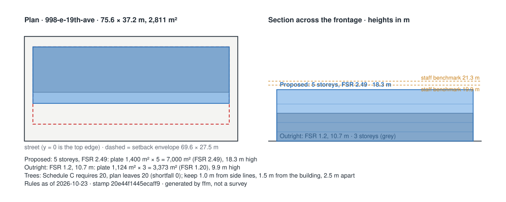

# First Read memo: 998 E 19th Ave, Vancouver, BC V5V 1K7

**Option:** What-if (hypothetical, for the demo): five storeys inside the staff benchmark with every funder question answered  
**Proponent:** Catalyst Community Developments Society (non profit society)  
**Rules as of:** 2026-10-23 · **version stamp:** `20e44f1445ecaff9` · engine 0.1.0  

> Deterministic output of the rule stack listed under *Sources*. Same inputs and rule set give the same memo. It is a feasibility screen, not legal, planning or funding advice; every number links to the document it came from, so check it there.

## 1. Is it allowed?
**Outright, under RM-1: no.** FSR 2.49 exceeds the outright maximum of 1.2; it can proceed only by rezoning (CD-1 under the Interim Rezoning Policy for Social Housing), where density is negotiated. Height 18.3 m exceeds the outright maximum of 10.7 m; it can proceed only by rezoning (CD-1 under the Interim Rezoning Policy for Social Housing), where height is negotiated.

**By rezoning (CD-1 under the Interim Rezoning Policy for Social Housing): yes.**

## 2. Does it fit the funders?
**Yes.**
- *Pass* — BC Builds: eligibility and below-market requirement: BC Builds: fits the published criteria: non-residential space is 15.7% of area, under the 30% cap; ground must break within 12 to 18 months of the conditional land contribution letter.
- *Pass* — BC Housing Community Housing Fund: eligibility and unit mix: Community Housing Fund: Fits the eligibility criteria: unit mix matches 30/50/20 within tolerance; site control (council resolution) meets the readiness bar; construction must be able to start within 18 months of award; program status: 2025 call (RFP #1070-2526-022) cancelled Feb 2026; program page says it will post when next seeking proposals (as of 22 Sep 2026).

## 3. What is still unsure, and who resolves it?
Nothing outstanding.

## Massing derived from the rules
- **Proposed: 5 storeys, FSR 2.49** — plate 1,400 m² × 5 storeys = 7,000 m² (FSR 2.49), 18.3 m high, inside a 69.6 × 27.5 m setback envelope. Derived from: option.gfa_m2, option.storeys, option.setbacks_m, option.floor_to_floor_m.
- **Outright: FSR 1.2, 10.7 m** — plate 1,124 m² × 3 storeys = 3,373 m² (FSR 1.20), 9.9 m high, inside a 69.6 × 27.5 m setback envelope. Derived from: cov.rm1.outright_fsr, cov.rm1.outright_height, option.setbacks_m, option.floor_to_floor_m.
- Staff benchmark under cov.irp.social_housing_rezoning: 19.9 to 21.3 m, about FSR 3.0.
- Note: Option height 18.3 m exceeds 5 x 3.3 m = 16.5 m; the extra 1.8 m is parapet, roof structure or taller ground floor, and the mass uses the stated height.

`massing.json` carries the same geometry for the Revit script (`revit/ffm_massing_pyrevit.py`).

## What changed since the previous memo
Previous stamp `20e44f1445ecaff9` (rules as of 2026-10-23) → current `20e44f1445ecaff9` (as of 2026-10-23). The rule files are unchanged; differences come from the as-of date or the inputs.

| Rule | Change | From | To | Now reads |
|---|---|---|---|---|
| bc.bcbuilds.eligibility | changed | uncertain | pass | BC Builds: fits the published criteria: non-residential space is 15.7% of area, under the 30% cap; ground must break within 12 to 18 months of the conditional land contribution letter. |
| bc.code_basis | finding changed | info | info | 5 storeys puts the building under Part 3 of the BC Building Code 2024 and the Vancouver Building By-law 2025; wood frame is standard to 6 storeys and encapsulated mass timber is permitted to 18 under the VBBL; seismic changes apply to permits from 2026-09-15. |
| bch.chf.eligibility | changed | uncertain | pass | Community Housing Fund: Fits the eligibility criteria: unit mix matches 30/50/20 within tolerance; site control (council resolution) meets the readiness bar; construction must be able to start within 18 months of award; program status: 2025 call (RFP #1070-2526-022) cancelled Feb 2026; program page says it will post when next seeking proposals (as of 22 Sep 2026). |
| cov.family_units | finding changed | pass | pass | 32 of 88 units (36.4%) have two or more bedrooms, against a 35.0% minimum. |
| cov.irp.social_housing_rezoning | changed | conditional | pass | Eligible for consideration as 100% social housing under the policy, within the staff benchmark. |
| cov.parking_minimums | finding changed | info | info | No minimum off-street parking applies citywide since June 2024; the option provides 40 vehicle and 220 bicycle spaces, which are set by the Parking By-law at the development permit stage. |
| cov.rm1.outright_fsr | finding changed | uncertain | uncertain | FSR 2.49 exceeds the outright maximum of 1.2; it can proceed only by rezoning (CD-1 under the Interim Rezoning Policy for Social Housing), where density is negotiated. |
| cov.rm1.outright_height | finding changed | uncertain | uncertain | Height 18.3 m exceeds the outright maximum of 10.7 m; it can proceed only by rezoning (CD-1 under the Interim Rezoning Policy for Social Housing), where height is negotiated. |
| cov.trees.replacement | changed | conditional | pass | Schedule C requires 20 trees on 2,811 m²; the option keeps 1 of 9 and plants 19, leaving 20, which meets the minimum. |

## Full ledger

### Layer A: Zoning district (City of Vancouver Zoning and Development By-law)

| Rule | Status | Finding | Numbers used | Source |
|---|---|---|---|---|
| Interim Rezoning Policy for Social Housing in Former Community Vision Areas (`cov.irp.social_housing_rezoning`, v 2023-11-01) | Pass | Eligible for consideration as 100% social housing under the policy, within the staff benchmark. | benchmark fsr = 3; height m = 18.3; fsr = 2.49 | [Interim Rezoning Policy for Social Housing, Seniors Housing, and Institutional, Cultural and Recreational Uses in Former Community Vision Areas (approved 1 Nov 2023, amended 31 Mar 2026), s.3.1.1; staff benchmark from the 998 E 19th Ave referral report](https://guidelines.vancouver.ca/policy-rezoning-former-community-visions-areas.pdf) |
| Off-street parking minimums (`cov.parking_minimums`, v 2024-06-26) | Info | No minimum off-street parking applies citywide since June 2024; the option provides 40 vehicle and 220 bicycle spaces, which are set by the Parking By-law at the development permit stage. | parking spaces = 40; bicycle spaces = 220 | [City of Vancouver, housing and transit-friendly actions passed June 2024 (minimum parking requirements eliminated citywide), Parking By-law amendments, June 2024](https://vancouver.ca/news-calendar/city-passes-housing-transit-friendly-action-june-2024.aspx) |
| RM-1 outright floor space ratio (`cov.rm1.outright_fsr`, v 2023-01-01) | Uncertain | FSR 2.49 exceeds the outright maximum of 1.2; it can proceed only by rezoning (CD-1 under the Interim Rezoning Policy for Social Housing), where density is negotiated. | fsr = 2.49; max fsr outright = 1.2; gfa m2 = 7,000; site area m2 = 2,810.7 | [City of Vancouver referral report, 998 E 19th Ave (states RM-1 outright FSR 1.20); RM-1 District Schedule, Existing zoning; RM-1 District Schedule s.4.7](https://council.vancouver.ca/20240625/documents/rr1.pdf) |
| RM-1 outright maximum height (`cov.rm1.outright_height`, v 2023-01-01) | Uncertain | Height 18.3 m exceeds the outright maximum of 10.7 m; it can proceed only by rezoning (CD-1 under the Interim Rezoning Policy for Social Housing), where height is negotiated. | height m = 18.3; max height m outright = 10.7; storeys = 5 | [City of Vancouver referral report, 998 E 19th Ave (states RM-1 outright height 10.7 m / 35 ft); RM-1 District Schedule, Existing zoning; RM-1 District Schedule s.4.3](https://council.vancouver.ca/20240625/documents/rr1.pdf) |

### Layer B: Provincial overrides (Bill 44 SSMUH, Bill 47 transit-oriented areas)

| Rule | Status | Finding | Numbers used | Source |
|---|---|---|---|---|
| Small-scale multi-unit housing minimum unit counts (`bc.ssmuh.minimum_units`, v 2024-06-30) | Not applicable | Written for R1-1, RS, RT districts; this site is zoned RM-1. | district = RM-1 | [Province of BC, Small-Scale Multi-Unit Housing overview webinar (22 Jan 2024) and SSMUH Provincial Policy Manual, Bill 44; Local Government Act Part 14 Division 5; manual Packages A to D](https://www2.gov.bc.ca/assets/gov/housing-and-tenancy/tools-for-government/local-governments-and-housing/webinars/lghi_webinar_2024-01-22_ssmuh-overview.pdf) |
| Transit-oriented area minimum allowable height and density (`bc.toa.minimum_density`, v 2024-06-30) | Not applicable | The site is outside the transit-oriented areas; no provincial minimum height applies. |  | [Province of BC webinar (Bill 47 transit-oriented areas); City of Vancouver release, June 2024, Bill 47; Local Government Act transit-oriented areas; Vancouver Charter amendments](https://vancouver.ca/news-calendar/city-passes-housing-transit-friendly-action-june-2024.aspx) |

### Layer C: City of Vancouver policies that attach to a rezoning

| Rule | Status | Finding | Numbers used | Source |
|---|---|---|---|---|
| Below-market rental housing policy for rezonings (secured market rental) (`cov.below_market_rental`, v 2023-01-01) | Not applicable | The below-market rental policy applies to 100% secured market rental rezonings; social housing is governed by the social housing definition instead. |  | [City of Vancouver, Policy: Below-Market Rental Housing for Rezonings, Policy requirements](https://guidelines.vancouver.ca/policy-below-market-rental-housing-for-rezonings.pdf) |
| Development cost levy and community amenity contribution treatment of social housing (`cov.dcl_cac_social_housing`, v 2023-01-01) | Info | Social housing is exempt from development cost levies and from community amenity contributions in a rezoning; the church use is also DCL-exempt. The exemption's value is worth stating in the memo. | dcl exempt = True; cac exempt = True | [998 E 19th Ave referral report: CAC exempt under the policy's social housing exemption; DCL exempt as church and social housing (estimated value $3,075,715 at 30 Sep 2023 rates), Public benefits](https://council.vancouver.ca/20240625/documents/rr1.pdf) |
| Family-unit requirement in rezonings (`cov.family_units`, v 1992-01-01) | Pass | 32 of 88 units (36.4%) have two or more bedrooms, against a 35.0% minimum. | units total = 88; two plus bed units = 32; two plus bed share = 0.364; three plus bed units = 8; three plus bed share = 0.091; min two plus bed share = 0.35; min three plus bed share = None | [High-Density Housing for Families with Children Guidelines (1992) as applied in rezonings; the 998 E 19th Ave referral report states the 35% policy minimum, Unit mix; family units 38 of 105 (36%) against a 35% minimum](https://council.vancouver.ca/20240625/documents/rr1.pdf) |
| Social housing definition (Zoning and Development By-law s.2; DCL By-law 9755) (`cov.social_housing_definition`, v 2023-01-01) | Pass | Meets the City's social housing definition: 30.0% of units for households below HILs (minimum 30.0%), owned by a non profit society, secured for 60 years. | share below hils = 0.3; owner type at completion = non_profit_society; housing agreement years = 60 | [998 E 19th Ave referral report: social housing as defined in the Vancouver Development Cost Levy By-law No. 9755 (at least 30% of units for households below the Housing Income Limits, rents not exceeding 30% of income, owned by a non-profit or government, secured by housing agreement for the longer of 60 years and the life of the building), Tenure and affordability; Housing Agreement and Section 219 covenant](https://council.vancouver.ca/20240625/documents/rr1.pdf) |
| Protection of Trees By-law 9958: minimum trees, protection distances, cash in lieu (`cov.trees.replacement`, v 2023-01-01) | Pass | Schedule C requires 20 trees on 2,811 m²; the option keeps 1 of 9 and plants 19, leaving 20, which meets the minimum. | site area m2 = 2,810.7; schedule c required = 20; existing = 9; retained = 1; removed = 8; replacements proposed = 19; trees after = 20; shortfall = 0; cash in lieu cad = 0; survey scope = every tree on the site, within 2 m of the boundary, and on the adjoining street | [City of Vancouver Protection of Trees By-law No. 9958 (consolidated), Schedule A (s.1.2), Schedule C (ss.5.1, 5.2, 6.2), s.6.2 cash in lieu, s.6.5 siting, s.7.2 arborist report](https://bylaws.vancouver.ca/9958c.PDF) |

### Layer D: Building code and funder design standards (flags, not checks, at this stage)

| Rule | Status | Finding | Numbers used | Source |
|---|---|---|---|---|
| Building code basis flags (BC Building Code 2024; Vancouver Building By-law 2025) (`bc.code_basis`, v 2025-09-15) | Info | 5 storeys puts the building under Part 3 of the BC Building Code 2024 and the Vancouver Building By-law 2025; wood frame is standard to 6 storeys and encapsulated mass timber is permitted to 18 under the VBBL; seismic changes apply to permits from 2026-09-15. | storeys = 5; part = 3 | [Province of BC, BC Building Code 2024; City of Vancouver, Guide to 2025 Vancouver Building By-law updates, Part 3 vs Part 9 basis (Div A 1.3.3.2); encapsulated mass timber](https://vancouver.ca/files/cov/guide-to-2025-vbbl-updates-v1.01.pdf) |
| BC Housing Design Guidelines: minimum net unit areas (`bch.design_guidelines.unit_areas`, v 2019-05-01) | Info | BC Housing minimum net unit areas are studio 33, one-bedroom 49, two-bedroom 67, three-bedroom 86 m²; the option averages 67 m² gross per unit, so net areas should be checked at the plan stage. | average gross area per unit m2 = 67 | [BC Housing Design Guidelines and Construction Standards (2019 edition; copy), Unit areas; building envelope; structure](https://compositedesign.ca/doc/bchousing/BCH-Design-Guidelines-Construction-Standards.pdf) |

### Layer E: Funding programs: eligibility criteria the memo tests (not the submission package)

| Rule | Status | Finding | Numbers used | Source |
|---|---|---|---|---|
| BC Builds: eligibility and below-market requirement (`bc.bcbuilds.eligibility`, v 2024-02-13) | Pass | BC Builds: fits the published criteria: non-residential space is 15.7% of area, under the 30% cap; ground must break within 12 to 18 months of the conditional land contribution letter. | submission = Proposal in any format by email against each Property Opportunity Notice; optional capital and operating budget template | [BC Builds, developers and operators (page current as of 22 Sep 2026); Province of BC BC Builds announcement 2024, Applicant requirements; grants; timelines](https://www.bcbuildshomes.ca/developers-operators) |
| BC Housing Community Housing Fund: eligibility and unit mix (`bch.chf.eligibility`, v 2025-05-30) | Pass | Community Housing Fund: Fits the eligibility criteria: unit mix matches 30/50/20 within tolerance; site control (council resolution) meets the readiness bar; construction must be able to start within 18 months of award; program status: 2025 call (RFP #1070-2526-022) cancelled Feb 2026; program page says it will post when next seeking proposals (as of 22 Sep 2026). | status = 2025 call (RFP #1070-2526-022) cancelled Feb 2026; program page says it will post when next seeking proposals (as of 22 Sep 2026); provisional grant per unit cad = 171211; indicative grant cad = 15066568 | [BC Housing, Community Housing Fund 2025 RFP #1070-2526-022 webinar slides; 2023 RFP #1070-2324-041; CHF program page, Eligibility; unit mix 30/50/20; minimum requirements; rated criteria](https://www.bchousing.org/sites/default/files/media/documents/CHF-RFP-2526-022A-Webinar-Slides.pdf) |
| BC Housing Project Development Fund (pre-development loans) (`bch.pdf.predevelopment_loan`, v 2025-01-01) | Info | max loan cad: 250000; eligible costs: due diligence, feasibility and design. | max loan cad = 250000; eligible costs = due diligence, feasibility and design | [UBCM resolution NR24 and the Province's response (Project Development Fund loans up to $250,000), Provincial response](https://www.ubcm.ca/node/111136) |
| CMHC Affordable Housing Fund: readiness and submission mechanics (`cmhc.ahf.readiness`, v 2024-03-13) | Info | construction start months after approval: 6; intake: continuous; submission: online application with Project Assessment Workbook and Integrity Declaration; separate Required Documentation Checklist; criteria note: Affordability, accessibility and energy thresholds sit in the program scoring, not in the applicant guide; pull from cmhc.ca/ahf before encoding. | construction start months after approval = 6; intake = continuous; submission = online application with Project Assessment Workbook and Integrity Declaration; separate Required Documentation Checklist; criteria note = Affordability, accessibility and energy thresholds sit in the program scoring, not in the applicant guide; pull from cmhc.ca/ahf before encoding | [CMHC, Affordable Housing Fund applicant guide, Minimum submission requirements; readiness](https://cmhc-schl.gc.ca/-/media/sites/cmhc/nhs/co-investment-fund/nhs-co-invest-fund-app-guide-en.ashx) |

## Inputs
- Site `998-e-19th-ave`: RM-1, 2,810.7 m², 75.6 × 37.2 m; owner: Vancouver First Church of the Nazarene.
- Option `998-e-19th-ave-what-if-funder-ready`: 5 storeys, 18.3 m, 7,000.0 m² GFA; units studio 24, one bed 32, two bed 24, three bed plus 8; tenure social housing.
- Site notes: Transit-oriented area set to No from the designation's distances: the nearest SkyTrain stations (VCC-Clark, Broadway-City Hall, Main Street-Science World) are all more than 800 m away and no bus exchange is within 400 m; confirm on the City's TOA map. Red pine DBH is a placeholder (the referral report names the species but not the diameter); replace from the arborist report before the user session. Context for the figures: the lot sits on the south side of E 19th Ave at Windsor St (the cross street is drawn on the left as seen from the street; verify against the survey), with a lane behind and a neighbouring parcel to the west; street and lane widths are typical, not surveyed, and the on-site tree positions are not in the public record, so the figures place them schematically.
- Option notes: Hypothetical option written so that the funder questions all come back answered: the same five-storey massing as the other what-if, a 30/50/20 rent-tier split, 5 accessible units (5% of 88), a 60-year agreement, 19 replacement trees, and a land tenure stated as settled rather than 'to confirm', so the Community Housing Fund check can pass instead of waiting. None of these figures come from Catalyst or the City; the tenure resolution does not exist.

## Sources
- Interim Rezoning Policy for Social Housing, Seniors Housing, and Institutional, Cultural and Recreational Uses in Former Community Vision Areas (approved 1 Nov 2023, amended 31 Mar 2026) — https://guidelines.vancouver.ca/policy-rezoning-former-community-visions-areas.pdf *(verify: Map 1 of the policy decides whether a site is inside a former Community Vision area; outside it the Affordable Housing Policies (1989) apply.)*
- City of Vancouver, housing and transit-friendly actions passed June 2024 (minimum parking requirements eliminated citywide) — https://vancouver.ca/news-calendar/city-passes-housing-transit-friendly-action-june-2024.aspx
- City of Vancouver referral report, 998 E 19th Ave (states RM-1 outright FSR 1.20); RM-1 District Schedule — https://council.vancouver.ca/20240625/documents/rr1.pdf *(verify: Confirm against the RM-1 district schedule in the consolidated Zoning and Development By-law before the user sessions: https://bylaws.vancouver.ca/zoning/zoning-by-law-consolidated.pdf)*
- City of Vancouver referral report, 998 E 19th Ave (states RM-1 outright height 10.7 m / 35 ft); RM-1 District Schedule — https://council.vancouver.ca/20240625/documents/rr1.pdf *(verify: Confirm against the RM-1 district schedule in the consolidated Zoning and Development By-law.)*
- Province of BC, Small-Scale Multi-Unit Housing overview webinar (22 Jan 2024) and SSMUH Provincial Policy Manual — https://www2.gov.bc.ca/assets/gov/housing-and-tenancy/tools-for-government/local-governments-and-housing/webinars/lghi_webinar_2024-01-22_ssmuh-overview.pdf
- Province of BC webinar (Bill 47 transit-oriented areas); City of Vancouver release, June 2024 — https://vancouver.ca/news-calendar/city-passes-housing-transit-friendly-action-june-2024.aspx *(verify: Tier storey figures are the Province's SkyTrain-station tiers as commonly reported; confirm against the Transit-Oriented Areas Designation Regulation before the user sessions.)*
- City of Vancouver, Policy: Below-Market Rental Housing for Rezonings — https://guidelines.vancouver.ca/policy-below-market-rental-housing-for-rezonings.pdf
- 998 E 19th Ave referral report: CAC exempt under the policy's social housing exemption; DCL exempt as church and social housing (estimated value $3,075,715 at 30 Sep 2023 rates) — https://council.vancouver.ca/20240625/documents/rr1.pdf *(verify: Current DCL rates and exemptions: City of Vancouver DCL bulletin (not yet opened in this project).)*
- High-Density Housing for Families with Children Guidelines (1992) as applied in rezonings; the 998 E 19th Ave referral report states the 35% policy minimum — https://council.vancouver.ca/20240625/documents/rr1.pdf
- 998 E 19th Ave referral report: social housing as defined in the Vancouver Development Cost Levy By-law No. 9755 (at least 30% of units for households below the Housing Income Limits, rents not exceeding 30% of income, owned by a non-profit or government, secured by housing agreement for the longer of 60 years and the life of the building) — https://council.vancouver.ca/20240625/documents/rr1.pdf
- City of Vancouver Protection of Trees By-law No. 9958 (consolidated) — https://bylaws.vancouver.ca/9958c.PDF
- Province of BC, BC Building Code 2024; City of Vancouver, Guide to 2025 Vancouver Building By-law updates — https://vancouver.ca/files/cov/guide-to-2025-vbbl-updates-v1.01.pdf
- BC Housing Design Guidelines and Construction Standards (2019 edition; copy) — https://compositedesign.ca/doc/bchousing/BCH-Design-Guidelines-Construction-Standards.pdf *(verify: The current edition on bchousing.org could not be fetched; confirm the figures against it before the user sessions.)*
- BC Builds, developers and operators (page current as of 22 Sep 2026); Province of BC BC Builds announcement 2024 — https://www.bcbuildshomes.ca/developers-operators
- BC Housing, Community Housing Fund 2025 RFP #1070-2526-022 webinar slides; 2023 RFP #1070-2324-041; CHF program page — https://www.bchousing.org/sites/default/files/media/documents/CHF-RFP-2526-022A-Webinar-Slides.pdf
- UBCM resolution NR24 and the Province's response (Project Development Fund loans up to $250,000) — https://www.ubcm.ca/node/111136
- CMHC, Affordable Housing Fund applicant guide — https://cmhc-schl.gc.ca/-/media/sites/cmhc/nhs/co-investment-fund/nhs-co-invest-fund-app-guide-en.ashx
- City of Vancouver referral report, rezoning of 998 E 19th Ave (11 Jun 2024) — https://council.vancouver.ca/20240625/documents/rr1.pdf
- Shape Your City application page, 998 E 19th Ave — https://shapeyourcity.ca/998-e-19-ave
- Derived by hand from the as-approved option for demonstration — https://council.vancouver.ca/20240625/documents/rr1.pdf

## Version stamp
- Rules hash (SHA-256 over all rule files): `14450d4face5e50cd1cccd94ba3236ecd49379484bbeb612cf300342bdc9fe9c`
- `a_zoning_district.json`: `ef2791008abaf57c…`
- `b_provincial.json`: `0fede33e5d62b1bd…`
- `c_city_policies.json`: `961f8f2e91ce2d3f…`
- `d_design_standards.json`: `dc53a9b24d809090…`
- `e_funding_programs.json`: `9267a33722068790…`
- Stamp (hash of rules hash + rule versions in force on 2026-10-23): `20e44f1445ecaff9`
